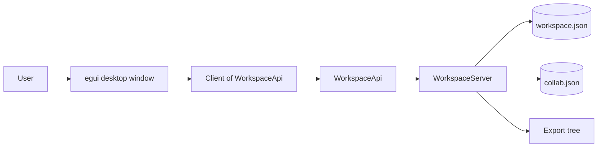

# not-notion

A clean-room desktop workspace application: pages made of editable blocks, a
page-tree sidebar, quick search, an inline table database, and a self-hosted
collaboration contract. Built in Rust with eframe/egui.

The system has two sides:

- **Client** — the desktop window and `Client<A: WorkspaceApi>`.
- **Server** — `WorkspaceServer`, which owns all state and exposes the same
  contract in-process and through an optional loopback HTTP listener.

The target is a **self-hosted server with accounts, document sync, sharing and
real-time editing**. The loopback slice is real and tested today; the
production auth/WebSocket/PostgreSQL adapters are decided but not built
(ADR-003). All state lives on the server; the client never mutates it directly.

Everything is written in English and built spec-first (`spec/`) and test-first
(`cargo test`). Start with [`docs/index.md`](docs/index.md) for the full
documentation map.

## Status (2026-11-08)

- **Specs:** 001–034 implemented; 007 retired; 016 is a plan with A9/B5
  open; 029 is the documentation pass; 035–037 are planned.
- **Tests:** 178 integration tests; clippy and `cargo fmt --check` are clean.
- **Implemented:** workspace/page CRUD, blocks, inline table, search, theme,
  screenshot mode, members/shares/sync log, version history (50/page), export
  tree, per-page writes with 250 ms debounce, collaboration persistence,
  functional Share/Library/Settings/page-action/comment/onboarding/template
  surfaces, and en/pt-BR/eo translations for core UI copy.
- **Decided, not built:** `/api/v1`, sessions/password hashing/Bearer auth, the
  WebSocket + Yrs CRDT channel, and PostgreSQL/SQLx storage.
- **Public API alignment (B4):** the public Notion developer docs were reviewed
  and turned into a v2 roadmap. The **foundation, pagination, rich text/blocks,
  properties/data sources and views are implemented** (specs 030–034):
  `/api/v2`, `Not-Notion-Version`, Bearer auth, structured `ApiError`,
  capabilities, request IDs, `ListResponse`, opaque cursors, rich text, block
  children, typed properties, databases, data sources and views. Specs 035–037
  cover comments/users/files, webhooks and limits. v1 stays stable. See
  [`docs/public-api-analysis.md`](docs/public-api-analysis.md) and
  [`docs/adr-006-public-api-alignment.md`](docs/adr-006-public-api-alignment.md).
- **Clean room:** strict public-behavior-only observation. No capture, proxy,
  Wireshark, source maps or decompilation. See
  [`docs/clean-room.md`](docs/clean-room.md).

## Architecture at a glance



- `model.rs` + `model/*` — entities, tree behavior, search, diff, index,
  settings, seed.
- `collab.rs` + `collab/export.rs` — accounts, roles, shares, sync log,
  versions, realtime DTOs, export tree.
- `server.rs` + `server/*` — routes, `WorkspaceApi`, loopback HTTP adapter,
  URL encoding.
- `client.rs` — the only data access the UI may use.
- `store.rs` — `WorkspaceStore` and `CollabStore` ports with JSON/null
  adapters.
- `app.rs` — composition root; `main.rs` is CLI wiring only.
- `ui.rs` + `ui/*` — commands, view state, input, apply, render, dialogs,
  widgets, switcher, page icon, edit queue, filters, caches.
- `templates.rs`, `ollama.rs`, `shortcuts.rs`, `screenshot.rs`, `cli.rs`,
  `i18n.rs` — focused adapters/helpers.

Dependency direction: `ui → client → server → model`, `server → store`, and
`app` wires the concrete adapters. `model` and `collab` know nothing about
egui, eframe, JSON files or sockets.

## Documentation

| Read | Why |
| ---- | --- |
| [`docs/index.md`](docs/index.md) | Reading order and source-of-truth rules |
| [`docs/architecture.md`](docs/architecture.md) | Layers, modules, request/persistence flows |
| [`docs/contributor-guide.md`](docs/contributor-guide.md) | SDD/TDD workflow and where code belongs |
| [`docs/testing.md`](docs/testing.md) | Test strategy, 17 test crates, fakes |
| [`docs/glossary.md`](docs/glossary.md) | Shared vocabulary |
| [`docs/api-contract.md`](docs/api-contract.md) | Implemented loopback API vs decided `/api/v1`/v2 |
| [`docs/public-api-analysis.md`](docs/public-api-analysis.md) | B4 public Notion API analysis and v2 roadmap |
| [`docs/clean-room.md`](docs/clean-room.md) | Allowed sources, evidence levels, stop conditions |
| [`docs/review-findings.md`](docs/review-findings.md) | Review findings and follow-ups |
| [`spec/README.md`](spec/README.md) | Spec index and status |
| [`AGENTS.md`](AGENTS.md) | Working rules for agents and contributors |

## Build and run

```sh
cargo build
cargo test --all-targets
cargo run
```

For the full gate (formatting, clippy, tests and Markdown checks):

```sh
pwsh -File scripts/quality.ps1
```

CI (`.github/workflows/ci.yml`) runs formatting, clippy, tests and a release
build on Windows.

### Other modes

```sh
# Save a picture of the window after ~120 frames and exit:
cargo run -- --screenshot shots/now.png

# Serve the workspace API on loopback (Ctrl+C to stop):
cargo run -- --serve 127.0.0.1:8787
```

The workspace is saved as JSON in the app data directory. On first start a
small neutral demo workspace is created. `workspace.json` and `collab.json`
are separate documents so a corrupt collaboration file cannot destroy pages.

### Previewing the pictured states

The window follows the dark-theme reference pictures in `reference/` (98
pictures: the original 29 plus the later build) and the 72 local
`screenshots/` pictures: a top tab strip, a sidebar, a breadcrumb bar, a
centered page column, and the Library, Share, Inbox and Settings opened states.
Set `NOT_NOTION_SHOW` to capture one state:

```sh
NOT_NOTION_SHOW=settings-general cargo run -- --screenshot shots/settings.png
```

Accepted values: `library`, `share`, `inbox`, `settings`,
`settings-general`, `settings-sidebar`, `settings-people`,
`settings-offline`, `search`, `tasks`, `newtab`, `ai`, `shortcuts`,
`iconpicker`, `pageactions`, `discussions`, `onboarding`, `templates`.
Normal runs never set this variable.

## Open source

`not-notion` is open source under the **MIT** license (see `LICENSE`). That is
a license fact, not a marketing feature: the window does not advertise a free
edition and shows no plan/feature-tier list.

## Clean room

The project reconstructs public behavior only. The 98 `reference/` pictures
(the original 29 plus the later build) are the primary visual source of truth;
the 72 `screenshots/` pictures are local later-build evidence. No original
program, file, asset, traffic capture, source map or decompiled code is read,
run or copied. See
[`docs/clean-room.md`](docs/clean-room.md) and
[`docs/reverse-engineering-log.md`](docs/reverse-engineering-log.md).
