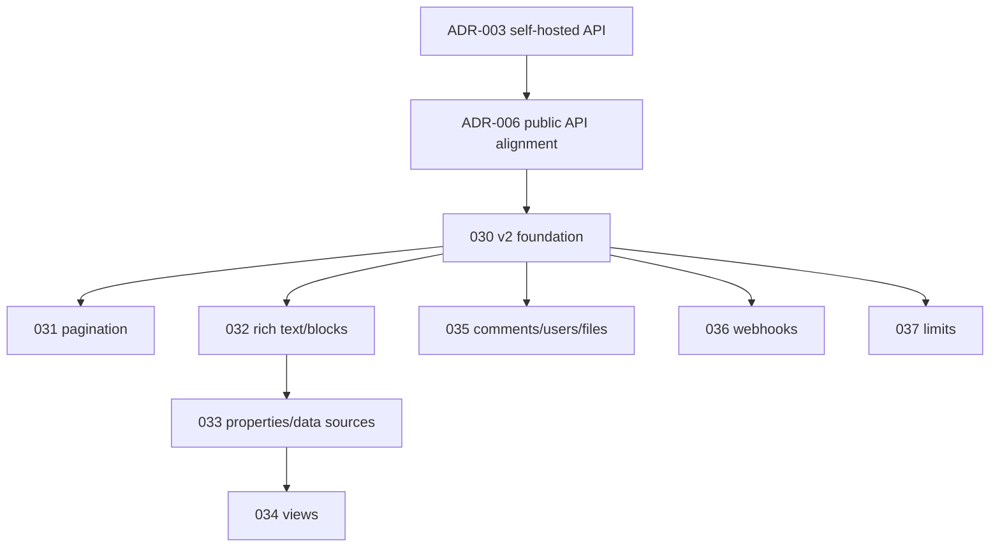

# ADR-006 — Public Notion API alignment

- **Status:** Accepted (B4 review; specs 030–037 implemented)
- **Date:** 2026-11-08
- **Supersedes:** none; refines ADR-003 (self-hosted collaborative API)
- **Related:** `docs/public-api-analysis.md`, `docs/api-observations.md`,
  `docs/api-contract.md`, `spec/spec-030` … `spec/spec-037`

## Context

The project has a working loopback API with a small model: pages, flat blocks,
an inline `TableRow` database, members/shares, a sync log and page versions.
ADR-003 decided a self-hosted REST + WebSocket contract but did not derive it
from the public Notion API.

The B4 review of the public documentation (2026-11-08) found a much richer
contract:

- a required version header and a structured error object with stable codes;
- cursor pagination with opaque cursors;
- capability-based permissions (read/update/insert content, comments, user
  info);
- rich text objects and a typed block tree with children;
- page properties and a database/data-source/property schema;
- view objects with filters, sorts and layouts;
- comment, user and file objects, including uploads and temporary URLs;
- webhook subscriptions with verification, HMAC signatures and retries;
- explicit rate, size and workspace block limits.

The public API is an **integration contract**, not the original product's
private server. It is allowed clean-room evidence because it is published for
developers.

## Alternatives considered

| Alternative | Verdict | Why |
| ----------- | ------- | --- |
| Keep the current v1 model and ignore the public API | Reject | Leaves obvious scale, permission, error and content-model gaps; the project would remain a toy API. |
| Copy the public API byte-for-byte | Reject | We are not Notion; claiming wire compatibility would be misleading and would force us to implement features outside our scope (agents, unfurl, SCIM). |
| Adopt the public **patterns** behind our own v2 contract | **Accept** | Gets the robustness (versioning, errors, pagination, capabilities, rich content, limits) without impersonation or scope explosion. |
| Replace v1 in one breaking change | Reject | The UI, tests and export depend on v1; a staged v2 is safer and follows Open/Closed. |
| Implement all block/property/view types at once | Reject | Too large for one session; support a renderable subset and mark the rest `unsupported`. |

## Decision

1. **Adopt compatible patterns, not an exact clone.** Use our own
   `Not-Notion-Version` header and `/api/v2` prefix. Never claim Notion wire
   compatibility.
2. **Keep v1 stable.** Add v2 behind the existing `WorkspaceApi` seam; migrate
   the UI incrementally. v1 routes remain for the loopback adapter and existing
   tests.
3. **Foundation first.** Spec-030 adds versioning, structured errors, request
   IDs and capabilities.
4. **Lists paginate.** Spec-031 adds `ListResponse<T>` with opaque cursors and
   `page_size` 1–100.
5. **Content becomes typed.** Spec-032 adds rich text, block metadata,
   children and block endpoints for a renderable subset; unsupported types are
   preserved explicitly.
6. **Data becomes relational.** Spec-033 adds page properties, databases,
   data sources and property items; spec-034 adds views.
7. **Collaboration objects expand.** Spec-035 adds comments on pages/blocks,
   users (person/bot) and files/uploads.
8. **Events leave the process.** Spec-036 adds webhook subscriptions,
   verification, signatures and retries.
9. **Limits are explicit.** Spec-037 adds rate/size/block limits, retry
   guidance and the error taxonomy.
10. **Record evidence.** Every public fact is marked **Observed (public docs)**
    in `docs/api-observations.md`; no capture or private source is used.

## Implementation status

| Spec | Status |
| ---- | ------ |
| 030 v2 foundation | **implemented** (`/api/v2`, versioning, `ApiError`, capabilities, request IDs) |
| 031 pagination | **implemented** (`ListResponse`, opaque cursors) |
| 032 rich text/blocks | **implemented** (RichText, metadata, children, endpoints) |
| 033 properties/data sources | **implemented** (typed properties, databases, data sources, migration) |
| 034 views | **implemented** (view CRUD, filters/sorts, board/calendar grouping) |
| 035 comments/users/files | **implemented** (comments, users, file uploads) |
| 036 webhooks | **implemented** (subscriptions, verification, HMAC-SHA256, aggregation, retries, all documented events) |
| 037 limits | **implemented** (rate/size/block limits, retry policy, 429/529/503/409) |

## Consequences

Positive:

- The API becomes versioned, paginated, typed and permission-aware without a
  rewrite.
- Public evidence is recorded and auditable; the clean-room claim stays intact.
- The UI can migrate feature by feature; v1 keeps working.
- The model can represent real workspace content (rich text, properties,
  relations, views) instead of four string columns.

Negative / risks:

- The public API is much larger than this app; we must explicitly mark
  unsupported types and avoid scope creep.
- Migration from `Block.text` and `TableRow` touches model, UI, export and
  tests; specs 032/033 stage it.
- Webhooks need a public HTTPS endpoint and new crypto dependencies; a local
  deployment may not be reachable.
- Rate limits and block limits depend on plan/member configuration; they are
  policy, not domain rules.

## What we deliberately do not adopt

- Link previews / unfurl attributes (custom connections are closed to new
  developers; outside the workspace core).
- Agent APIs and agent parent objects.
- SCIM/SSO enterprise provisioning.
- Byte-for-byte compatibility with Notion.
- Private endpoints or payloads not in public documentation.

## References

- `docs/public-api-analysis.md` — the full B4 analysis.
- `docs/api-observations.md` — evidence levels and inventory.
- `docs/api-contract.md` — implemented v1 and decided v2.
- `docs/clean-room.md` — allowed sources and stop conditions.
- `spec/spec-030` … `spec/spec-037` — implementation roadmap.
