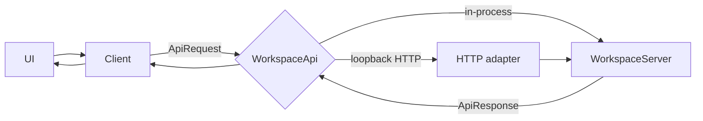
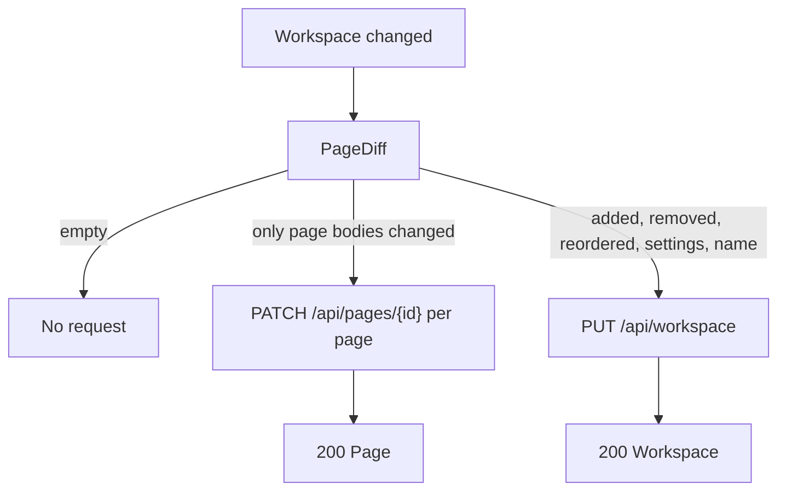
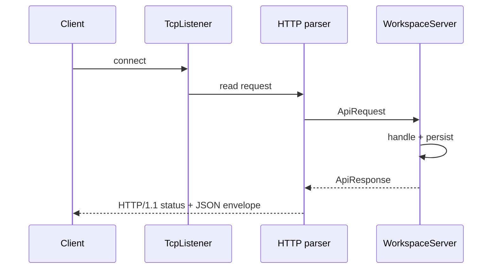
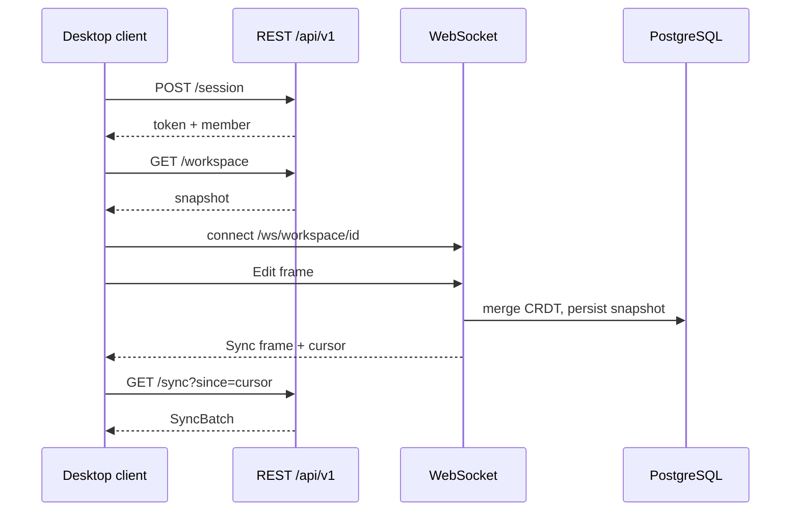

# API contract — not-notion

This document is the reference for the **implemented** loopback API and the
**decided** production API. It separates the two on purpose:

- **Implemented today:** the in-process `WorkspaceApi` and the optional
  `--serve` loopback HTTP/1.1 adapter, using unversioned `/api/...` routes.
- **Decided, not built:** the self-hosted production shape under `/api/v1`,
  sessions, auth middleware, PostgreSQL and the WebSocket/CRDT channel
  (ADR-003).

Nothing here is a claim about the original product's private API. The
clean-room inventory is `docs/api-observations.md`.

## 1. The seam

Every client request is a transport-neutral value:

```rust
pub struct ApiRequest {
    pub method: Method,      // Get, Post, Put, Patch, Delete
    pub path: String,        // "/api/pages/p-home?x=1"
    pub body: Option<String> // JSON text
}

pub struct ApiResponse {
    pub status: u16,
    pub body: String,        // JSON envelope
}
```

`WorkspaceApi` has one method:

```rust
pub trait WorkspaceApi {
    fn handle(&mut self, request: &ApiRequest) -> ApiResponse;
}
```



The client never depends on HTTP; the loopback adapter never contains business
rules. A future remote client is another `WorkspaceApi` implementation.

## 2. Envelope and status codes

Every JSON body is:

```json
{ "data": <value or null>, "error": null }
```

or, on failure:

```json
{ "data": null, "error": "message" }
```

| Status | Meaning in this API |
| ------ | ------------------- |
| `200` | Success with data |
| `201` | Resource created (`POST /api/pages`, `POST /api/members`) |
| `400` | Invalid JSON, missing body, empty title/name/email, unknown parent |
| `404` | Unknown route, unknown page, delete of a missing page |
| `500` | Storage failure while persisting workspace or collaboration state |

`401` and `403` are part of the decided production contract (missing/invalid
session, insufficient permission) but are **not** produced by the current
loopback server because it has no auth middleware.

## 3. Implemented routes

| Method | Path | Request body | Success response | Notes |
| ------ | ---- | ------------ | ---------------- | ----- |
| `GET` | `/health` | — | `"ok"` | Liveness probe |
| `GET` | `/api/workspace` | — | `Workspace` | Full snapshot |
| `PUT` | `/api/workspace` | `Workspace` | `Workspace` | Structural/settings replace; records versions for changed pages, then one `Replace` change |
| `GET` | `/api/pages` | — | `Vec<PageSummary>` | Sidebar/list view |
| `POST` | `/api/pages` | `PageDraft` | `Page` (`201`) | Title must be non-empty; parent must exist; default icon `"P"` |
| `GET` | `/api/pages/{id}` | — | `Page` | `404` when missing |
| `PATCH` | `/api/pages/{id}` | `Page` | `Page` | The id in the path wins; records a version and an `Update` change |
| `DELETE` | `/api/pages/{id}` | — | `Vec<String>` | Removes the subtree and returns removed ids |
| `GET` | `/api/pages/{id}/versions` | — | `Vec<PageVersion>` | Newest first; at most 50 per page |
| `GET` | `/api/search?q=` | — | `Vec<SearchResult>` | Ranked, case-insensitive |
| `GET` | `/api/members` | — | `Vec<Member>` | People directory |
| `POST` | `/api/members` | `MemberDraft` | `Member` (`201`) | Name and email must be non-empty |
| `GET` | `/api/shares?page=` | — | `Vec<Share>` | All shares, or page-specific plus general |
| `PUT` | `/api/shares` | `Share` | `Share` | Upsert by `(page_id, subject)` |
| `GET` | `/api/sync?since=` | — | `SyncBatch` | Changes with `seq > since`, plus cursor |
| `GET` | `/api/export` | — | `Vec<ExportFile>` | Markdown page tree, People folder, CSV |
| `GET` | `/api/realtime` | — | `RealtimeContract` | Decided channel/CRDT description as data |

Unknown routes return `404` with an error envelope. Malformed JSON returns
`400`. A failing store returns `500`; it is never reported as success.

### 3.1 `PATCH` vs `PUT`



The UI computes the diff against `last_committed`, debounces for 250 ms, and
force-flushes on page/tab switch, reload, reset, new/delete page, version
restore, settings change and window close.

## 4. DTOs

All DTOs are serde structs/enums in `src/model.rs` and `src/collab.rs`.

| DTO | Fields |
| --- | ------ |
| `Workspace` | `name`, `pages`, `version`, `settings` |
| `Page` | `id`, `title`, `icon`, `parent`, `favorite`, `locked`, `available_offline`, `show_toc`, `discussions`, `inline_comments`, `archived`, `comments`, `blocks`, `rows`, `updated_at` |
| `Block` | `id`, `kind`, `text`, `checked`, `collapsed` |
| `TableRow` | `id`, `name`, `status`, `assignee`, `due` |
| `Comment` | `id`, `author`, `text`, `created_at` |
| `PageDraft` | `title`, `icon`, `parent` |
| `PageSummary` | `id`, `title`, `icon`, `parent`, `favorite` |
| `SearchResult` | `page_id`, `page_title`, `snippet`, `score` |
| `Member` | `id`, `name`, `email`, `role` |
| `MemberDraft` | `name`, `email`, `role` |
| `Share` | `page_id`, `subject`, `access` |
| `Change` | `seq`, `page_id`, `op`, `actor` |
| `PageVersion` | `version`, `page_id`, `title`, `actor`, `updated_at`, `snapshot` |
| `SyncBatch` | `cursor`, `changes` |
| `RealtimeEvent` | `kind`, `page_id`, `actor`, `payload` |
| `RealtimeContract` | `transport`, `channel`, `events`, `conflict_resolution` |
| `ExportFile` | `path`, `content` |

Enums: `Role { Owner, Member, Guest }`, `Access { Full, Edit, View, None }`,
`ChangeOp { Create, Update, Delete, Replace }`,
`RealtimeKind { Presence, Edit, Awareness, Sync }`,
`BlockKind { Paragraph, Heading1, Heading2, Heading3, Bulleted, Numbered, Todo, Quote, Callout, Code, Divider }`.

## 5. Client surface

`Client<A: WorkspaceApi>` is the only data access the UI may use. Its methods
mirror the routes:

```text
workspace, replace_workspace, list_pages, get_page, create_page,
update_page, delete_page, search, page_versions,
list_members, invite_member, list_shares, set_share,
changes_since, export_tree, realtime_contract
```

Errors are explicit:

| Variant | Meaning |
| ------- | ------- |
| `ClientError::Http(u16)` | Non-success status |
| `ClientError::Decode(String)` | Success status but malformed JSON |
| `ClientError::Encode(String)` | Request body could not be serialized |

No method uses `unwrap_or_default()` on a serialization result.

## 6. Loopback HTTP adapter

- Transport: `std::net::TcpListener`, HTTP/1.1, one request per connection.
- Parses the request line, headers and `Content-Length` body.
- Formats a response with `Content-Length` and
  `Content-Type: application/json`.
- `serve_on` reads on the connection thread and locks the server only for
  `handle`, so independent clients do not block each other's I/O.
- Binds to the address given to `--serve` (use `127.0.0.1:8787` locally).



## 7. Decided production API (ADR-003)

This is the target shape; it is **not** served by the current build.

| Method | Path | Purpose |
| ------ | ---- | ------- |
| `GET` | `/health` | Liveness |
| `POST` | `/api/v1/session` | Sign in (`{email,password}` → `{token,member}`) |
| `GET` | `/api/v1/workspace` | Full snapshot (cold start) |
| `PUT` | `/api/v1/workspace` | Replace snapshot |
| `GET` / `POST` | `/api/v1/pages` | List summaries / create |
| `GET` / `PATCH` / `DELETE` | `/api/v1/pages/{id}` | Read / update / delete subtree |
| `GET` | `/api/v1/pages/{id}/versions` | Version history |
| `GET` | `/api/v1/search?q=` | Ranked search |
| `GET` / `POST` | `/api/v1/members` | Directory / invite |
| `GET` / `PUT` | `/api/v1/shares` | Read / set permission |
| `GET` | `/api/v1/sync?since=` | Versioned changes after a cursor |
| `GET` | `/api/v1/export` | Workspace export tree |
| `GET` | `/api/v1/realtime` | Discover the real-time contract |
| `WS` | `/ws/workspace/{id}?token=` | Real-time co-editing frames |

### 7.1 Auth and permissions (decided)

- Own email/password accounts; short-lived session token.
- `Authorization: Bearer <token>`.
- `401` for missing/invalid token; `403` for a valid token without permission.
- Auth is a transport-adapter concern, never a domain rule.
- `Access::Full`/`Edit` can write; `View`/`None` cannot.

### 7.2 Sync and real-time (decided)

- Cold start: full workspace snapshot.
- Incremental: every mutation appends `Change { seq, page_id, op, actor }`.
- Client polls `GET /api/v1/sync?since=<cursor>`; an up-to-date client gets an
  empty batch.
- Real-time: WebSocket `wss`, channel `/ws/workspace/{id}?token=`, frames of
  `RealtimeEvent`.
- Conflict resolution: CRDT per block (Yrs/automerge-style); presence and
  awareness are ephemeral.



### 7.3 Implementation status

| Capability | Status |
| ---------- | ------ |
| Workspace/page CRUD, search | Implemented (loopback) |
| Members, shares, sync log, versions | Implemented (loopback + `collab.json`) |
| Export tree | Implemented (in memory) |
| Realtime contract | Implemented as data |
| `/api/v1` prefix | Decided |
| Sessions/password hashing/Bearer auth | Decided, not implemented |
| WebSocket/CRDT server | Decided, not implemented |
| PostgreSQL/SQLx store | Decided, not implemented |
| Pagination/sorting | Not implemented; full snapshots |

## 8. Compatibility strategy

1. Keep the DTOs in `src/collab.rs` and the routes in `src/server.rs`.
2. Add production adapters behind `WorkspaceApi`, `WorkspaceStore` and
   `CollabStore`; do not rewrite the domain.
3. Derive the external contract only from public behavior (B4); record every
   entry with an evidence level.
4. When a public source confirms or contradicts a decision, update ADR-003 and
   this file **before** changing code.
5. Contract tests (`tests/contract.rs`) will drive the real `Client` against a
   mock built from the derived contract (B5).

## 9. Examples

Create a page:

```http
POST /api/pages
Content-Type: application/json

{"title":"Roadmap","icon":"R","parent":null}
```

```json
{
  "data": {
    "id": "8c1e5b2a-0000-4000-8000-000000000000",
    "title": "Roadmap",
    "icon": "R",
    "parent": null,
    "favorite": false,
    "blocks": [],
    "rows": [],
    "updated_at": "2026-11-08 12:00"
  },
  "error": null
}
```

Read a page that does not exist:

```json
{ "data": null, "error": "page not found" }
```

Sync after cursor 4:

```json
{
  "data": {
    "cursor": 6,
    "changes": [
      {"seq": 5, "page_id": "p-home", "op": "Update", "actor": "m-owner"},
      {"seq": 6, "page_id": "p-home", "op": "Update", "actor": "m-owner"}
    ]
  },
  "error": null
}
```
