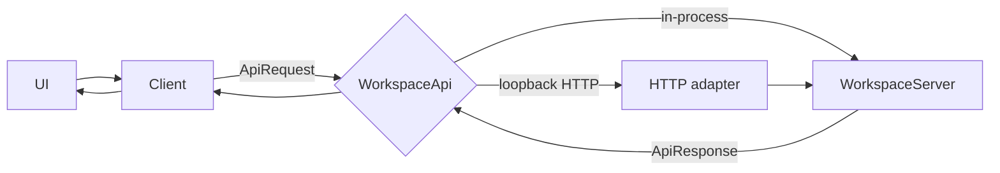
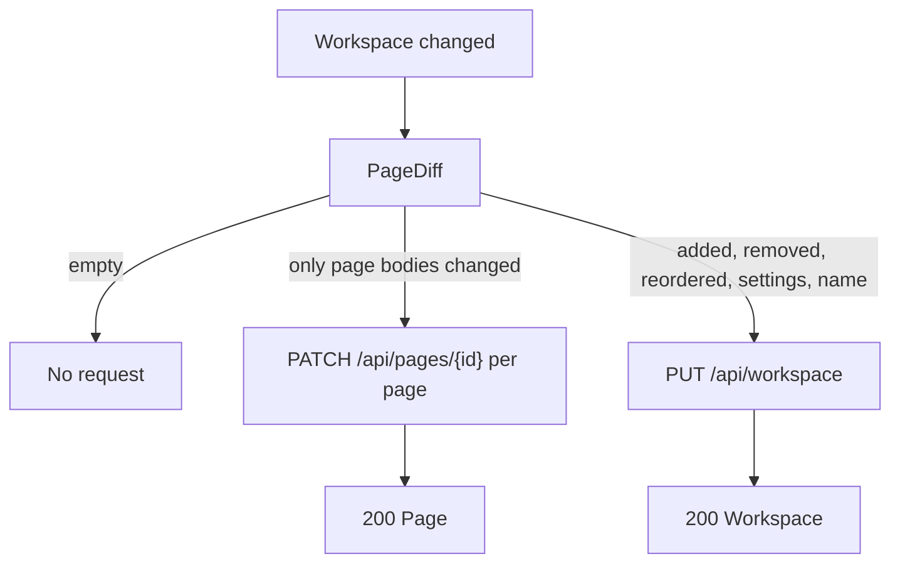
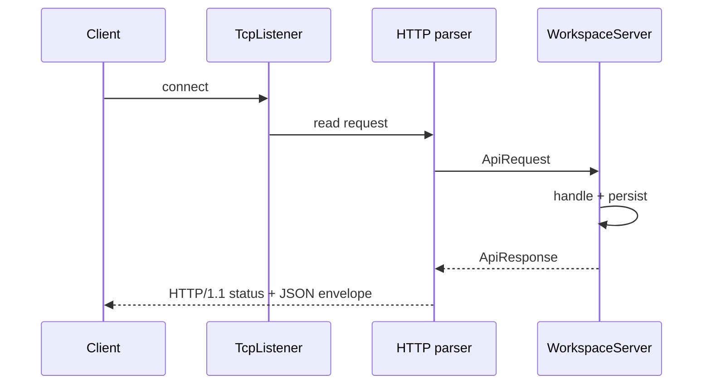
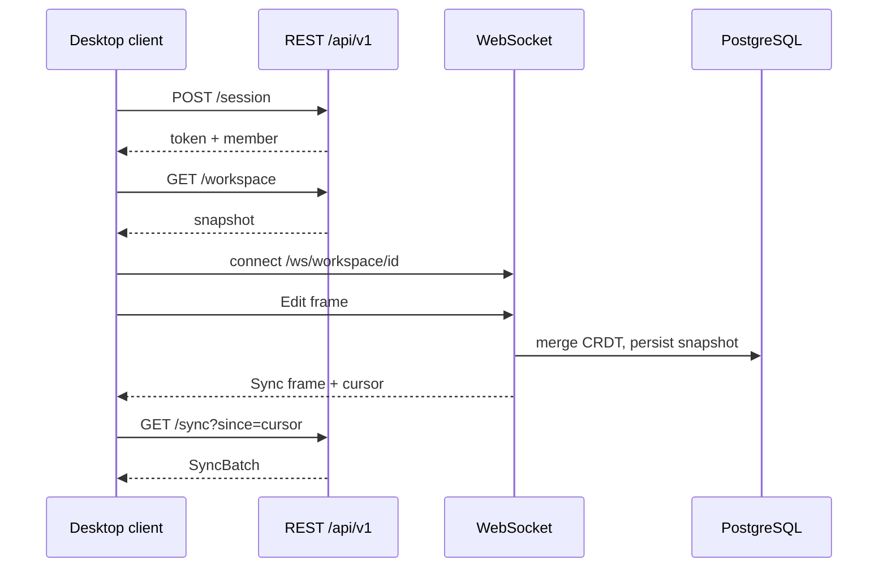
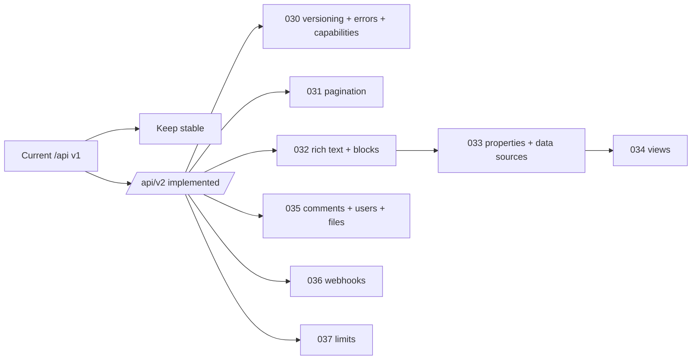

# API contract — ion-of-notes

This document is the reference for the **implemented** loopback API and the
**decided** production API. It separates the two on purpose:

- **Implemented today:** the in-process `WorkspaceApi` and the optional
  `--serve` loopback HTTP/1.1 adapter, using unversioned `/api/...` routes.
- **Decided, not built:** the self-hosted production shape under `/api/v1`,
  sessions, auth middleware, PostgreSQL and the WebSocket/CRDT channel
  (ADR-003).

Nothing here is a claim about the original product's private API. The
clean-room inventory is `docs/api-observations.md`.

## 1. The seam

Every client request is a transport-neutral value:

```rust
pub struct ApiRequest {
    pub method: Method,                    // Get, Post, Put, Patch, Delete
    pub path: String,                      // "/api/pages/p-home?x=1"
    pub body: Option<String>,              // JSON text
    pub headers: BTreeMap<String, String>, // case-insensitive lookup
}

pub struct ApiResponse {
    pub status: u16,
    pub body: String,                      // JSON envelope or ApiError
    pub request_id: Option<String>,        // v2 request id
}
```

`WorkspaceApi` has one method:

```rust
pub trait WorkspaceApi {
    fn handle(&mut self, request: &ApiRequest) -> ApiResponse;
}
```



The client never depends on HTTP; the loopback adapter never contains business
rules. A future remote client is another `WorkspaceApi` implementation.

## 2. Envelope and status codes

Every JSON body is:

```json
{ "data": <value or null>, "error": null }
```

or, on failure:

```json
{ "data": null, "error": "message" }
```

| Status | Meaning in this API |
| ------ | ------------------- |
| `200` | Success with data |
| `201` | Resource created (`POST /api/pages`, `POST /api/members`) |
| `400` | Invalid JSON, missing body, empty title/name/email, unknown parent |
| `404` | Unknown route, unknown page, delete of a missing page |
| `500` | Storage failure while persisting workspace or collaboration state |

`401` and `403` are produced by the **v2 foundation** (missing/invalid token,
missing capability); v1 has no auth middleware and does not produce them. The
v2 operational contract adds `409 conflict_error`, `429 rate_limited`,
`503 service_unavailable` and `529 service_overload`; see §8.8,
`docs/public-api-analysis.md` §3 and spec-037.

## 3. Implemented routes

| Method | Path | Request body | Success response | Notes |
| ------ | ---- | ------------ | ---------------- | ----- |
| `GET` | `/health` | — | `"ok"` | Liveness probe |
| `GET` | `/api/workspace` | — | `Workspace` | Full snapshot |
| `PUT` | `/api/workspace` | `Workspace` | `Workspace` | Structural/settings replace; records versions for changed pages, then one `Replace` change |
| `GET` | `/api/pages` | — | `Vec<PageSummary>` | Sidebar/list view |
| `POST` | `/api/pages` | `PageDraft` | `Page` (`201`) | Title must be non-empty; parent must exist; default icon `"P"` |
| `GET` | `/api/pages/{id}` | — | `Page` | `404` when missing |
| `PATCH` | `/api/pages/{id}` | `Page` | `Page` | The id in the path wins; records a version and an `Update` change |
| `DELETE` | `/api/pages/{id}` | — | `Vec<String>` | Removes the subtree and returns removed ids |
| `GET` | `/api/pages/{id}/versions` | — | `Vec<PageVersion>` | Newest first; at most 50 per page |
| `GET` | `/api/search?q=` | — | `Vec<SearchResult>` | Ranked, case-insensitive |
| `GET` | `/api/members` | — | `Vec<Member>` | People directory |
| `POST` | `/api/members` | `MemberDraft` | `Member` (`201`) | Name and email must be non-empty |
| `GET` | `/api/shares?page=` | — | `Vec<Share>` | All shares, or page-specific plus general |
| `PUT` | `/api/shares` | `Share` | `Share` | Upsert by `(page_id, subject)` |
| `GET` | `/api/sync?since=` | — | `SyncBatch` | Changes with `seq > since`, plus cursor |
| `GET` | `/api/export` | — | `Vec<ExportFile>` | Markdown page tree, People folder, CSV |
| `GET` | `/api/realtime` | — | `RealtimeContract` | Socket URL, messages, resume and staged CRDT description |
| `GET` | `/ws/workspace/{id}?token=&since=` | WebSocket upgrade | `ServerMessage` frames | Real-time change feed, presence and ping/pong |

Unknown routes return `404` with an error envelope. Malformed JSON returns
`400`. A failing store returns `500`; it is never reported as success.

### 3.1 `PATCH` vs `PUT`



The UI computes the diff against `last_committed`, debounces for 250 ms, and
force-flushes on page/tab switch, reload, reset, new/delete page, version
restore, settings change and window close.

## 4. DTOs

All DTOs are serde structs/enums in `src/model.rs` and `src/collab.rs`.

| DTO | Fields |
| --- | ------ |
| `Workspace` | `name`, `pages`, `version`, `settings` |
| `Page` | `id`, `title`, `icon`, `parent`, `favorite`, `locked`, `available_offline`, `show_toc`, `discussions`, `inline_comments`, `archived`, `comments`, `blocks`, `rows`, `updated_at` |
| `Block` | `id`, `kind`, `text`, `checked`, `collapsed` |
| `TableRow` | `id`, `name`, `status`, `assignee`, `due` |
| `Comment` | `id`, `author`, `text`, `created_at` |
| `PageDraft` | `title`, `icon`, `parent` |
| `PageSummary` | `id`, `title`, `icon`, `parent`, `favorite` |
| `SearchResult` | `page_id`, `page_title`, `snippet`, `score` |
| `Member` | `id`, `name`, `email`, `role` |
| `MemberDraft` | `name`, `email`, `role` |
| `Share` | `page_id`, `subject`, `access` |
| `Change` | `seq`, `page_id`, `op`, `actor` |
| `PageVersion` | `version`, `page_id`, `title`, `actor`, `updated_at`, `snapshot` |
| `SyncBatch` | `cursor`, `changes` |
| `RealtimeEvent` | `kind`, `page_id`, `actor`, `payload` |
| `RealtimeContract` | `transport`, `channel`, `events`, `conflict_resolution`, `resume`, `messages` |
| `ServerMessage` | `ready`, `change`, `presence`, `pong`, `error` (tagged by `type`) |
| `ClientMessage` | `ping` |
| `PresenceMember` | `session_id`, `member_id`, `name`, `state` |
| `ExportFile` | `path`, `content` |

Enums: `Role { Owner, Member, Guest }`, `Access { Full, Edit, View, None }`,
`ChangeOp { Create, Update, Delete, Replace }`,
`RealtimeKind { Presence, Edit, Awareness, Sync }`,
`BlockKind { Paragraph, Heading1, Heading2, Heading3, Bulleted, Numbered, Todo, Quote, Callout, Code, Divider }`.

## 5. Client surface

`Client<A: WorkspaceApi>` is the only data access the UI may use. Its methods
mirror the routes:

```text
workspace, replace_workspace, list_pages, get_page, create_page,
update_page, delete_page, search, page_versions,
list_members, invite_member, list_shares, set_share,
changes_since, export_tree, realtime_contract
```

Errors are explicit:

| Variant | Meaning |
| ------- | ------- |
| `ClientError::Http(u16)` | Non-success status |
| `ClientError::Decode(String)` | Success status but malformed JSON |
| `ClientError::Encode(String)` | Request body could not be serialized |

No method uses `unwrap_or_default()` on a serialization result.

`Client::with_token(api, token)` adds the v2 headers. The v2 surface mirrors
the v1 methods with a `_v2` suffix (`workspace_v2`, `create_page_v2`,
`get_page_v2`, `update_page_v2`, `delete_page_v2`, `list_members_v2`,
`invite_member_v2`, `list_shares_v2`, `set_share_v2`, `sync_v2`,
`export_tree_v2`, `realtime_contract_v2`). A v2 failure is
`ClientError::Api(Box<ApiError>)`; a missing token is
`ClientError::MissingToken`.

Paged methods return one `ListResponse<T>`: `list_pages_page_v2`,
`search_page_v2`, `list_members_page_v2`, `list_shares_page_v2`,
`sync_page_v2` and `page_versions_page_v2`. The unsuffixed list helpers follow
cursors to the end with a termination guard.

Block methods: `get_block_v2`, `list_block_children_v2`,
`list_block_children_page_v2`, `append_block_children_v2`, `update_block_v2`
and `delete_block_v2`.

Database/data-source methods: `list_databases_v2`, `create_database_v2`,
`get_database_v2`, `update_database_v2`, `delete_database_v2`,
`list_data_sources_v2`, `create_data_source_v2`, `get_data_source_v2`,
`update_data_source_v2`, `query_data_source_v2`,
`query_data_source_page_v2`, `page_property_items_v2` and
`page_property_items_page_v2`.

View methods: `list_views_v2`, `create_view_v2`, `get_view_v2`,
`update_view_v2`, `delete_view_v2` and `query_view_v2`.

Comment/user/file methods: `list_comments_v2`/`list_comments_page_v2`,
`create_comment_v2`, `get_comment_v2`, `update_comment_v2`,
`delete_comment_v2`, `list_users_v2`, `get_user_v2`,
`create_file_upload_v2`, `send_file_upload_v2`, `complete_file_upload_v2`,
`get_file_upload_v2`, `list_file_uploads_v2` and
`list_file_uploads_page_v2`.

## 6. Loopback HTTP adapter

- Transport: `std::net::TcpListener`, HTTP/1.1, one request per connection.
- Parses the request line, headers and `Content-Length` body.
- Formats a response with `Content-Length` and
  `Content-Type: application/json`.
- `serve_on` reads on the connection thread and locks the server only for
  `handle`, so independent clients do not block each other's I/O.
- Binds to the address given to `--serve` (use `127.0.0.1:8787` locally).



## 7. Decided production API (ADR-003)

This is the target shape; it is **not** served by the current build.

| Method | Path | Purpose |
| ------ | ---- | ------- |
| `GET` | `/health` | Liveness |
| `POST` | `/api/v1/session` | Sign in (`{email,password}` → `{token,member}`) |
| `GET` | `/api/v1/workspace` | Full snapshot (cold start) |
| `PUT` | `/api/v1/workspace` | Replace snapshot |
| `GET` / `POST` | `/api/v1/pages` | List summaries / create |
| `GET` / `PATCH` / `DELETE` | `/api/v1/pages/{id}` | Read / update / delete subtree |
| `GET` | `/api/v1/pages/{id}/versions` | Version history |
| `GET` | `/api/v1/search?q=` | Ranked search |
| `GET` / `POST` | `/api/v1/members` | Directory / invite |
| `GET` / `PUT` | `/api/v1/shares` | Read / set permission |
| `GET` | `/api/v1/sync?since=` | Versioned changes after a cursor |
| `GET` | `/api/v1/export` | Workspace export tree |
| `GET` | `/api/v1/realtime` | Discover the real-time contract |
| `WS` | `/ws/workspace/{id}?token=` | Real-time co-editing frames |

### 7.1 Auth and permissions (decided)

- Own email/password accounts; short-lived session token.
- `Authorization: Bearer <token>`.
- `401` for missing/invalid token; `403` for a valid token without permission.
- Auth is a transport-adapter concern, never a domain rule.
- `Access::Full`/`Edit` can write; `View`/`None` cannot.

### 7.2 Sync and real-time (decided)

- Cold start: full workspace snapshot.
- Incremental: every mutation appends `Change { seq, page_id, op, actor }`.
- Client polls `GET /api/v1/sync?since=<cursor>`; an up-to-date client gets an
  empty batch.
- Real-time: WebSocket `wss`, channel `/ws/workspace/{id}?token=`, frames of
  `RealtimeEvent`.
- Conflict resolution: CRDT per block (Yrs/automerge-style); presence and
  awareness are ephemeral.



### 7.3 Implementation status

| Capability | Status |
| ---------- | ------ |
| Workspace/page CRUD, search | Implemented (loopback) |
| Members, shares, sync log, versions | Implemented (loopback + `collab.json`) |
| Export tree | Implemented (in memory) |
| Realtime contract | Implemented as data |
| `/api/v1` prefix | Decided |
| Sessions/password hashing/Bearer auth | Decided, not implemented |
| WebSocket/CRDT server | Decided, not implemented |
| PostgreSQL/SQLx store | Decided, not implemented |
| Pagination/sorting | Not implemented; full snapshots |

## 8. Public API alignment (v2 foundation implemented)

The B4 review of the public Notion API (`docs/public-api-analysis.md`,
ADR-006) found patterns we should adopt without cloning the service. The
**foundation** is implemented in `/api/v2` (spec-030); the current `/api/...`
v1 routes stay stable.

### 8.1 v2 foundation (implemented)

- Required header: `Ion-Of-Notes-Version: 2026-11-08`.
- Auth: `Authorization: Bearer <token>`; the local demo owner token is
  `owner-token`. Connections live in memory and the owner connection is
  recreated on startup; a production deployment replaces this with self-hosted
  sessions.
- Every v2 response carries a request ID in `ApiResponse.request_id` and the
  `X-Request-Id` HTTP header; the same ID is appended to the in-memory request
  log.
- Errors are a structured `ApiError` body:
  `{object:"error",status,code,message,request_id,additional_data?}`. Stable
  codes include `missing_version`, `unsupported_version`, `invalid_json`,
  `validation_error`, `invalid_cursor`, `unauthorized`, `restricted_resource`,
  `object_not_found`, `internal_server_error`, `rate_limited`,
  `service_overload`, `service_unavailable` and `conflict_error`.
- Capabilities: read/update/insert content, read/insert comments and user-info
  levels. The content routes enforce read/update/insert separately.
- Success bodies use the existing `{data,error}` envelope for v1-compatible
  routes; v2 list routes return `ListResponse<T>`.
- The v2 routes mirror the v1 use cases for workspace, pages, versions, search,
  members, shares, sync, export and realtime; v1 is unchanged.

### 8.1.1 HTTP transport (implemented, spec-038)

- `--serve` uses an Axum/Tokio/Tower adapter behind the same `WorkspaceApi`
  seam; the hand-written loopback listener remains for parser tests and as a
  fallback.
- Responses carry `Content-Type: application/json; charset=utf-8`,
  `X-Request-Id` when the core produced one, and `Retry-After` for
  `429`/`503`/`529` from `additional_data.retry_after`.
- The transport body cap is 2 MB; the v2 500 KB check still returns the
  documented `400 validation_error`.
- Ctrl+C triggers graceful shutdown.
- `--database <path>` selects the SQLite adapter; without it the server uses
  the JSON documents. An empty database imports the existing JSON documents.

### 8.1.2 v2 authentication (implemented, spec-039)

- `POST /api/v2/auth/login` takes `{email, password}` and returns
  `{token, expires_at, member_id, email, name}`. The raw `sess_<uuid>` token is
  returned once.
- `POST /api/v2/auth/logout` revokes the current session.
- `GET /api/v2/auth/session` returns the current member and expiry.
- Passwords are Argon2id PHC strings; only the SHA-256 hash of a session token
  is stored. Sessions last 30 days and survive a server restart.
- The demo `owner-token` remains available when no auth store is configured
  (desktop/tests). The SQLite server seeds the owner account from
  `ION_OF_NOTES_OWNER_PASSWORD` (development default documented in ADR-008).

### 8.1.3 WebSocket change feed (implemented, spec-040)

- Connect to `GET /ws/workspace/{workspace_id}?token=<session>&since=<seq>`.
  The `Authorization: Bearer` header is also accepted.
- The socket must match the server workspace; missing/invalid tokens fail with
  `401`, a wrong workspace with `404`.
- Server messages are JSON text frames tagged by `type`:
  `ready {workspace_id,session_id,seq}`, `change {change}`,
  `presence {members}`, `pong`, `error {code,message}`.
- `?since=<seq>` replays every change with a greater sequence before live
  events. Reconnect with the last seen `seq`.
- The client may send `{"type":"ping"}`; the server replies `pong`.
- Every successful `WorkspaceServer::write` publishes a `change` after the
  persist succeeds.
- This slice is a versioned change feed + presence. Full Yrs/Automerge merge is
  staged; use `If-Match` and page snapshots for conflict handling today.

| Concern | v1 today | v2 target | Spec | Status |
| ------- | -------- | --------- | ---- | ------ |
| Versioning | none | required `Ion-Of-Notes-Version` header | 030 | **implemented** |
| Errors | `{data,error}` string | `object:"error"` + `status`/`code`/`message`/`request_id`/`additional_data` | 030 | **implemented** |
| Capabilities | `Role` + `Access` | read/update/insert content, comments, user-info | 030 | **foundation implemented** |
| Pagination | full arrays | `ListResponse<T>` with opaque cursors | 031 | **implemented** |
| Blocks | flat text | rich text + metadata + children + block endpoints | 032 | **implemented** |
| Page | title/icon/parent/blocks/rows | properties, icon, cover, parent, in_trash, url | 032/033 | planned |
| Properties | `TableRow` (4 strings) | property schema + typed values + property items | 033 | **implemented** |
| Database | inline rows | database container + data sources | 033 | **implemented** |
| Views | table/board | view object + filters/sorts/configuration | 034 | **implemented** |
| Comments | page plain text | page/block, rich text, discussions, attachments | 035 | **implemented** |
| Users | `Member` | person/bot, profile, workspace limits | 035 | **implemented** |
| Files | none | file/file_upload/external + lifecycle | 035 | **implemented** |
| Webhooks | none | subscriptions, verification, HMAC, retries | 036 | **implemented** |
| Limits | none | rate/size/block limits, 429/529/503 guidance | 037 | **implemented** |

Implemented v2 routes:

| Method | Path | Required capability |
| ------ | ---- | ------------------- |
| `POST` | `/api/v2/auth/login` | none (version header only) |
| `POST` | `/api/v2/auth/logout` | read content |
| `GET` | `/api/v2/auth/session` | read content |
| `GET` / `PUT` | `/api/v2/workspace` | read / update content |
| `GET` / `POST` | `/api/v2/pages` | read / insert content |
| `GET` / `PATCH` / `DELETE` | `/api/v2/pages/{id}` | read / update content |
| `GET` | `/api/v2/pages/{id}/versions` | read content |
| `GET` | `/api/v2/blocks/{id}` | read content |
| `GET` / `PATCH` | `/api/v2/blocks/{id}/children` | read / update content |
| `PATCH` / `DELETE` | `/api/v2/blocks/{id}` | update content |
| `GET` | `/api/v2/search` | read content |
| `GET` / `POST` | `/api/v2/members` | read / insert content |
| `GET` / `PUT` | `/api/v2/shares` | read / update content |
| `GET` | `/api/v2/sync` | read content |
| `GET` | `/api/v2/export` | read content |
| `GET` / `POST` | `/api/v2/databases` | read / insert content |
| `GET` / `PATCH` / `DELETE` | `/api/v2/databases/{id}` | read / update content |
| `GET` / `POST` | `/api/v2/databases/{id}/data_sources` | read / insert content |
| `GET` / `PATCH` | `/api/v2/data_sources/{id}` | read / update content |
| `POST` | `/api/v2/data_sources/{id}/query` | read content |
| `GET` / `PATCH` | `/api/v2/pages/{id}/properties` | read / update content |
| `GET` | `/api/v2/pages/{id}/properties/{property_id}` | read content |
| `GET` / `POST` | `/api/v2/views` | read / insert content |
| `GET` / `PATCH` / `DELETE` | `/api/v2/views/{id}` | read / update content |
| `POST` | `/api/v2/views/{id}/query` | read content |
| `GET` / `POST` | `/api/v2/comments` | read / insert comments |
| `GET` / `PATCH` / `DELETE` | `/api/v2/comments/{id}` | read / insert comments |
| `GET` | `/api/v2/users` | read content |
| `GET` | `/api/v2/users/{id}` | read content |
| `GET` / `POST` | `/api/v2/file_uploads` | read / insert content |
| `GET` | `/api/v2/file_uploads/{id}` | read content |
| `POST` | `/api/v2/file_uploads/{id}/send` | insert content |
| `POST` | `/api/v2/file_uploads/{id}/complete` | insert content |
| `GET` / `POST` | `/api/v2/webhooks` | read / insert content |
| `DELETE` | `/api/v2/webhooks/{id}` | update content |
| `POST` | `/api/v2/webhooks/{id}/verify` | insert content |
| `GET` | `/api/v2/webhook_deliveries` | read content |
| `POST` | `/api/v2/webhook_deliveries/retry` | insert content |
| `GET` | `/api/v2/realtime` | read content |

### 8.2 v2 list envelope (implemented)

List routes return:

```json
{
  "data": {
    "object": "list",
    "type": "page",
    "results": [],
    "has_more": false,
    "next_cursor": null
  },
  "error": null
}
```

- `page_size`: 1–100, default 100.
- `start_cursor`: omit on the first request; pass `next_cursor` back unchanged.
- Cursors are opaque and bound to the endpoint/query; malformed or mismatched
  cursors return `400 invalid_cursor`.
- `type` values: `page`, `search_result`, `member`, `share`, `change`,
  `page_version`.
- The client `*_page_v2` methods expose one page; `list_pages_v2` and the other
  unsuffixed helpers follow cursors with a termination guard.

### 8.3 v2 block model (implemented)

`BlockDto` carries `object`, `id`, `parent` (`page_id` or `block_id`),
`created_time`, `created_by`, `last_edited_time`, `last_edited_by`,
`in_trash`, `has_children`, `type` and type-specific payload fields
(`rich_text`, `checked`, `collapsed`, `table_width`, `cells`, …). Rich text
objects are `text`, `mention` or `equation` with `annotations`, `plain_text`
and `href`.

- `GET /api/v2/blocks/{id}` — retrieve one block.
- `GET /api/v2/blocks/{id}/children` — paginated direct children (a page id is
  accepted for top-level blocks).
- `PATCH /api/v2/blocks/{id}/children` — append children.
- `PATCH /api/v2/blocks/{id}` — update a block.
- `DELETE /api/v2/blocks/{id}` — move a block to trash (`in_trash: true`).
- Legacy `Block.text` is migrated to one rich text object; unsupported types
  are preserved as `type: "<original>"` with `unsupported_type`.

### 8.4 v2 properties and data sources (implemented)

- `Property` has `id`, `name`, `description`, `type` and type-specific
  `config` (select/status options, relation target, formula expression,
  rollup settings, unique-id prefix).
- `PageProperty` carries `id`, `type` and a typed `value`; `Page` stores them
  in `properties` keyed by property id.
- `Database` is a container of `data_sources`; `DataSource` owns the property
  schema and its `rows` (pages).
- `Workspace::ensure_data_sources` migrates legacy `TableRow` pages into a
  default database/data source with row pages and typed title/status/assignee/
  due values.
- Page property writes are `PATCH /api/v2/pages/{id}/properties`; omitted
  properties keep their values, arrays are replaced, and the documented clear
  rule is available through `PropertyValue::clear`.
- Property-item reads return a paginated `ListResponse<PageProperty>`.

### 8.5 v2 views (implemented)

- `View` has `id`, `parent`, `data_source_id`, `name`, `type`, `filter`,
  `sorts`, `configuration`, timestamps, users and `url`.
- Supported query layouts: table, board, calendar and list; gallery, timeline,
  form, chart, map and dashboard are represented but read-only/unsupported.
- `Filter` supports `and`/`or`, equals, not-equals, contains, empty,
  not-empty, greater/less-than and checkbox checks.
- `Sort` is `{ property, direction }` with ascending/descending.
- `POST /api/v2/views/{id}/query` filters/sorts the data-source rows, returns
  `ViewQueryResult { view_id, type, groups, pages, has_more, next_cursor }`,
  and groups board/calendar results.
- `ensure_views` creates one default table view per data source.

### 8.6 v2 comments, users and files (implemented)

- `CommentDto` carries `parent` (page or block), `discussion_id`,
  `property_id`, timestamps, `created_by`, rich text, attachments, an optional
  display name and `has_pending_attachments`.
- Comments support page/block parents, up to three uploaded attachments and
  connection/user/custom display names.
- `UserDto` distinguishes `person` and `bot`; profile fields are filtered by
  the connection's user-info capability. Bots expose owner, workspace id/name
  and `workspace_limits.max_file_upload_size_in_bytes`.
- `FileUpload` has a pending → uploaded lifecycle; `FileObject` is `file`,
  `file_upload` or `external`. Comments accept only uploaded file uploads.
- Local upload URLs are placeholders; a production object store is a future
  adapter behind the same contract.

### 8.7 v2 webhooks and event delivery (implemented)

- `WebhookSubscription` has `id`, `url`, `events`, `verification_token`,
  `status` (`pending`/`active`/`paused`/`deleted`) and `created_at`.
- Creating a subscription stores it as `pending`; the endpoint becomes `active`
  only after `POST /api/v2/webhooks/{id}/verify` with the matching token.
- `WebhookEvent` carries `id`, `timestamp`, `workspace_id`, `subscription_id`,
  `integration_id`, `type`, `authors`, `accessible_by`, `entity`, `data` and
  `attempt_number`.
- Documented event types are supported for pages (`created`,
  `content_updated`, `properties_updated`, `moved`, `deleted`, `undeleted`,
  `locked`, `unlocked`, `transcription_block_transcript_deleted`), databases
  and data sources (`created`, `content_updated`, `schema_updated`, `moved`,
  `deleted`, `undeleted`), comments (`created`, `updated`, `deleted`), file
  uploads (`created`, `completed`, `expired`, `upload_failed`) and views
  (`created`, `updated`, `deleted`).
- Deliveries are signed with `X-Ion-Of-Notes-Signature: sha256=<hex>`, an
  HMAC-SHA256 over the raw JSON body keyed by the verification token.
- High-frequency page/database/data-source events are aggregated per
  subscription and entity; comment, file-upload and view events deliver
  immediately.
- Failed deliveries are retried with exponential backoff up to 8 attempts; the
  delivery log records the last status, error, attempt count and next attempt
  time.
- `GET /api/v2/webhook_deliveries` lists the log and
  `POST /api/v2/webhook_deliveries/retry` processes due retries.
- Subscription URLs must be HTTPS; loopback HTTP is accepted only when the
  server enables the explicit development override. The local adapter does not
  implement TLS delivery, so a production deployment supplies its own sender
  behind the same contract.

### 8.8 v2 limits and operations (implemented)

- `Plan` is `free`, `business` or `enterprise`; it configures limits only, not
  billing. `RequestBudget { plan, members, blocks }` derives the policy.
- Per-connection budgets are 180 requests/minute on Free and 600 on Business/
  Enterprise. The shared workspace budget scales from that value. Both use a
  fixed 60-second window.
- A rejected request returns `429 rate_limited` with
  `additional_data.rate_limit_reason` (`public_api_request_rate_limit` or
  `public_api_space_request_rate_limit`) and `additional_data.retry_after`.
- `529 service_overload` is returned while the server reports overload and
  carries the same `retry_after` guidance.
- Request-size checks run before any mutation: 500 KB body, 1000 block
  elements, 2000-character rich text/URL, 1000-character equation, 100 items
  per rich-text/multi-select/relation/people array, 200-character email/phone.
  Violations return `400 validation_error` with `additional_data.limit`.
- A Free workspace with more than one member has a 1000 lifetime-block limit.
  The write that reaches the limit succeeds; the next block-creating request
  returns `403 restricted_resource` with `additional_data.block_limit:
  "block_creation"`. Reads, deletes and non-creating edits keep working.
- `If-Match: <workspace-version>` enables optimistic concurrency: a stale value
  returns `409 conflict_error` with `additional_data.current_version`.
- A write that was saved but could not build its response returns
  `503 service_unavailable` with `additional_data.retry_guidance`,
  `retry_after` and, for creates, `committed_resource_id`. Clients read the
  object instead of repeating the write.
- `Retry-After` is emitted as an HTTP header from
  `additional_data.retry_after`, so header and body agree.
- Client `RetryPolicy` retries `429`/`529`, retries `500`/`502`/`503`/`504`
  only for idempotent methods, honours `Retry-After`, uses capped exponential
  backoff with caller-supplied jitter, and never retries
  `public_api_request_blocked` or a plan-limit `403`.



The v2 contract is **not** a claim of Notion wire compatibility. We use our
own header name and route prefix; the public API informs the shape, not our
identity. The detailed acceptance criteria and test scenarios are in
`spec/spec-030` … `spec/spec-037`.

## 9. Compatibility strategy

1. Keep the DTOs in `src/collab.rs` and the routes in `src/server.rs`.
2. Add production adapters behind `WorkspaceApi`, `WorkspaceStore` and
   `CollabStore`; do not rewrite the domain.
3. Derive the external contract only from public behavior (B4); record every
   entry with an evidence level.
4. When a public source confirms or contradicts a decision, update ADR-003 and
   this file **before** changing code.
5. Contract tests (`tests/contract.rs`) will drive the real `Client` against a
   mock built from the derived contract (B5).

## 10. Examples

Create a page:

```http
POST /api/pages
Content-Type: application/json

{"title":"Roadmap","icon":"R","parent":null}
```

```json
{
  "data": {
    "id": "8c1e5b2a-0000-4000-8000-000000000000",
    "title": "Roadmap",
    "icon": "R",
    "parent": null,
    "favorite": false,
    "blocks": [],
    "rows": [],
    "updated_at": "2026-11-08 12:00"
  },
  "error": null
}
```

Read a page that does not exist:

```json
{ "data": null, "error": "page not found" }
```

Sync after cursor 4:

```json
{
  "data": {
    "cursor": 6,
    "changes": [
      {"seq": 5, "page_id": "p-home", "op": "Update", "actor": "m-owner"},
      {"seq": 6, "page_id": "p-home", "op": "Update", "actor": "m-owner"}
    ]
  },
  "error": null
}
```
