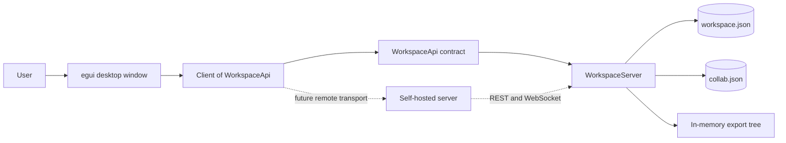
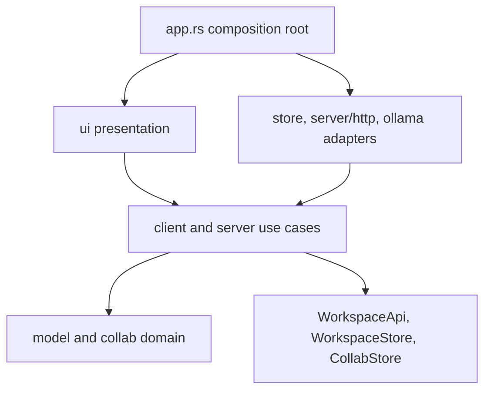
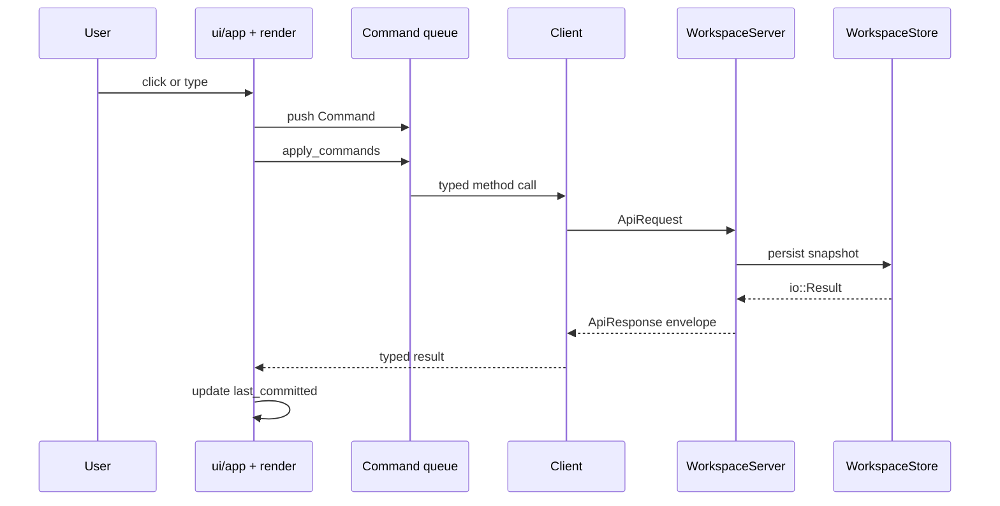
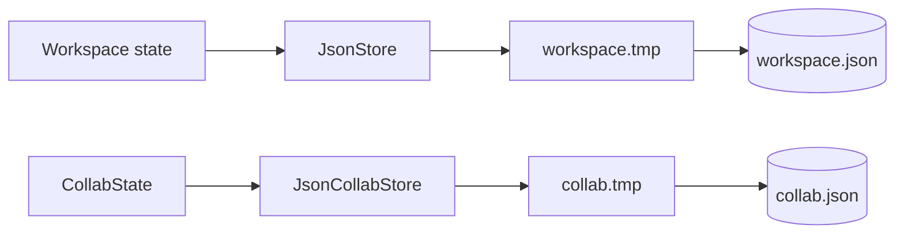
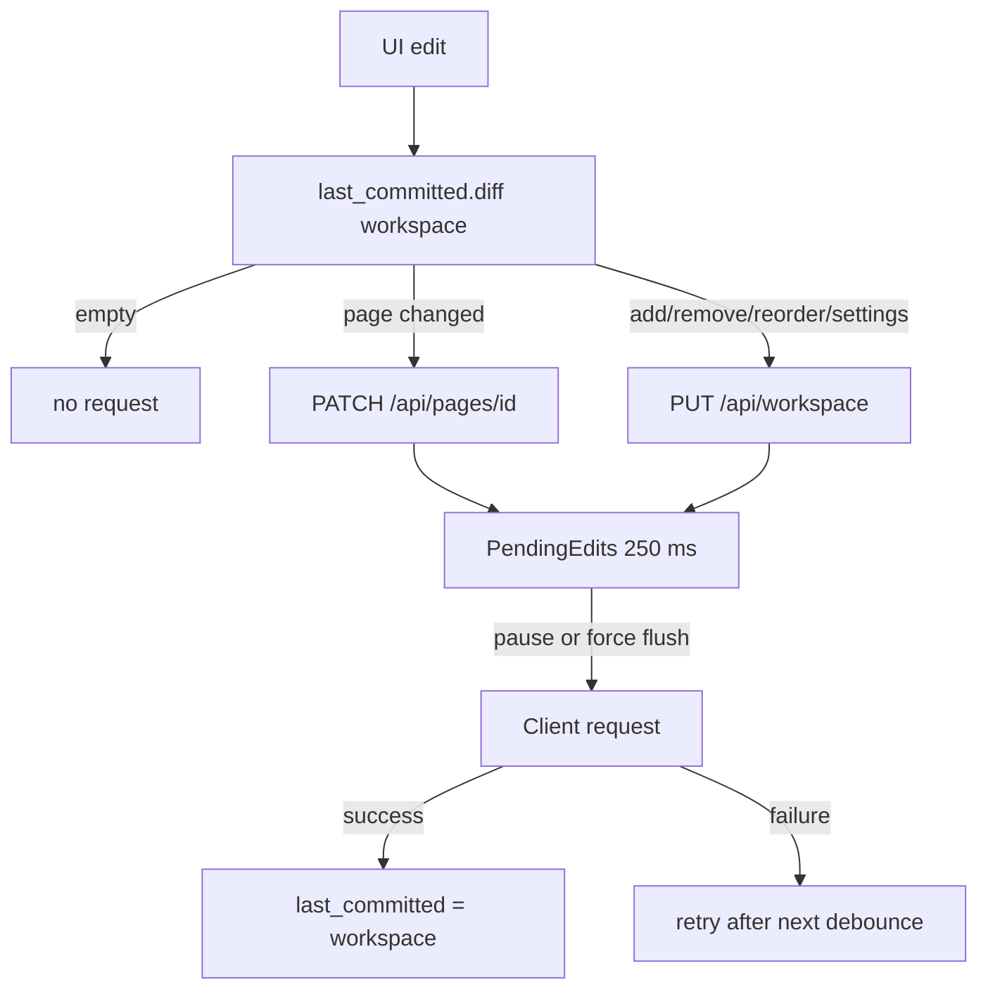
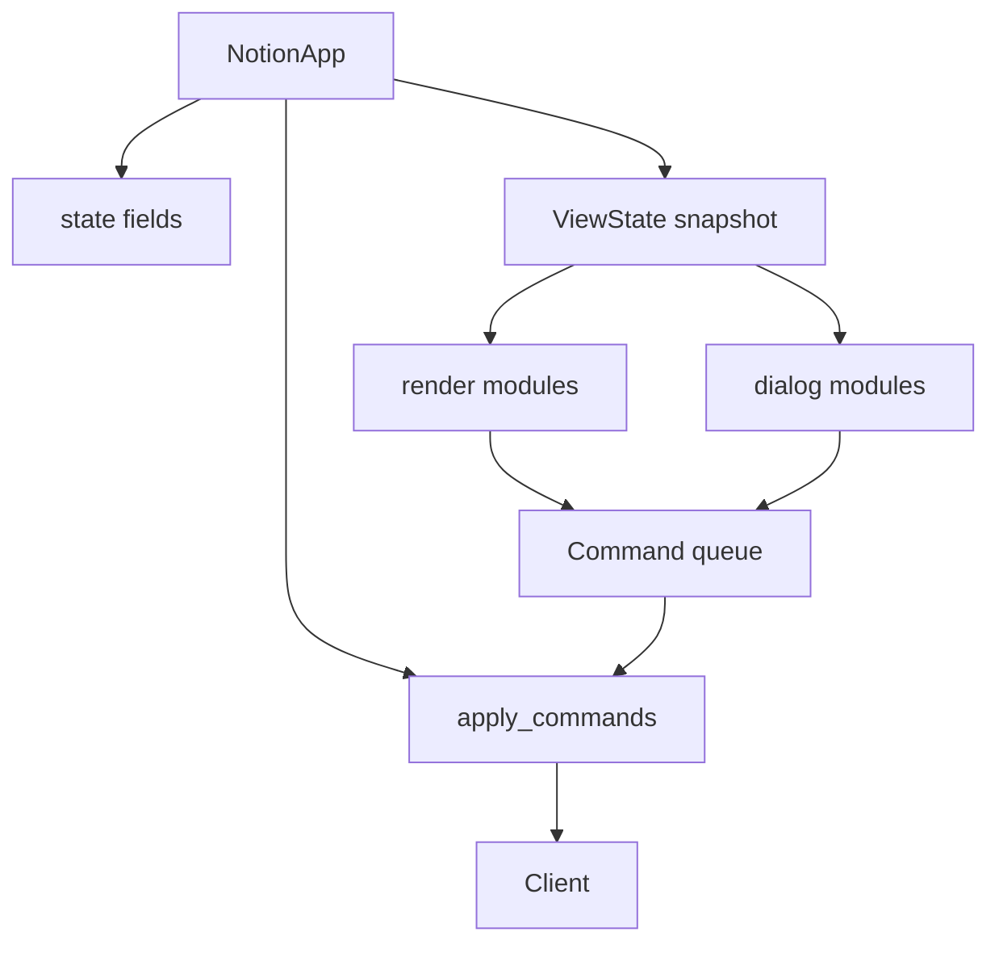
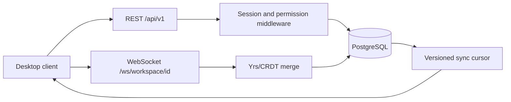
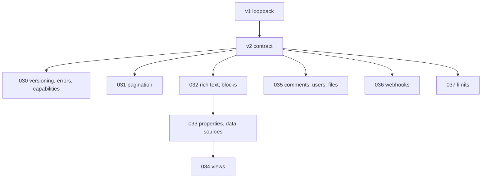

# Architecture — ion-of-notes

This document explains how the application is structured, why it is structured
that way, and how a change travels through the system. It is the didactic
companion to `AGENTS.md` and the ADRs.

## 1. System context

`ion-of-notes` is a desktop workspace application with a client/server split:

- the **client** is the egui window plus `Client<A: WorkspaceApi>`;
- the **server** owns workspace and collaboration state and exposes the same
  contract in-process and through an optional Axum HTTP adapter.



The important rule: **the window never mutates server state directly.** It
collects `Command`s, applies them to a local optimistic `Workspace`, and sends
the difference through `Client`.

## 2. Layers and dependency direction



| Layer | Responsibility | Main modules |
| ----- | -------------- | ------------ |
| Domain | entities, invariants, pure rules | `model.rs`, `model/*`, `collab.rs`, `collab/export.rs` |
| Application | use cases, orchestration, contracts | `server.rs`, `client.rs`, `collab.rs` state methods |
| Infrastructure | filesystem, HTTP, external AI service | `store.rs`, `server/http.rs`, `server/web.rs`, `ollama.rs` |
| Presentation | window, commands, view state, rendering | `ui.rs`, `ui/*` |
| Bootstrap | compose concrete adapters into the core | `app.rs` |

Dependency direction: `ui → client → server → model`, `server → store`, and
`app` wires everything. `model` and `collab` know nothing about egui, eframe,
JSON files, sockets or the loopback listener.

## 3. Module map

```text
src/
  main.rs            CLI wiring only
  app.rs             composition root
  lib.rs             crate facade and re-exports
  model.rs           entities, rich text, block DTOs, properties, databases,
                     data sources, views, comments, users, files + tree behavior
  model/
    seed.rs          demo workspace
    search.rs        ranked search
    diff.rs          changed/added/removed/reordered pages
    index.rs         derived page/children index
    settings.rs      persisted workspace settings
  collab.rs          accounts, sharing, sync, versions, realtime DTOs
  collab/
    export.rs        markdown/CSV export tree
  auth.rs            accounts, Argon2id passwords, sessions, AuthStore port
  store.rs           WorkspaceStore + CollabStore + AuthStore ports and JSON adapters
  store/
    sqlite.rs        SQLite adapter for workspace, collaboration and auth
  server.rs          WorkspaceServer, WorkspaceApi, routes
  server/
    http.rs          legacy loopback HTTP/1.1 adapter (tests/fallback)
    web.rs           Axum/Tokio HTTP adapter for --serve
    url.rs           shared percent-encoding
    contract.rs      v2 versioning, ApiError, capabilities, request IDs
    pagination.rs    v2 ListResponse, opaque cursors, page_size validation
  client.rs          typed client over WorkspaceApi
  templates.rs       starter template catalog
  ollama.rs          AI assistant adapter
  shortcuts.rs       pure shortcut table
  screenshot.rs      ColorImage -> PNG
  cli.rs             argument parsing
  i18n.rs            locale switching + dynamic key helper
  ui.rs              UI facade
  ui/
    commands.rs      Command / NewTabChoice / IconTab / FontStyle
    view.rs          ViewState
    input.rs         egui keys -> shortcut actions
    app.rs           NotionApp shell + eframe::App
    apply.rs         command application / state transitions
    render.rs        render facade
    render/          chrome, sidebar, content, library, database
    dialogs.rs       dialog facade
    dialogs/         settings, sharing, page actions, menus, help,
                     search window, onboarding, templates
    widgets.rs       shared popover/menu/toggle/label primitives
    switcher.rs      shared search/new-tab renderer
    page_icon.rs     page-icon catalog/picker/renderer
    search_cache.rs  query/version search cache
    settings_search.rs settings section/row matcher and row table
    invite.rs        invite email parsing/validation
    library_filter.rs Library tab filtering
    edit_queue.rs    commit plan + debounce
```

## 4. Request lifecycle

A click or keystroke does not call the server directly. The UI translates it
into a `Command`, applies the command to local state, and then commits the
difference.



### Why commands?

- one input adapter for mouse and keyboard;
- every state change follows the same client-bound path;
- the render modules stay pure and testable;
- undo/redo and persistence can observe a single boundary.

## 5. Persistence and write path

The workspace and collaboration state are separate JSON documents:



`store::save` writes a sibling temporary file and moves it into place. A
storage failure is surfaced as an API `500`; it is never silently swallowed.

### Per-page writes and debounce



Force-flush points include page/tab switch, reload, new/delete page, reset,
version history/restore, settings change and window close (`on_exit`).

## 6. UI composition



`ui.rs` is a facade. `ui/app.rs` owns the state shell and eframe lifecycle;
`ui/apply.rs` owns transitions; render/dialog modules only read `ViewState` and
push `Command`s.

## 7. Collaboration target

The current loopback API is real and testable. The production self-hosted
server is a decided target, not a running service:



Current state:

- members, shares, sync log and page versions persist in `collab.json` by
  default, or in SQLite with `--database` (spec-039);
- `--serve` uses the Axum/Tokio adapter (spec-038); the hand-written loopback
  listener remains for parser tests and as a fallback;
- v1 and v2 routes are served through the same `WorkspaceApi` seam;
- Argon2id accounts and opaque sessions are implemented (spec-039); WebSocket
  and Yrs are staged behind the same seams (ADR-003, ADR-007, ADR-008);
- `GET /api/realtime` returns the decided contract as data.

## 8. Design principles in practice

### DRY — one source of knowledge

- one `Envelope` helper for every JSON response;
- one `WorkspaceServer::write` path for mutations, version log and persistence;
- one shared search/new-tab renderer (`ui/switcher.rs`);
- one palette for colors/fonts (`ui/palette.rs`);
- one locale key table for core UI copy;
- shared test helpers in `tests/common/mod.rs`.

DRY here means **one rule in one place**, not "make every similar-looking line
shared".

### SOLID — mainly SRP and DIP

- **SRP:** one cohesive responsibility per module; UI state, command
  application, rendering, dialogs and domain are separate.
- **OCP/DIP:** new stores/transports implement `WorkspaceStore`, `CollabStore`
  or `WorkspaceApi`; the server does not change.
- **ISP:** ports are tiny (`persist`, `handle`).
- **LSP:** `NoStore`, `JsonStore`, `NoCollabStore`, `JsonCollabStore` and test
  stubs are interchangeable.
- **Selective DDD:** the workspace is one bounded context; invariants live at
  `Workspace`/server boundaries. There is no empty layer scaffold.

### Clean Architecture

The domain does not depend on infrastructure or presentation. `model` has no
egui/eframe/socket/file types. `collab` has serde DTOs and pure state methods.
Adapters implement the ports; the composition root wires them.

## 9. Where to add a feature

| Change | Start here |
| ------ | ---------- |
| New page/block field | `src/model.rs` + `docs/data-model.md` + migration test |
| New pure rule | `src/model/*` or `src/collab.rs` + `tests/model.rs`/`tests/collab.rs` |
| New server route/DTO | `src/server.rs` + `src/client.rs` + `tests/server.rs`/`tests/client.rs` |
| New persistence backend | implement `WorkspaceStore`/`CollabStore`, wire in `src/app.rs` |
| New UI surface | `ui/commands.rs` + `ui/view.rs` + `ui/apply.rs` + `ui/render/*` or `ui/dialogs/*` |
| New translation | `locales/*.yml` + `i18n::t("key")` + `tests/i18n.rs` |
| New starter template | `src/templates.rs` + `tests/templates.rs` |
| New visual state | `ION_OF_NOTES_SHOW` preview hook + `--screenshot` |

## 10. Public API alignment roadmap

The B4 review (`docs/public-api-analysis.md`, ADR-006) compares our v1 contract
with the public Notion API and schedules the gaps as specs 030-038. The
architecture stays the same: new adapters and DTOs sit behind the existing
ports; v1 routes remain stable.



| New concern | Module / port | Notes |
| ----------- | ------------- | ----- |
| Version/errors/capabilities | `server/contract.rs`, `collab.rs` | `ApiError`, `Capability`, `Connection`; no domain dependency |
| Pagination | `server/pagination.rs` | pure cursor codec; opaque to clients |
| Rich text/blocks | `model/richtext.rs`, `model/block.rs` | `Block.text` migration; block endpoints |
| Properties/data sources | `model/property.rs`, `model/database.rs` | `TableRow` migration; `DataSource` schema |
| Views | `model/view.rs` | filter/sort/config; query pagination |
| Comments/users/files | `model/comment.rs`, `model/file.rs`, `model/user.rs` | attachments; `FileStore` port |
| Webhooks | `webhooks.rs`, `server/webhooks.rs` | `WebhookStore` port; delivery worker |
| Limits | `server/limits.rs`, `server/rate_limit.rs` | policy, not domain rules; in-process limiter behind one decision type |

The v2 work must not break the dependency direction: DTOs stay free of egui and
sockets; the domain does not know HTTP or files; the composition root wires
new stores and delivery workers.

## 11. Known constraints

- The workspace is still small enough for full snapshots on structural
  changes; per-page writes and debounce reduce the common case.
- `ui/apply.rs` is intentionally one command-application switch; split only if
  a genuinely separate responsibility appears.
- Real-time collaboration is a contract, not a running CRDT server.
- Auth/sessions and production storage are not implemented.
- The Library More menu and page-action placeholders still contain
  presentation-only views.
- Inline comments persist a preference; block anchors are not implemented.
- The v2 **foundation, pagination, rich text/blocks, properties/data sources,
  views, comments/users/files, webhooks and limits** exist (specs 030-039):
  `/api/v2`, version/auth/capability checks, structured errors, request IDs,
  cursor list envelopes, rich text, block metadata/children, typed properties,
  databases, data sources, views, comments, users, file uploads, signed webhook
  delivery, the operational limits/retry contract, the Axum production HTTP
  adapter and SQLite-backed accounts/sessions.

## 12. Further reading

- `docs/contributor-guide.md` — how to make a change.
- `docs/testing.md` — test strategy.
- `docs/api-contract.md` — current and decided API.
- `docs/adr-002-architecture-guidelines.md` — guidelines.
- `docs/adr-003-self-hosted-collaborative-api.md` — API decision.
- `docs/adr-004-modularization-decision.md` - modularization decision.
- `docs/adr-007-production-web-server.md` - Axum/Tokio/Tower server decision.
- `docs/adr-008-sessions-and-sqlite.md` - sessions, Argon2id and SQLite decision.
