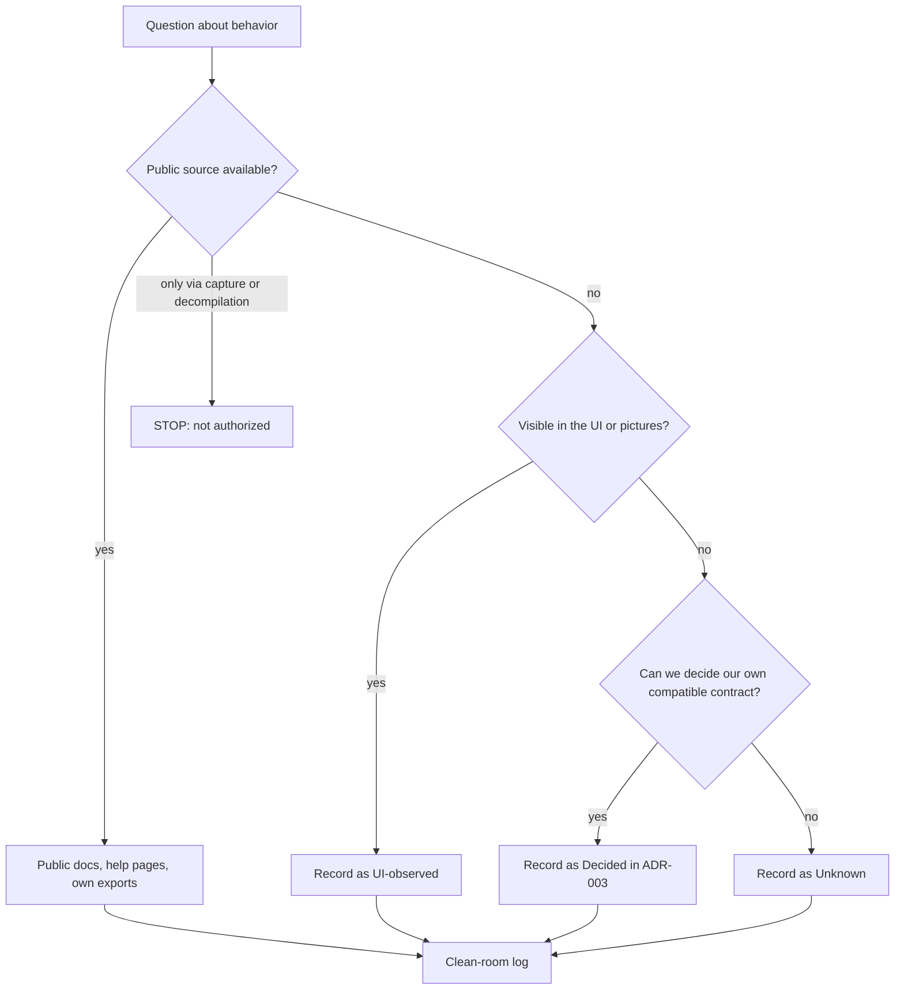
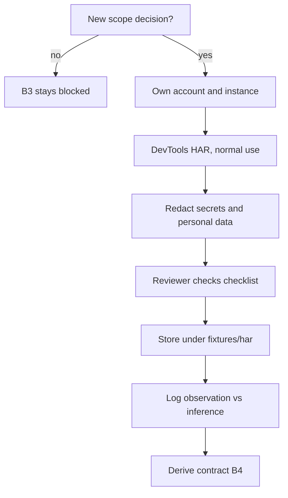
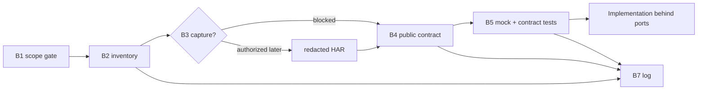

# Clean-room guide — not-notion

This is the operating manual for learning about the product without copying
it. The project rule is absolute: **nothing inside the original program, its
files, or its folder is read, listed, run, or decompiled.** This guide explains
what is allowed instead, how to record evidence, and when to stop.

The decision record is `docs/adr-005-clean-room-server-observation.md`; the
audit trail is `docs/reverse-engineering-log.md`.

## 1. The boundary in one picture

The four evidence levels are used consistently in
`docs/api-observations.md`:

| Level | Meaning | Example |
| ----- | ------- | ------- |
| **UI-observed** | Visible in the 98 `reference/` pictures, the 72 `screenshots/` pictures, or normal product behavior. | "The Share popover has Full access / Can edit / Can view / No access." |
| **Inferred** | A reasonable server implication, not confirmed by public documentation. | "A page update is probably a page-level request." |
| **Decided** | Our own contract in ADR-003. Not a claim about the original. | "`GET /api/v1/sync?since=` returns `SyncBatch`." |
| **Unknown** | Needs public documentation or a future authorized source. | "What are the original session token lifetimes?" |

## 2. Allowed sources

1. **The 98 pictures** in the workspace `reference/` folder — the primary
   visual source of truth (`1`–`29` original set, `30`–`98` later build).
2. **The 72 additional pictures** in `screenshots/` — a later UI build; visual
   and behavioral evidence only. `screenshots/` is local and git-ignored.
3. **Behavior visible in the product UI** while using it normally.
4. **Public help and documentation pages**, for example:
   - <https://www.notion.com/help>
   - <https://developers.notion.com/reference/intro>
   - <https://developers.notion.com/docs>
   - <https://www.notion.com/help/export-your-content>
   - <https://www.notion.com/help/sharing-and-permissions>
   - <https://www.notion.com/help/offline-mode>
   - <https://www.notion.com/help/version-history>
   - <https://www.notion.com/help/keyboard-shortcuts>
5. **Exports the person already owns** (markdown/CSV), used as a behavioral
   shape, not as source code.
6. **Our own decided contract** in ADR-003 and the tests that exercise it.

Public documentation is the preferred source. The public API reference was
reviewed in B4 on 2026-11-08; it is a public contract, not a capture.

## 3. Forbidden sources and actions

- Reading, listing, running or decompiling the original program or its folder.
- HAR or packet capture of a third-party service.
- `mitmproxy`, Charles, Wireshark or any TLS interception of traffic we do not
  control.
- Browser source maps, bundled JavaScript, or any original source code.
- Bypassing authentication, certificate pinning, rate limits or terms.
- Copying proprietary payloads, identifiers, assets, logos, photos, avatars or
  long passages of text into the repository.
- Presenting an inference as a fact about the original implementation.

> **Why Wireshark is not the primary tool:** modern traffic is TLS-protected;
> decrypting it requires controlling the client or installing a trusted
> interception proxy. A packet capture of a proprietary service reveals
> internal identifiers and undocumented payloads, which is much closer to
> reading the implementation than to observing documented behavior. It may also
> violate terms or law. See ADR-005.

## 4. What "own-account capture" would require

B3 (own-account HAR) is **blocked** under the current B1 decision. It can only
resume after a new, explicit scope decision recorded in ADR-005 and the
clean-room log. If that happens, all of the following apply:

1. The account and instance are the person's own, or written permission exists.
2. Capture happens with browser DevTools while using the product normally.
3. The HAR is stored under `fixtures/har/` **only after redaction**.
4. Redaction removes cookies, bearer tokens, email addresses, workspace names,
   avatars, file contents and any other personal data.
5. A reviewer checks the redaction checklist before the file is committed.
6. Only the minimum necessary capture is kept; it is never used to copy source
   or assets.
7. The clean-room log records date, source, what was observed, what was
   inferred, what was rejected, and the redaction status.

## 5. Observation workflow (B1 … B8)

`spec/spec-016-architecture-follow-up-and-observation.md` defines the phases:

| Phase | Purpose | Status |
| ----- | ------- | ------ |
| **B1** | Permission and scope gate | **Done:** public behavior only, strict clean room |
| **B2** | Behavioral inventory | **Done:** `docs/api-observations.md` + visual inventory |
| **B3** | Own-account HAR capture | **Blocked** by B1 |
| **B4** | Contract derivation | **In progress:** public developer docs reviewed 2026-11-08; specs 030–037 drafted; specs 030–036 implemented (spec-037 pending) |
| **B5** | Mock server and contract tests | **Pending:** follows B4 |
| **B6** | Tooling policy | **Recorded:** DevTools first; interception only on our traffic |
| **B7** | Clean-room log | **Ongoing:** every session appends an entry |
| **B8** | Stop conditions | **Reviewed before every source** |

## 6. How to record an observation

Use one row per operation in `docs/api-observations.md`:

| Column | Rule |
| ------ | ---- |
| Operation | Short verb phrase ("Read one page") |
| UI / public evidence | What was actually seen, and where |
| Inferred behavior | The server implication, clearly marked |
| Status | `Decided` / `Observed (public docs)` / `Unknown` |
| Confidence | High / medium / low, tied to the source |
| Open questions | What the source does not answer |

Rules:

- A screenshot proves a **surface**, not a route.
- A public doc can confirm a route; quote it in your own words and link it.
- An inference is never written in the present tense as if it were observed.
- A decision (our contract) is labeled **Decided**, not "the original does".
- Every session appends a dated entry to `docs/reverse-engineering-log.md`.

## 7. Stop conditions

Stop immediately and ask the person when:

- the only way to answer is to capture a third-party service;
- the source requires bypassing a login, certificate pinning, a rate limit or
  terms;
- the source would expose proprietary source code or internal artifacts;
- a capture would contain secrets or personal data that cannot be redacted;
- a request would require running or inspecting the original program.

Falling back is always allowed: public documentation, UI observation, exports,
or a deliberately compatible **decided** contract.

## 8. Reviewing the public API links (B4, started 2026-11-08)

The person provided the public Notion developer links. They are allowed public
documentation, and they were reviewed with `webfetch` on 2026-11-08.

1. Read only the public documentation.
2. For each resource, record what the public contract states in
   `docs/api-observations.md` as **Observed (public docs)**.
3. Compare it with ADR-003/ADR-006 and `docs/api-contract.md`.
4. Where they differ, update the observation, then the ADR, then the contract
   doc — before changing code.
5. The full analysis is `docs/public-api-analysis.md`; the derived roadmap is
   specs 030–037. Spec-030 is implemented; B5 (a broader mock server and
   contract suite) follows the next v2 slices.
6. Do **not** infer private endpoints, payloads or auth flows that the public
   docs do not state. The public API is an integration contract, not the
   original product's private server.

## 9. Clean-room checklist for a pull request

- [ ] No captured traffic, HAR, proxy log or source map is included.
- [ ] No original asset, logo, photo, avatar or long text is included.
- [ ] Every server behavior in the change is traceable to a public source, a
      UI observation, an owned export, or ADR-003.
- [ ] New observations carry an evidence level.
- [ ] `docs/reverse-engineering-log.md` has a dated entry.
- [ ] `docs/api-observations.md` and `docs/api-contract.md` are in sync.
- [ ] The change does not claim to reproduce undocumented internals.

## 10. Related documents

- `docs/api-observations.md` — the behavioral inventory.
- `docs/reverse-engineering-log.md` — the dated audit trail.
- `docs/unknowns.md` — open reconstruction questions.
- `docs/adr-005-clean-room-server-observation.md` — the decision.
- `docs/adr-003-self-hosted-collaborative-api.md` — our decided contract.
- `spec/spec-016-architecture-follow-up-and-observation.md` — phases B1–B8.
