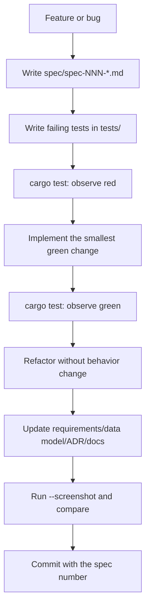
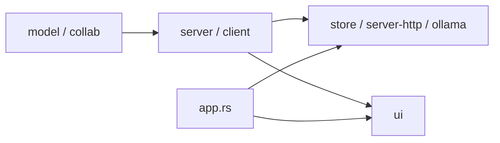

# Contributor guide — not-notion

This guide is for humans and agents making changes. It explains the project's
Spec-Driven Development (SDD) and Test-Driven Development (TDD) loop, where
code belongs, and how to verify a change.

## 1. Prerequisites

- Rust stable (edition 2024), `cargo`.
- Windows is the primary desktop target; the code is otherwise portable.
- No database, web server or Node.js toolchain is required.
- Ollama is optional (AI assistant only).

## 2. Commands

```sh
cargo build                     # compile
cargo test --all-targets        # run all integration tests
cargo clippy --all-targets -- -D warnings
cargo fmt --check
cargo run                       # desktop window
cargo run -- --serve 127.0.0.1:8787
cargo run -- --screenshot shots/now.png
```

CI runs formatting, clippy, tests and a release build on Windows.

## 3. The SDD/TDD loop



Rules:

1. **No production code without a failing test first.** For a pure refactor,
   the existing suite is the regression guard and the red step is a compile
   failure when the new module is declared before the code moves.
2. **One spec is one working session.** If a spec grows, split it into the next
   numbered spec.
3. **Tests never live in `src/`.** Every test is an integration test in
   `tests/`; shared helpers live in `tests/common/mod.rs`.
4. **A completed spec is committed in the same session.** The commit message
   names the spec.

## 4. Spec template

```markdown
# spec-NNN — Short title

## Purpose and scope
What this session changes, and what it deliberately does not.

## Evidence
Pictures, public docs, code findings, requirements.

## Acceptance criteria
Given / When / Then.

## Test scenarios (written before implementation)
Which test crates and test names.

## Design
Where the code goes and why.

## Plan / tasks
- [ ] ...
```

See `spec/README.md` for the index and status of every spec.

## 5. Where code belongs



| Concern | Location | Test file |
| ------- | -------- | --------- |
| Entity/field/invariant | `src/model.rs`, `src/model/*` | `tests/model.rs` |
| Collaboration DTO/state | `src/collab.rs` | `tests/collab.rs` |
| Export | `src/collab/export.rs` | `tests/collab.rs` |
| Route/use case | `src/server.rs` | `tests/server.rs` |
| Typed client | `src/client.rs` | `tests/client.rs` |
| Persistence port/adapter | `src/store.rs` | `tests/store.rs`, `tests/store_port.rs` |
| HTTP adapter | `src/server/http.rs` | `tests/server.rs` |
| Composition root | `src/app.rs` | `tests/app.rs` |
| UI state/commands | `src/ui/commands.rs`, `view.rs`, `app.rs`, `apply.rs` | `tests/ui.rs` |
| Rendering | `src/ui/render/*` | pure helpers in `tests/ui.rs` |
| Dialogs | `src/ui/dialogs/*` | pure helpers in `tests/ui.rs` |
| AI adapter | `src/ollama.rs` | `tests/ollama.rs` |
| Templates | `src/templates.rs` | `tests/templates.rs` |
| Locales | `locales/*.yml` | `tests/i18n.rs` |

## 6. Adding a feature end-to-end

### 6.1 Domain field or rule

1. Add the field to the entity in `src/model.rs` with a serde default for
   backward compatibility.
2. Update `Workspace` equality/diff if the field affects persistence.
3. Add a test in `tests/model.rs` for defaults, round-trip and behavior.
4. Update `docs/data-model.md`.
5. If the field changes the workspace shape, ensure `PageDiff` falls back to
   the full snapshot path when appropriate.

### 6.2 Server route / DTO

1. Add the DTO in `src/collab.rs` (serde, no egui/socket/file types).
2. Add the route in `src/server.rs`; use the shared `Envelope` helpers.
3. Persist through `WorkspaceServer::write` or `persist_collab`; return `500`
   on storage failure.
4. Add a typed method in `src/client.rs`.
5. Add tests in `tests/server.rs` and `tests/client.rs`.
6. Update `docs/api-contract.md`, `docs/data-model.md` and ADR-003 if the
   contract changed.

### 6.3 UI surface

1. Add the state fields to `NotionApp` (`ui/app.rs`) and `ViewState`
   (`ui/view.rs`).
2. Add `Command` variants in `ui/commands.rs`.
3. Apply them in `ui/apply.rs`; keep persistence through `Client`.
4. Render in `ui/render/*` or `ui/dialogs/*`; collect commands, never mutate
   server state directly.
5. Add pure helper tests where possible; otherwise verify with `--screenshot`.
6. Add a `NOT_NOTION_SHOW` preview hook if the state is otherwise hard to
   capture.

### 6.4 Translation

1. Add the key to `locales/en.yml`, `locales/pt-BR.yml` and `locales/eo.yml`.
2. Use `i18n::t("key")` (or `i18n::t_count` for `%{count}`).
3. Keep internal state keys (for example Library tab names) in stable English;
   translate only the display label.
4. Run `cargo test --test i18n` to check key completeness.

### 6.5 Starter template

1. Add a `Template` entry in `src/templates.rs` with blocks/rows.
2. Add or update a test in `tests/templates.rs`.
3. The template library and onboarding pick it up automatically.

## 7. Testing

See `docs/testing.md` for the full strategy. In short:

- pure logic → `tests/model.rs`, `tests/collab.rs`, `tests/ui.rs`;
- persistence → `tests/store.rs`, `tests/store_port.rs`;
- server/client → `tests/server.rs`, `tests/client.rs`;
- composition → `tests/app.rs`;
- end-to-end → `tests/integration.rs`;
- screenshots → `--screenshot`, compared by eye with `reference/` (98
  pictures) and `screenshots/` (72 local pictures).

Tests must be deterministic: unique temp paths, no wall-clock assertions, no
listeners left behind.

## 8. Preview hooks

`NOT_NOTION_SHOW` opens one pictured state for `--screenshot`:

```text
library | share | inbox | settings | settings-general | settings-sidebar |
settings-people | settings-offline | search | tasks | newtab | ai |
shortcuts | iconpicker | pageactions | discussions | onboarding | templates
```

`NOT_NOTION_LOCALE=en|pt-BR|eo` selects the initial locale.

Normal runs never set these variables.

## 9. Code style and architecture rules

- Private by default; `pub(crate)` for crate sharing; `pub use` for facades.
- One coherent responsibility per module; do not split by line count or
  one-struct-per-file.
- Domain independent of egui/eframe/JSON/sockets.
- Ports only at real boundaries (`WorkspaceApi`, `WorkspaceStore`,
  `CollabStore`).
- Errors: `Result` in library code, no `unwrap()` on user input; specific error
  types per context.
- UI copy: short, neutral English; no copied brand names/logos/long text.
- Use `i18n::t` for user-visible labels.
- Keep the palette centralized (`ui/palette.rs`).

## 10. Common pitfalls

- **Direct server mutation from render code:** forbidden. Push a `Command` and
  apply it through `Client`.
- **Forgetting the diff:** a new workspace-level field must be compared in
  `Workspace::diff`; otherwise it will not persist.
- **Page-level vs workspace-level writes:** page edits use `PATCH`; added,
  removed, reordered pages or settings changes need the full `PUT`.
- **Stale index:** direct `Workspace.pages` mutation bypasses the index; use
  `add_page`/`remove_page` or expect the safe linear fallback.
- **Archive filtering:** new page lists must decide whether archived pages are
  visible (`pages_for_view`, sidebar tree, search).
- **Version growth:** every page edit records a version; retention is 50 per
  page.
- **Locale keys:** missing keys fail `tests/i18n.rs`; add all three locales.
- **Clean room:** do not add captured traffic, proprietary assets or copied
  text. See `docs/clean-room.md`.

## 11. Commit checklist

- [ ] Spec written and linked from `spec/README.md`.
- [ ] Tests written first and observed red (or compile-red for refactors).
- [ ] `cargo test --all-targets` green.
- [ ] `cargo clippy --all-targets -- -D warnings` clean.
- [ ] `cargo fmt --check` clean.
- [ ] `--screenshot` checked if the UI changed.
- [ ] Requirements/data model/ADR/docs/changelog updated.
- [ ] Commit message names the spec.
