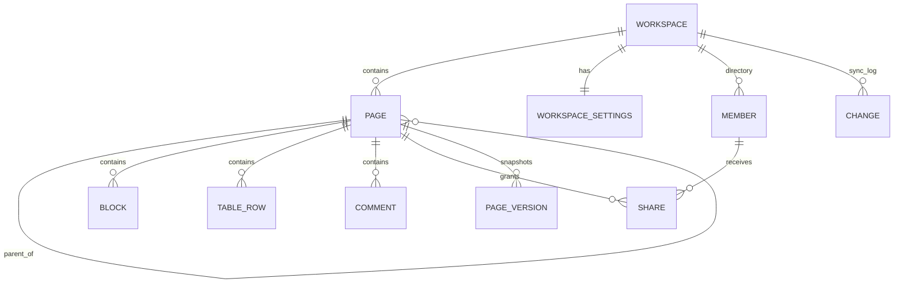
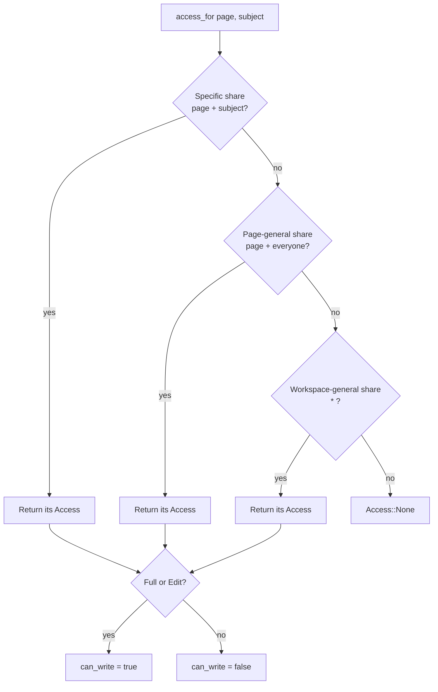
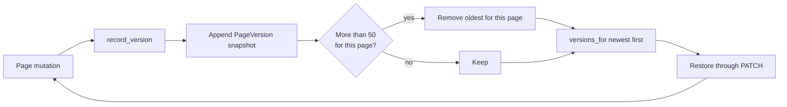
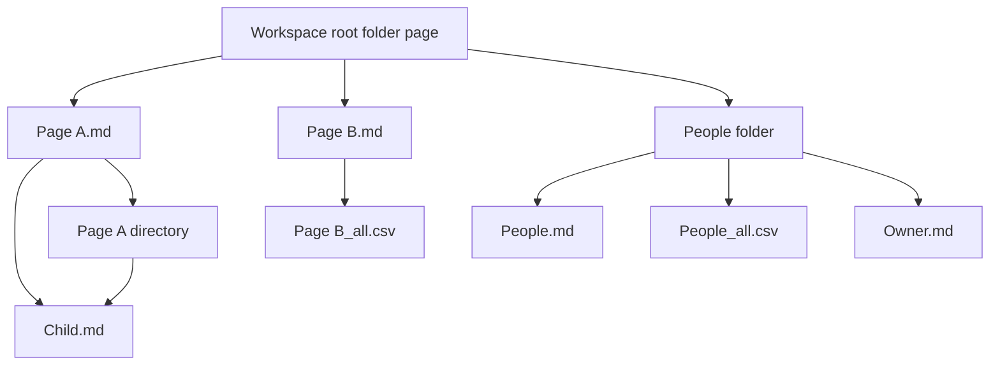
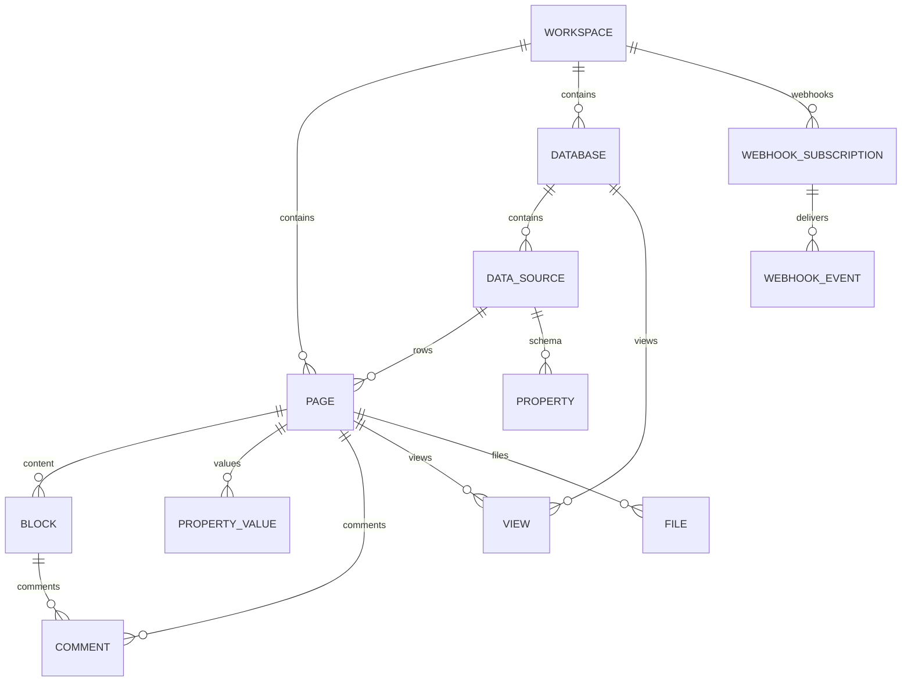

# Data Model — not-notion

All entities are plain Rust structs deriving `Serialize`/`Deserialize`. The
workspace is one JSON document (`workspace.json`); collaboration state is a
second document (`collab.json`) so a corrupt collaboration file cannot destroy
pages (spec-019). No egui types appear here.

## Entity: Workspace

| Field      | Type                | Description                                  |
| ---------- | ------------------- | -------------------------------------------- |
| `name`     | `String`            | Display name, default `not-notion`           |
| `pages`    | `Vec<Page>`         | All pages, order is the sidebar order        |
| `version`  | `u64`               | Increments on every successful write         |
| `settings` | `WorkspaceSettings` | Persisted workspace preferences (spec-025)   |

`Workspace` also holds a private `WorkspaceIndex` (id positions and parent →
children) that is derived state: it is skipped by serde, rebuilt after
deserialization and after add/remove, and ignored by equality (spec-022).

## Entity: WorkspaceSettings

| Field | Type | Description |
| ----- | ---- | ----------- |
| `id` | `String` | Stable local workspace id (default `local-workspace`) |
| `icon` | `String` | Workspace icon glyph |
| `landing_page` | `Option<String>` | Page opened on first landing |
| `allowed_domains` | `Vec<String>` | Domains allowed to join |
| `onboarding_completed` | `bool` | First-run onboarding was completed/dismissed |
| `workspace_purpose` | `Option<String>` | `work`, `personal` or `school` |
| `sidebar_*` | `bool` | Visibility toggles for sidebar sections |
| `show_other_apps` | `bool` | Show other apps in the sidebar |
| `analytics` | `bool` | Save/display page-view analytics |
| `offline_auto_download` | `bool` | Automatically download offline pages |
| `people_directory` | `bool` | Enable the People directory |
| `recent_activity` | `bool` | Show recent activity on profiles |
| `hover_cards` | `bool` | Show profile hover cards |

`Workspace.settings` is serialized with the workspace document and defaults
are supplied for older files (spec-025).

## Entity: Page

| Field               | Type                | Description                                      |
| ------------------- | ------------------- | ------------------------------------------------ |
| `id`                | `String`            | UUID v4, unique inside the workspace             |
| `title`             | `String`            | Editable page title                              |
| `icon`              | `String`            | Glyph/emoji or image reference                   |
| `parent`            | `Option<String>`    | Parent page id, `None` for a root page           |
| `favorite`          | `bool`              | Shown in the Favorites sidebar section           |
| `locked`            | `bool`              | Prevents editing when true (serde default false) |
| `available_offline` | `bool`              | Marks page for offline listing (serde default)   |
| `show_toc`          | `bool`              | Render the heading table of contents             |
| `discussions`       | `bool`              | Show the page-level discussion thread            |
| `inline_comments`   | `bool`              | Persist the inline-comment preference            |
| `archived`          | `bool`              | Hide from normal views; show in Library Archive  |
| `comments`          | `Vec<Comment>`      | Page-level discussion comments                   |
| `blocks`            | `Vec<Block>`        | Ordered editable content                         |
| `rows`              | `Vec<TableRow>`     | Inline table database (empty for normal pages)   |
| `updated_at`        | `String`            | ISO-8601-like display timestamp                  |

## Entity: Comment

| Field        | Type     | Description              |
| ------------ | -------- | ------------------------ |
| `id`         | `String` | UUID v4                  |
| `author`     | `String` | Display author label     |
| `text`       | `String` | Comment body             |
| `created_at` | `String` | Display timestamp        |

## Entity: Block

| Field       | Type        | Description                                     |
| ----------- | ----------- | ----------------------------------------------- |
| `id`        | `String`    | UUID v4                                         |
| `kind`      | `BlockKind` | Rendering and behavior variant                  |
| `text`      | `String`    | Editable text (empty for a divider)             |
| `checked`   | `bool`      | Only meaningful for `Todo`                      |
| `collapsed` | `bool`      | Reserved for a future toggle variant            |

`BlockKind` variants: `Paragraph`, `Heading1`, `Heading2`, `Heading3`,
`Bulleted`, `Numbered`, `Todo`, `Quote`, `Callout`, `Code`, `Divider`.

## Entity: TableRow

| Field      | Type     | Description                                    |
| ---------- | -------- | ---------------------------------------------- |
| `id`       | `String` | UUID v4                                        |
| `name`     | `String` | Row title                                      |
| `status`   | `String` | One of `Not started`, `In progress`, `Done`    |
| `assignee` | `String` | Short person label                             |
| `due`      | `String` | Short date label                               |

## Value objects

- `PageDraft { title, icon, parent }` — the create-page request body.
- `PageSummary { id, title, icon, parent, favorite }` — sidebar/list view.
- `SearchResult { page_id, page_title, snippet, score }` — search response.
- `ApiRequest { method, path, body }` / `ApiResponse { status, body }` — the
  client/server contract.
- `Envelope<T> { data: Option<T>, error: Option<String> }` — JSON response body.

## Relationships



```
Workspace 1 --- * Page
Page       0..1 --- * Page        (self-referencing parent tree)
Page       1 --- * Block
Page       1 --- * TableRow
Page       1 --- * Comment
Workspace 1 --- * Member
Member     1 --- * Share
Page       1 --- * Share
Page       1 --- * PageVersion
Workspace 1 --- * Change
```

Deleting a page removes the whole subtree (all descendants), so no orphan
pages can remain. Ids are never reused. Archived pages remain in the document
but are hidden from normal views (spec-026).

## Invariants

- I1: `Workspace.pages` contains no duplicate ids.
- I2: Every non-null `parent` refers to an existing page id.
- I3: `version` only increases.
- I4: Search ranking is deterministic: title prefix > title contains > body
  contains, then by page order.

## Collaboration entities (spec-011 / ADR-003)

All in `src/collab.rs`; plain serde structs/enums with no egui, socket or file
types. They are the DTOs of the decided API.

| Entity | Fields | Purpose |
| ------ | ------ | ------- |
| `Member` | `id, name, email, role: Role` | An account / People-directory row |
| `Role` | `Owner \| Member \| Guest` | Membership type ("Workspace owner") |
| `MemberDraft` | `name, email, role` | `POST /api/members` invite body |
| `Share` | `page_id, subject, access: Access` | Permission grant; `page_id == "*"` is general |
| `Access` | `Full \| Edit \| View \| None` | Share popover levels; `can_write` for Full/Edit |
| `Change` | `seq, page_id, op, actor` | One versioned sync-log entry |
| `PageVersion` | `version, page_id, title, actor, updated_at, snapshot` | Stored page snapshot for version history |
| `ChangeOp` | `Create \| Update \| Delete \| Replace` | Mutation kind |
| `SyncBatch` | `cursor, changes: Vec<Change>` | `GET /api/sync?since=` response |
| `RealtimeEvent` | `kind, page_id, actor, payload` | WebSocket frame payload |
| `RealtimeKind` | `Presence \| Edit \| Awareness \| Sync` | Frame category |
| `RealtimeContract` | `transport, channel, events, conflict_resolution` | `GET /api/realtime` discovery |
| `ExportFile` | `path, content` | One file of the in-memory export tree |
| `CollabState` | `members, shares, changes, next_seq, versions` | Server-owned state + pure methods |

`CollabState` methods: `invite`, `set_access`, `shares_for`, `access_for`
(most-specific-first resolution), `can_write`, `record`, `changes_since`,
`record_version`, `versions_for`. It is persisted through the `CollabStore`
port (`JsonCollabStore` writes `collab.json`) and restored on startup. Version
history keeps at most `MAX_VERSIONS_PER_PAGE` (50) newest snapshots per page;
older snapshots are pruned and other pages are untouched (spec-022). The
version snapshots are read by
`Client::page_versions` and shown in the page-actions version-history window
(spec-015); restoring one writes it back through `Client::update_page`.

## Access resolution

`CollabState::access_for(page_id, subject)` resolves the most specific grant
first:



## Version history lifecycle



## Export tree (takes the described workspace export into account)

`export_tree(workspace, members) -> Vec<ExportFile>` reproduces the structure
the person supplied:

- one markdown file per page, named `Title <id>.md`;
- a page with children is a **folder**: its own markdown lists links to the
  child markdown files (URL-encoded `%20` paths) and the children live in a
  same-named directory;
- the workspace root is itself a folder page linking to top-level pages;
- a `People` folder holds `People.md` (links + `filters:`/`sort:` view
  definition), `People_all.csv`, and one person file per member containing
  `Membership Type: <role>` and `Person: <name>`;
- inline table pages emit a companion `_all.csv`.

The export is pure (no filesystem I/O); writing the ZIP/files is a future
infrastructure adapter.



## Target data model (v2, planned)

The B4 public API review (`docs/public-api-analysis.md`, ADR-006) adds a richer
target model. It is **planned** in specs 030–037; the v1 entities above remain
the implemented shape until each spec lands.



| Entity | Key fields | Spec |
| ------ | ---------- | ---- |
| `RichText` | `type`, text/mention/equation, `annotations`, `plain_text`, `href` | 032 |
| `Block` | `object`, `id`, `parent`, timestamps, users, `in_trash`, `has_children`, typed payload | 032 |
| `Property` | `id`, `name`, `type`, type-specific config | 033 |
| `PropertyValue` | typed value (title, rich_text, number, select, status, date, relation, formula, …) | 033 |
| `DataSource` | `id`, `title`, `properties`, `parent`, `database_parent` | 033 |
| `Database` | `id`, `title`, `data_sources`, `parent`, `is_inline` | 033 |
| `View` | `id`, `data_source_id`, `name`, `type`, `filter`, `sorts`, `configuration` | 034 |
| `Comment` | `id`, `parent`, `discussion_id`, `rich_text`, `attachments`, `display_name` | 035 |
| `User` | `id`, `type` (person/bot), `name`, `avatar_url`, profile/bot fields | 035 |
| `FileObject` | `type` (file/file_upload/external), URL or upload id | 035 |
| `FileUpload` | `id`, `status`, `filename`, `content_type`, `content_length`, URLs | 035 |
| `WebhookSubscription` | `id`, `url`, `events`, `verification_token`, `status` | 036 |
| `WebhookEvent` | `id`, `timestamp`, `type`, `entity`, `data`, `attempt_number` | 036 |
| `ListResponse<T>` | `object:"list"`, `type`, `results`, `has_more`, `next_cursor` | 031 |
| `ApiError` | `object:"error"`, `status`, `code`, `message`, `request_id`, `additional_data` | 030 |

### Migration rules

- `Block.text` remains readable and is exposed as one `RichText` object; saving
  writes `rich_text` and does not lose text.
- `Page.rows` becomes a default data source with `name`, `status`, `assignee`
  and `due` properties; the old shape is a read-only projection until the UI
  migrates.
- `Page.parent` becomes a `Parent` object; a page-only parent is the
  compatibility case.
- `Comment` keeps `author`/`text` as a compatibility projection of
  `created_by`/`rich_text`.
- `Member` keeps `name`/`email`/`role`; the v2 `User` adds `type`, avatar and
  bot fields.
- `workspace.json` and `collab.json` remain the v1 documents; v2 may add
  `data_sources.json`/`webhooks.json` or store them behind the existing
  `CollabStore` port. A migration spec must decide before code.

## Templates and onboarding

The starter template catalog (`src/templates.rs`) is pure data: each
`Template` has an id, a title, block blueprints and optional table rows.
`Template::to_page` builds a real `Page` with stable ids. The workspace stores
only the result (a normal page) plus `onboarding_completed` and
`workspace_purpose` in `WorkspaceSettings`; there is no separate template
entity in the document.
