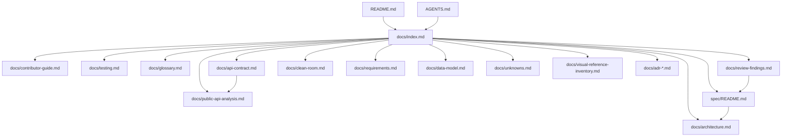

# Documentation index — not-notion

This is the entry point for contributors and agents. It explains what to read,
in what order, and which document is the source of truth for each concern.

## Start here

| You are… | Read in this order |
| -------- | ------------------ |
| New contributor | `README.md` → `docs/architecture.md` → `docs/contributor-guide.md` → `docs/testing.md` → `docs/glossary.md` |
| Agent starting a task | `AGENTS.md` → `spec/README.md` → `docs/architecture.md` → the relevant spec → `docs/review-findings.md` |
| Working on the server/API | `docs/api-contract.md` → `docs/public-api-analysis.md` → `docs/api-observations.md` → `docs/clean-room.md` → ADR-003/ADR-006 |
| Reviewing quality | `docs/review-findings.md` → `docs/testing.md` → `CHANGELOG.md` |
| Working on visuals | `docs/visual-reference-inventory.md` → `reference/` and `screenshots/` → the relevant spec |

## Current status (2026-11-08)

- **Specs:** `spec-001` … `spec-028` implemented; `spec-007` retired;
  `spec-016` is a plan with A9 still open; `spec-029` is the documentation
  overhaul; `spec-030` … `spec-037` are the planned public-API alignment
  roadmap.
- **Tests:** 115 integration tests across `tests/`; `cargo clippy --all-targets
  -- -D warnings` and `cargo fmt --check` are clean.
- **v1 runtime:** in-process server + optional loopback HTTP adapter. There is
  no production Axum/PostgreSQL/WebSocket/auth service yet.
- **Collaboration:** members, shares, sync log and version snapshots persist in
  `collab.json`; real-time CRDT transport is a decided contract, not a running
  server.
- **Clean room:** strict public-behavior-only observation. No capture, proxy,
  Wireshark, source maps or decompilation. B3 is blocked; **B4 public docs were
  reviewed on 2026-11-08** (`docs/public-api-analysis.md`); B5 follows the first
  implemented v2 slice.
- **Localization:** core navigation, Share, Library, page actions, comments and
  Settings are translated into `en`, `pt-BR` and `eo`; remaining strings are
  migrated incrementally.
- **Visual evidence:** 98 pictures in the workspace `reference/` folder
  (original 29 + later build) and 72 local `screenshots/` pictures; see
  `docs/visual-reference-inventory.md`.

## Documentation map

## Document catalog

| Document | Audience | What it is the source of truth for |
| -------- | -------- | ---------------------------------- |
| `AGENTS.md` | agents, contributors | Working rules, architecture guidelines, module tree, commands, conventions, commit rules |
| `README.md` | everyone | Project overview, quick start, feature/status summary |
| `docs/index.md` | everyone | Reading order and documentation map |
| `docs/architecture.md` | contributors, agents | System context, layers, modules, request/persistence flows, diagrams |
| `docs/contributor-guide.md` | contributors, agents | Step-by-step SDD/TDD workflow and how to add features |
| `docs/testing.md` | contributors, agents | Test strategy, test crates, fakes, red/green discipline |
| `docs/glossary.md` | everyone | Shared vocabulary (domain, ports, adapters, DTOs, CRDT, clean room, …) |
| `docs/review-findings.md` | maintainers, reviewers | Findings from the architecture/performance review and their resolution |
| `docs/requirements.md` | everyone | Functional and non-functional requirements, requirement → spec map |
| `docs/data-model.md` | contributors, agents | Entities, fields, relationships, invariants, persistence shape |
| `docs/api-contract.md` | client/server contributors | Current loopback API, decided `/api/v1` target, DTOs, status codes |
| `docs/api-observations.md` | clean-room researchers | UI/public evidence inventory and unknown server behavior |
| `docs/public-api-analysis.md` | architects, API contributors | B4 public Notion API analysis, comparison and roadmap |
| `docs/clean-room.md` | everyone | Allowed sources, observation levels, stop conditions, Wireshark guidance |
| `docs/reverse-engineering-log.md` | reviewers, agents | Auditable clean-room log of observations vs inferences |
| `docs/visual-reference-inventory.md` | UI contributors | What the 72 `screenshots/` pictures show and their gaps |
| `docs/unknowns.md` | everyone | Open reconstruction questions and their status |
| `docs/adr-001…006` | maintainers | Accepted architecture, API, modularization, clean-room and public-API-alignment decisions |
| `spec/README.md` | everyone | Spec index, status, and the SDD lifecycle |
| `CHANGELOG.md` | everyone | What changed, in what spec, with verification notes |

## Source-of-truth rules

1. **Behavior requirements** live in `docs/requirements.md`; a spec records the
   slice that implements them.
2. **Data shape** lives in `docs/data-model.md`; Rust structs are the executable
   form.
3. **Architecture decisions** live in ADRs; `AGENTS.md` summarizes the standing
   guidelines.
4. **The current API** is `docs/api-contract.md`; the original service's
   contract is unknown and must not be inferred from our implementation.
5. **Visual evidence** is `reference/` (98 pictures: the original 29 plus the
   later build) plus `screenshots/` (72 local later-build pictures);
   `docs/visual-reference-inventory.md` summarizes them.
6. **Clean-room evidence** is `docs/api-observations.md` and
   `docs/reverse-engineering-log.md`; no capture is authorized under B1.
7. **Public API evidence** is `docs/public-api-analysis.md` plus the
   **Observed (public docs)** rows in `docs/api-observations.md`. It describes
   the public integration contract, not the original private server.

## Keeping docs current

- Behavior change → update requirements + the relevant spec.
- New entity/field → update data model.
- New route/DTO/status → update `docs/api-contract.md`.
- New module or dependency direction change → update `AGENTS.md` and
  `docs/architecture.md`.
- New visual surface → update `docs/visual-reference-inventory.md` if it comes
  from the pictures.
- Completed spec → update `CHANGELOG.md`, `spec/README.md`, and commit.
