# Documentation index — ion-of-notes

This is the entry point for contributors and agents. It explains what to read,
in what order, and which document is the source of truth for each concern.

## Start here

| You are… | Read in this order |
| -------- | ------------------ |
| New contributor | `README.md` → `docs/architecture.md` → `docs/contributor-guide.md` → `docs/testing.md` → `docs/glossary.md` |
| Agent starting a task | `AGENTS.md` → `spec/README.md` → `docs/architecture.md` → the relevant spec → `docs/review-findings.md` |
| Working on the server/API | `docs/api-contract.md` → `docs/security-hardening.md` → `docs/authorization.md` → `docs/public-api-analysis.md` → `docs/api-observations.md` → `docs/clean-room.md` → ADR-003/ADR-006/ADR-007/ADR-008/ADR-009/ADR-010/ADR-011/ADR-012/ADR-013/ADR-014 |
| Reviewing a security finding | `docs/review-response.md` → `docs/security-hardening.md` → `docs/authorization.md` → the relevant spec |
| Deploying the server | `docs/deployment.md` → `compose.yml` → `Dockerfile` → `spec-050`/`spec-051` |
| Reviewing quality | `docs/review-findings.md` → `docs/refactoring-roadmap.md` → `docs/testing.md` → `CHANGELOG.md` |
| Working on visuals | `docs/ui-guidelines.md` → `docs/visual-reference-inventory.md` → `reference/` and `screenshots/` → the relevant spec |

## Current status (2026-11-12)

- **Specs:** `spec-001` .. `spec-056` implemented; `spec-007` retired;
  `spec-016` is a plan with B5 done; `spec-057` is implemented (UI quality
  pass); `spec-058` .. `spec-062` are implemented (workspaces, chrome,
  editor/AI responsiveness, settings formats, customizable sidebar);
  `spec-063` .. `spec-066` are implemented (bug-bashing II); `spec-067` is
  implemented (runtime smoke tests); `spec-068` .. `spec-071` are implemented
  (bug-bashing III); `spec-072` is implemented (centralized UI metrics);
  `spec-073` .. `spec-077` are implemented (authentication boundary, atomic
  persistence, webhook SSRF hardening, principal authorization and the review
  response); `spec-078` .. `spec-081` are implemented (route policy table,
  shared CRDT helpers, sidebar decomposition and the refactoring roadmap);
  `spec-082` .. `spec-086` are implemented (pipeline stages, transport
  segregation, client modules, adapter split and refactoring round II);
  `spec-087` is implemented (typed handler errors and the comments use case);
  `spec-088` is implemented (SearchState/SearchView grouping); `spec-089` is
  implemented (typed handlers for the remaining resource families);
  `spec-090` is implemented (complete typed handler conversion); `spec-091` is
  implemented (auth and webhook service modules). The
  v2 foundation, pagination, rich
  text/blocks, properties/data sources, views, comments/users/files, webhooks,
  limits and the Axum adapter are implemented (specs 030-038); sessions/SQLite
  (spec-039), the WebSocket change feed (spec-040), TLS webhooks/shared limits
  (spec-041), Yrs CRDT merge (spec-042), client awareness (spec-043), the
  remote transport (spec-044), the server login UI (spec-045), module
  boundaries (spec-046), the use-case seam (spec-047), the desktop feature
  seam/build profile (spec-048), the UI/client split (spec-049), the server
  container/Compose stack (spec-050), container hardening/deployment operations
  (spec-051), deployment hardening II (spec-052), the supply-chain/tooling baseline
  (spec-053), webhook reliability (spec-054), remote-mode UX (spec-055) and the production
  Compose/TLS manifest (spec-056) are implemented.
- **Tests:** 312 tests across the core and desktop passes (275 + 37); both
  clippy feature passes and `cargo fmt --check` are clean.
- **Runtime:** in-process server + Axum HTTP/WebSocket adapter; `--database`
  selects SQLite with Argon2id accounts and sessions. The desktop can connect
  remotely with `--server`/`--token` or Settings → Server. PostgreSQL remains
  next.
- **Deployment:** `ion-of-notes-server` builds without the desktop stack;
  `Dockerfile` and `compose.yml` run it with the `ion-data` volume, loopback
  binding, read-only root, dropped capabilities and a `/health` check. See
  `docs/deployment.md` for TLS, backups, secrets, upgrades and multi-arch builds.
- **Collaboration:** members, shares, sync log and version snapshots persist in
  `collab.json` or SQLite. `GET /ws/workspace/{id}` streams changes with
  presence and resume; Yrs CRDT merges page title/block text server-side and the
  desktop editor uses a client Yrs session with awareness cursors.
- **Clean room:** strict public-behavior-only observation. No capture, proxy,
  Wireshark, source maps or decompilation. B3 is blocked; **B4 public docs were
  reviewed on 2026-11-08** (`docs/public-api-analysis.md`); the v2 foundation,
  pagination, rich text/blocks, properties/data sources, views,
  comments/users/files, webhooks, limits and the Axum adapter are implemented
  (specs 030-038); sessions/SQLite (spec-039), the WebSocket change feed
  (spec-040), TLS webhooks/shared limits (spec-041), Yrs CRDT merge (spec-042),
  client awareness (spec-043), the remote transport (spec-044) and the server
  login UI (spec-045) are implemented. B5 is done.
- **Localization:** core navigation, Share, Library, page actions, comments and
  Settings are translated into `en`, `pt-BR` and `eo`; remaining strings are
  migrated incrementally.
- **Visual evidence:** 98 pictures in the workspace `reference/` folder
  (original 29 + later build) and 72 local `screenshots/` pictures; see
  `docs/visual-reference-inventory.md`.

## Documentation map

```mermaid
flowchart TD
    README[README.md] --> INDEX[docs/index.md]
    INDEX --> ARCH[docs/architecture.md]
    INDEX --> GUIDE[docs/contributor-guide.md]
    INDEX --> UIGUIDE[docs/ui-guidelines.md]
    INDEX --> SEC[docs/security-hardening.md]
    INDEX --> AUTHZ[docs/authorization.md]
    INDEX --> PERSIST[docs/persistence-integrity.md]
    INDEX --> PERF[docs/performance-roadmap.md]
    INDEX --> REVIEWRESP[docs/review-response.md]
    INDEX --> REFACTOR[docs/refactoring-roadmap.md]
    INDEX --> TEST[docs/testing.md]
    INDEX --> GLOSS[docs/glossary.md]
    INDEX --> REVIEW[docs/review-findings.md]
    INDEX --> API[docs/api-contract.md]
    INDEX --> PUBLIC[docs/public-api-analysis.md]
    API --> PUBLIC
    INDEX --> CLEAN[docs/clean-room.md]
    INDEX --> REQ[docs/requirements.md]
    INDEX --> DATA[docs/data-model.md]
    INDEX --> UNK[docs/unknowns.md]
    INDEX --> VIS[docs/visual-reference-inventory.md]
    INDEX --> DEPLOY[docs/deployment.md]
    INDEX --> ADR[docs/adr-*.md]
    INDEX --> SPECS[spec/README.md]
    AGENTS[AGENTS.md] --> INDEX
    SPECS --> ARCH
    REVIEW --> SPECS
```

## Document catalog

| Document | Audience | What it is the source of truth for |
| -------- | -------- | ---------------------------------- |
| `AGENTS.md` | agents, contributors | Working rules, architecture guidelines, module tree, commands, conventions, commit rules |
| `README.md` | everyone | Project overview, quick start, feature/status summary |
| `docs/index.md` | everyone | Reading order and documentation map |
| `docs/architecture.md` | contributors, agents | System context, layers, modules, request/persistence flows, diagrams |
| `docs/deployment.md` | operators | Container deployment, TLS/reverse proxy, backups, secrets, upgrades and hardening |
| `docs/contributor-guide.md` | contributors, agents | Step-by-step SDD/TDD workflow and how to add features |
| `docs/ui-guidelines.md` | UI contributors, agents | Alignment, margins, padding, design constants and how to add new UI tokens |
| `docs/security-hardening.md` | operators, contributors | Auth boundary, owner password, login limits, sessions, request bounds and webhook egress |
| `docs/authorization.md` | server contributors | Roles, capabilities, page access resolution and nested-resource gaps |
| `docs/persistence-integrity.md` | operators, contributors | Atomic snapshots, failure reload, JSON limits and backup/restore |
| `docs/performance-roadmap.md` | contributors | Deferred performance/scale work and the measurement plan |
| `docs/review-response.md` | reviewers, maintainers | Finding → response → spec → evidence map for the 2026-11-12 reviews |
| `docs/refactoring-roadmap.md` | contributors | Implemented general refactors and the risk-ordered deferred work |
| `docs/testing.md` | contributors, agents | Test strategy, test crates, fakes, red/green discipline |
| `docs/glossary.md` | everyone | Shared vocabulary (domain, ports, adapters, DTOs, CRDT, clean room, …) |
| `docs/review-findings.md` | maintainers, reviewers | Findings from the architecture/performance review and their resolution |
| `docs/requirements.md` | everyone | Functional and non-functional requirements, requirement → spec map |
| `docs/data-model.md` | contributors, agents | Entities, fields, relationships, invariants, persistence shape |
| `docs/api-contract.md` | client/server contributors | Current loopback API, decided `/api/v1` target, DTOs, status codes |
| `docs/api-observations.md` | clean-room researchers | UI/public evidence inventory and unknown server behavior |
| `docs/public-api-analysis.md` | architects, API contributors | B4 public Notion API analysis, comparison and roadmap |
| `docs/clean-room.md` | everyone | Allowed sources, observation levels, stop conditions, Wireshark guidance |
| `docs/reverse-engineering-log.md` | reviewers, agents | Auditable clean-room log of observations vs inferences |
| `docs/visual-reference-inventory.md` | UI contributors | What the 72 `screenshots/` pictures show and their gaps |
| `docs/unknowns.md` | everyone | Open reconstruction questions and their status |
| `docs/adr-001..014` | maintainers | Accepted architecture, API, modularization, clean-room, storage and transport decisions |
| `scripts/README.md` | contributors, agents | Reusable link/Mermaid/table/test/quality checks |
| `spec/README.md` | everyone | Spec index, status, and the SDD lifecycle |
| `CHANGELOG.md` | everyone | What changed, in what spec, with verification notes |

## Source-of-truth rules

1. **Behavior requirements** live in `docs/requirements.md`; a spec records the
   slice that implements them.
2. **Data shape** lives in `docs/data-model.md`; Rust structs are the executable
   form.
3. **Architecture decisions** live in ADRs; `AGENTS.md` summarizes the standing
   guidelines.
4. **The current API** is `docs/api-contract.md`; the original service's
   contract is unknown and must not be inferred from our implementation.
5. **UI layout and design constants** are `docs/ui-guidelines.md`; the
   executable values are in `src/ui/constants.rs`.
6. **Visual evidence** is `reference/` (98 pictures: the original 29 plus the
   later build) plus `screenshots/` (72 local later-build pictures);
   `docs/visual-reference-inventory.md` summarizes them.
7. **Clean-room evidence** is `docs/api-observations.md` and
   `docs/reverse-engineering-log.md`; no capture is authorized under B1.
8. **Public API evidence** is `docs/public-api-analysis.md` plus the
   **Observed (public docs)** rows in `docs/api-observations.md`. It describes
   the public integration contract, not the original private server.

## Keeping docs current

- Behavior change → update requirements + the relevant spec.
- New entity/field → update data model.
- New route/DTO/status → update `docs/api-contract.md`.
- New module or dependency direction change → update `AGENTS.md` and
  `docs/architecture.md`.
- UI layout, alignment, spacing or design-token change → update
  `docs/ui-guidelines.md` and the relevant spec.
- New visual surface → update `docs/visual-reference-inventory.md` if it comes
  from the pictures.
- Completed spec → update `CHANGELOG.md`, `spec/README.md`, and commit.
