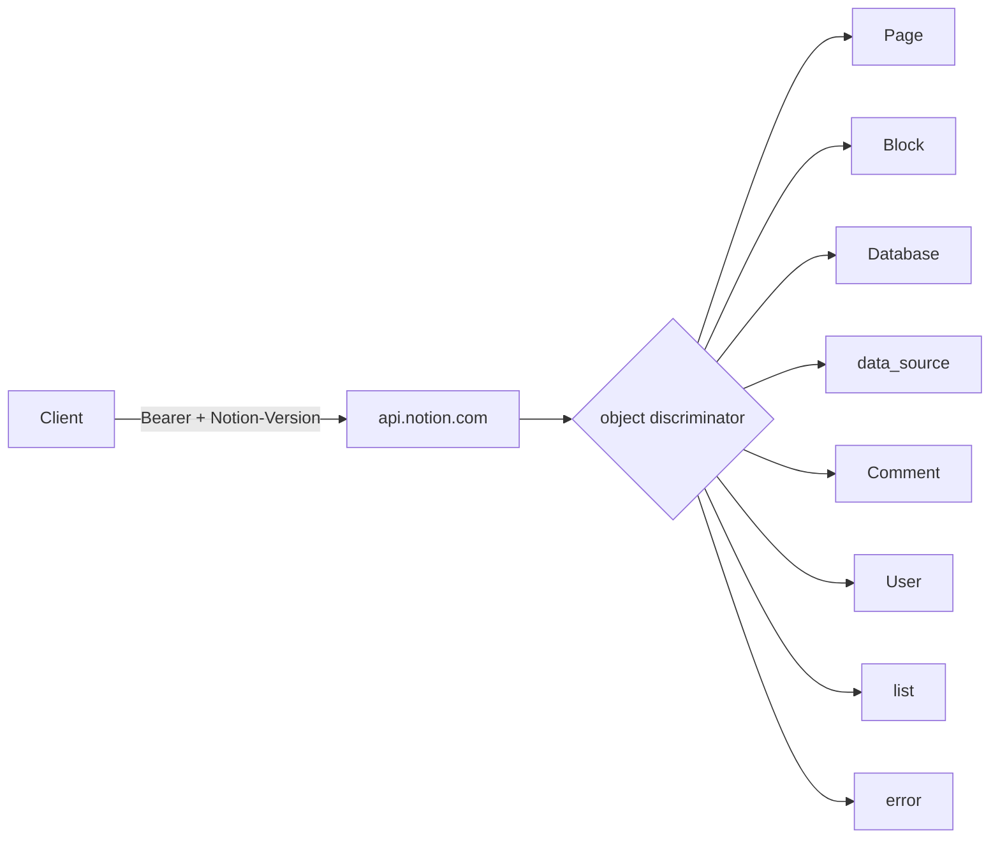
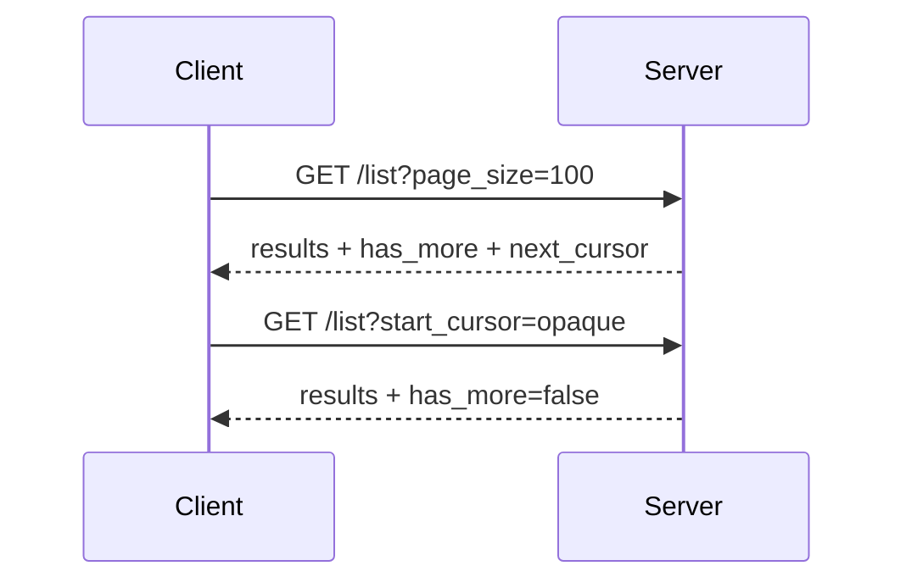
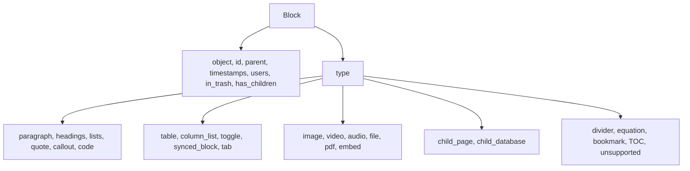
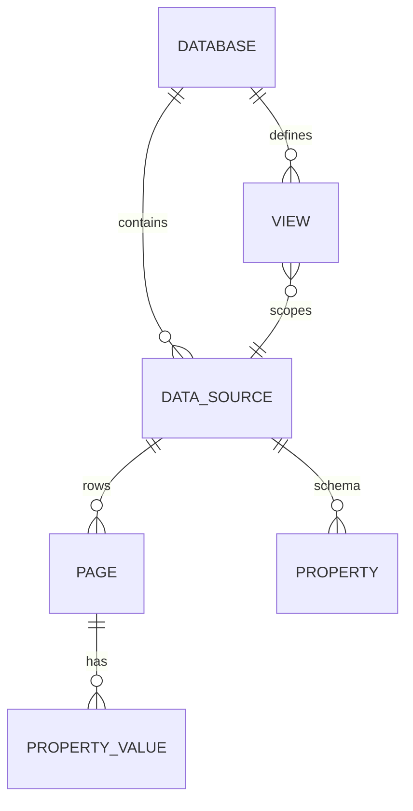
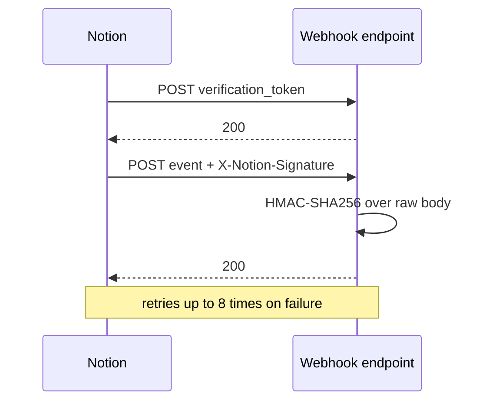
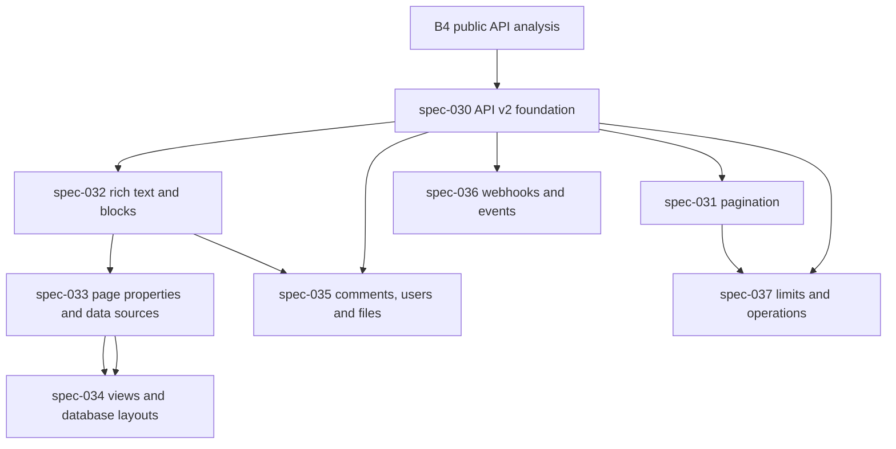

# Public Notion API analysis — not-notion

**Status:** B4 public-documentation review, 2026-11-08
**Scope:** public documentation only. No capture, proxy, Wireshark, source
map or decompilation was used.
**Purpose:** understand the public Notion API contract well enough to improve
our own self-hosted contract without copying private implementation details.

> This document describes the **public Notion API**. It is not a claim about
> the original product's private server. The public API is a documented
> integration contract; it is the best allowed evidence for how a mature
> workspace API models pages, blocks, properties, comments, files and events.

## 1. Sources reviewed

| Area | Public page |
| ---- | ----------- |
| Conventions | <https://developers.notion.com/reference/intro> |
| Pagination | <https://developers.notion.com/reference/pagination> |
| Capabilities | <https://developers.notion.com/reference/capabilities> |
| Webhooks | <https://developers.notion.com/reference/webhooks> |
| Webhook delivery | <https://developers.notion.com/reference/webhooks-events-delivery> |
| Request limits | <https://developers.notion.com/reference/request-limits> |
| Workspace block limits | <https://developers.notion.com/reference/workspace-block-limits> |
| Status codes | <https://developers.notion.com/reference/status-codes> |
| Versioning | <https://developers.notion.com/reference/versioning> |
| Changes by version | <https://developers.notion.com/reference/changes-by-version> |
| Block | <https://developers.notion.com/reference/block> |
| Rich text | <https://developers.notion.com/reference/rich-text> |
| Page | <https://developers.notion.com/reference/page> |
| Page property values | <https://developers.notion.com/reference/page-property-values> |
| Property item | <https://developers.notion.com/reference/property-item-object> |
| Database | <https://developers.notion.com/reference/database> |
| Data source | <https://developers.notion.com/reference/data-source> |
| Property object | <https://developers.notion.com/reference/property-object> |
| View | <https://developers.notion.com/reference/view> |
| Comment | <https://developers.notion.com/reference/comment-object> |
| Comment attachment | <https://developers.notion.com/reference/comment-attachment> |
| Comment display name | <https://developers.notion.com/reference/comment-display-name> |
| File object | <https://developers.notion.com/reference/file-object> |
| File upload | <https://developers.notion.com/reference/file-upload> |
| User | <https://developers.notion.com/reference/user> |
| Parent object | <https://developers.notion.com/reference/parent-object> |
| Emoji and icon | <https://developers.notion.com/reference/emoji-and-icon> |
| Unfurl attribute | <https://developers.notion.com/reference/unfurl-attribute-object> |

Endpoint and webhook-event reference pages were not fetched in this pass; the
analysis below covers the object model, conventions and delivery behavior that
those pages depend on.

## 2. Conventions

- Base URL: `https://api.notion.com`.
- Auth: `Authorization: Bearer <token>`.
- Every REST request requires a `Notion-Version` header (for example
  `2026-03-11`). Missing or invalid versions are rejected.
- JSON bodies use `Content-Type: application/json`.
- The `object` field is the resource discriminator (`page`, `block`,
  `database`, `data_source`, `comment`, `user`, `list`, `error`, …).
- Property names are `snake_case`.
- Dates and timestamps are ISO 8601 (`2026-03-11`,
  `2026-03-11T09:30:00.000Z`).
- Page and database IDs may be sent with or without dashes.
- Additive response fields appear on **every** API version immediately; clients
  must ignore unknown fields. Link formats and cursors are not stable
  identifiers; record IDs are stable UUIDs.



## 3. Errors and status codes

Public errors use a structured error object:

```json
{
  "object": "error",
  "status": 400,
  "code": "validation_error",
  "message": "body failed validation: ...",
  "request_id": "...",
  "additional_data": { }
}
```

| Status | Stable `code` | Meaning |
| ------ | ------------- | ------- |
| 200 | — | Success |
| 400 | `invalid_json`, `invalid_request_url`, `invalid_request`, `validation_error`, `missing_version`, `invalid_beta` | Bad request / missing version / schema mismatch |
| 401 | `unauthorized` | Invalid bearer token |
| 403 | `restricted_resource` | No permission, or workspace block limit |
| 404 | `object_not_found` | Missing or not shared |
| 409 | `conflict_error` | Data collision; retry with fresh state |
| 429 | `rate_limited` | Rate limit; respect `Retry-After` |
| 500 | `internal_server_error` | Unexpected server error |
| 502 | `bad_gateway` | Upstream failure |
| 503 | `service_unavailable`, `database_connection_unavailable` | Unavailable or timed out; a write may already be saved |
| 504 | `gateway_timeout` | Request timed out |
| 529 | `service_overload` | Temporarily overloaded; respect `Retry-After` |

`additional_data` can carry retry guidance, the rate-limit reason, or
`block_limit`. A 503 write must be checked before retrying: the change may
already be saved.

## 4. Pagination

List endpoints are cursor-paginated:

| Request | Meaning |
| ------- | ------- |
| `start_cursor` | Omit on the first request; pass `next_cursor` verbatim afterwards |
| `page_size` | 1–100; most endpoints default to 100 |

| Response | Meaning |
| -------- | ------- |
| `object: "list"` | Standard list envelope |
| `type` | Kind of result |
| `results` | Items on this page |
| `has_more` | Whether another page exists |
| `next_cursor` | Opaque cursor, or `null` at the end |

Cursors are **opaque**: never parse, validate or store them beyond passing them
back. Some lists can return fewer items than requested even when more remain.
`title`, `rich_text`, `people` and `relation` page properties have their own
paginated property-item response.



## 5. Capabilities and permissions

A connection or token has capabilities that gate endpoints and response
fields:

| Group | Capabilities |
| ----- | ------------ |
| Content | read content, update content, insert content |
| Comments | read comments, insert comments |
| Agents | view sessions / interact, edit selected agents |
| User info | none, user info without email, user info with email |

If a connection can access a page, it can access the page's children. Request
the minimum capabilities needed. This is more granular than a single
`Access` level: reading, updating and inserting are separate rights, and user
profile visibility is a separate concern.

## 6. Blocks

A block is the unit of page content. Every block has:

`object`, `id` (UUIDv4), `parent`, `type`, `created_time`, `created_by`,
`last_edited_time`, `last_edited_by`, `in_trash` (with deprecated `archived`
alias), `has_children`, and a type-specific object keyed by `type`.

Supported public block types include paragraph, heading 1–4, bulleted and
numbered list items, to-do, quote, callout, code, divider, table, table row,
toggle, column list/column, child page, child database, image, video, audio,
file, pdf, bookmark, embed, equation, link preview, synced block, template,
table of contents, meeting notes, tab, breadcrumb, and `unsupported`.

Not every block type is writable. Some support children; some have constraints
(table width is fixed at creation; synced block content cannot be updated;
template creation is deprecated; `link_preview` is read-only). Unsupported
types appear as `type: "unsupported"` with a `block_type` field.



## 7. Rich text

Blocks that carry text use an array of rich text objects:

| Field | Meaning |
| ----- | ------- |
| `type` | `text`, `mention` or `equation` |
| type object | `text.content` + optional `text.link.url`; mention target; equation expression |
| `annotations` | bold, italic, strikethrough, underline, code, color |
| `plain_text` | Unformatted text |
| `href` | Link or mention URL |

Mentions can target a database, date, link preview, page, template placeholder
or user. Inline equations use a KaTeX-compatible expression. Rich text limits:
2000 characters for text content and link URL, 1000 for an equation, and 100
rich text objects per array.

## 8. Pages and properties

A page has `object`, `id`, timestamps, `created_by`/`last_edited_by`, `icon`,
`cover`, `parent`, `in_trash`, `properties`, `url` and `public_url`. Page
content is a separate block tree.

If the parent is another page or the workspace, the only property is `title`.
If the parent is a data source, the page is a row and its `properties` must
match the data source schema.

Property values support a large type set:

| Group | Types |
| ----- | ----- |
| Text | `title`, `rich_text` |
| Numbers | `number`, `unique_id` |
| Choice | `select`, `multi_select`, `status` |
| Date/location | `date`, `place`, `created_time`, `last_edited_time` |
| People | `people`, `created_by`, `last_edited_by` |
| Media | `files` |
| Links | `url`, `email`, `phone_number` |
| Relations | `relation`, `rollup`, `formula` |
| Control | `checkbox`, `button`, `verification` |

Writes replace an entire array value (not append). Clear rules differ by type:
empty array for title/rich_text/people/relation/multi_select/files, `null` for
number/url/email/phone/select/date/place, `false` for checkbox, and
`{state:"unverified"}` for verification.

A page response can omit large relation/people/title/rich-text values; the
property-item endpoint paginates them. A property's `id` is stable when its
name changes; the Name property always has `id: "title"`.

## 9. Databases, data sources and views

Since API version `2025-09-03`, a **database** is a container with one or more
**data sources**. Each data source owns its schema (`properties`) and its rows
(pages). A database has `data_sources` (id + name), timestamps, title,
description, icon, cover, parent, `in_trash`, `is_inline`, `database_type`,
`show_data_source_title`, `url` and `public_url`. A data source has
`properties`, `parent`, `database_parent`, timestamps, title, description,
icon, `in_trash` and optional `sync_metadata`.

A **view** defines how rows are filtered, sorted and displayed. Public view
types: table, board, calendar, timeline, gallery, list, form, chart, map and
dashboard. A view has `parent`, `data_source_id`, `name`, `type`, `filter`,
`sorts`, `configuration`, timestamps, users and `url`.



## 10. Comments, users and files

**Comment** fields: `object`, `id`, `parent` (page or block), `discussion_id`,
optional `property_id`, `created_time`, `last_edited_time`, `created_by`,
`rich_text`, `attachments`, `display_name`, `has_pending_attachments`.
Comments are listed chronologically. A comment can have up to 3 attachments.
`display_name` is `connection`, `user` or `custom`, with a resolved name.
Comment capabilities gate read/insert.

**User** fields: `object`, `id`, optional `type` (`person` or `bot`), `name`,
`avatar_url`; people can expose `person.email` and `email_verified` when the
capability allows; bots expose `owner`, `workspace_name`, `workspace_id` and
`workspace_limits.max_file_upload_size_in_bytes`. User objects may be partial:
always rely on `id`, not on a name or email being present.

**File** objects have `type` = `file`, `file_upload` or `external`.
Notion-hosted files return a temporary URL valid for about one hour;
re-fetch instead of caching. External files use a stable public URL. A
`file_upload` references an uploaded file by ID and reads back as `file`.
The File Upload lifecycle is `pending` → `uploaded` → attached, or `expired` /
`failed`; it supports single-part and multi-part modes, content type/length,
`upload_url` and `complete_url`.

## 11. Webhooks

A webhook subscription sends an HTTPS POST to a public endpoint when workspace
content changes. Setup:

1. Create the subscription with a public HTTPS URL and selected event types.
2. Notion sends a one-time `verification_token`; the endpoint must receive it.
3. The subscription is verified by submitting the token.
4. Every event carries `X-Notion-Signature: sha256=<HMAC-SHA256>` computed over
   the raw body with the verification token. Validate with a constant-time
   comparison.
5. Events are signals, not full content: fetch the object by ID to get the
   latest state.

Event fields: `id`, `timestamp`, `workspace_id`, `subscription_id`,
`integration_id`, `type`, `authors`, `accessible_by`, `attempt_number`,
`entity {id,type}`, and event-specific `data`.

Event types include `page.created`, `page.content_updated`,
`page.properties_updated`, `page.moved`, `page.deleted`, `page.undeleted`,
`page.locked`, `page.unlocked`, `database.*` (deprecated in `2025-09-03`),
`data_source.*` (new in `2025-09-03`), and `comment.created`, `comment.updated`,
`comment.deleted`.

Delivery behavior: aggregated events are batched (typically under a minute);
events can arrive out of order; use `timestamp` to reorder; at-most-once
delivery with up to 8 retries over about 24 hours using exponential backoff;
events may be delayed up to 5 minutes. Localhost endpoints are not reachable.



## 12. Limits

| Limit | Value |
| ----- | ----- |
| Per-connection rate | 600/min Business/Enterprise, 180/min other plans |
| Data source query | about 3 requests/second per connection |
| Per-workspace rate | shared, plan-scaled; `Retry-After` may exceed 60s |
| Rate-limit response | 429 `rate_limited`, `Retry-After`, `additional_data.rate_limit_reason` |
| Overload | 529 `service_overload`, respect `Retry-After` |
| Request payload | max 1000 block elements, 500 KB overall |
| Rich text content / link | 2000 characters |
| Equation expression | 1000 characters |
| Block array | 100 elements |
| URL | 2000 characters |
| Email / phone | 200 characters |
| Multi-select / relation / people | 100 each per request |
| Free workspace blocks | 1000 lifetime blocks for Free workspaces with more than one member; 403 `restricted_resource` + `additional_data.block_limit` |
| Schema recommendation | max 500 properties or 50 KB |

Retry policy: respect `Retry-After`; retry 429/529; retry 500/502/503/504 only
when idempotent; do not retry a blocked 429; check `retry_guidance` before
retrying a 503 write.

## 13. Comparison with the current implementation

| Concern | Public Notion API | not-notion today | Gap |
| ------- | ----------------- | ---------------- | --- |
| Auth | Bearer token + version header | none (loopback) | No auth, no version header |
| Errors | structured `error` object + codes | `{data,error}` string | No codes, request IDs or retry guidance |
| Pagination | cursor lists | full arrays | No pagination |
| Capabilities | read/update/insert, comments, user info | `Role` + `Access` | Coarse permissions |
| Blocks | 30+ types, metadata, children, rich text | 11 kinds, plain text, flat | No metadata, rich text or nesting |
| Page | properties, icon, cover, parent, in_trash, url | title, icon, parent, flags, blocks, rows | No properties/cover/url |
| Properties | 25+ types, property items | `TableRow` with 4 strings | No schema or property values |
| Database | container + data sources | inline rows | No database/data source split |
| Views | 10 types, filter/sort/config | table + board | No view DTO |
| Comments | page/block, rich text, attachments, discussions | page comments, plain text | No block anchors, attachments or discussions |
| Files | file/file_upload/external, lifecycle | none | No file model |
| Users | person/bot, avatar, email, limits | `Member` name/email/role | No user object |
| Parent | page/database/data_source/workspace/block/agent | page id only | No parent object |
| Icons | emoji/custom/icon/external/file | glyph string | No icon object |
| Webhooks | subscriptions, signatures, retries | none | No event delivery |
| Limits | rate, size, block limits | none | No limits |
| Versioning | required version, additive changes, opaque cursors | none | No versioning |
| Link previews | unfurl attributes | none | Deliberately out of scope |

## 14. What to adopt, adapt, or leave out

### Adopt (compatible patterns)

- Versioned API with a required version header.
- Structured errors with stable codes, request IDs and retry guidance.
- Cursor pagination with opaque cursors and `has_more`.
- Capability-based permissions (content read/update/insert, comments, user info).
- Rich text objects and block metadata/children.
- Page properties and a data source/property schema.
- View objects for table/board/calendar/list.
- Comment objects with rich text and attachments.
- File objects with external, hosted and uploaded variants.
- User objects with person/bot distinction and optional email.
- Parent objects with page/database/data-source/workspace/block variants.
- Icon objects (emoji, custom, native icon, external).
- Webhooks with verification and HMAC signatures.
- Explicit limits and retry semantics.

### Adapt (our own compatible design)

- Use our own `Not-Notion-Version` header, not `Notion-Version`, to avoid
  impersonating another service.
- Keep v1 loopback routes stable; add `/api/v2` behind the same `WorkspaceApi`
  seam and migrate the UI incrementally.
- Support a subset of block types that the egui UI can render; represent the
  rest as `unsupported` rather than pretending to support them.
- Support core property types first (title, rich_text, number, select,
  multi_select, status, date, checkbox, url, email, people, files, relation,
  formula/rollup read-only); defer `place`, `verification`, `button`.
- Support table/board/calendar/list views first; defer timeline, gallery, form,
  chart, map and dashboard.
- Use a local file store with expiring URLs; a production object store is an
  adapter behind a port.

### Leave out (deliberately)

- Link previews / unfurl attributes: custom connections are closed to new
  developers and the feature is outside the workspace core.
- Agent APIs and agent parent objects: out of scope for this product.
- SCIM/SSO enterprise provisioning: an operator concern, not a workspace rule.
- Exact private Notion endpoints or payloads that are not in public docs.
- A byte-for-byte clone of the public API. We adopt the patterns that make our
  contract robust; we do not claim compatibility with Notion.

## 15. Roadmap to specs



| Spec | Outcome | Depends on |
| ---- | ------- | ---------- |
| `spec-030` | Version header, structured errors, request IDs, capabilities, v2 prefix | — |
| `spec-031` | Cursor pagination and list envelopes | 030 |
| `spec-032` | Rich text, block metadata, block children and endpoints | 030 |
| `spec-033` | Page properties, data sources and property items | 032 |
| `spec-034` | View objects and table/board/calendar/list queries | 033 |
| `spec-035` | Comment, user and file objects, attachments, uploads | 030, 032 |
| `spec-036` | Webhook subscriptions, verification, signatures and retries | 030 |
| `spec-037` | Rate/size/block limits, retries, error taxonomy | 030, 031 |

**Status (2026-11-08):** spec-030 is implemented (`/api/v2`, versioning,
structured errors, capabilities, request IDs). Specs 031–037 remain planned.

## 16. Risks and open questions

- **Scope risk:** the public API is much larger than this app. We adopt a
  subset and mark unsupported types explicitly.
- **Compatibility risk:** our contract is not Notion's; we must never claim
  wire compatibility. Public docs inform our design, not our identity.
- **Migration risk:** moving from `TableRow` to data sources/properties touches
  the model, UI, export and tests. Specs 033/034 stage it.
- **Webhook risk:** a public HTTPS endpoint, TLS, retries and signatures are
  operational features; a local self-hosted server may not be reachable.
  Spec-036 keeps delivery behind a port and documents the limitation.
- **Limit risk:** rate and block limits depend on plan/member count. Spec-037
  makes the policy explicit and configurable.
- **Clean-room risk:** public API docs are allowed, but they describe the
  integration surface, not the original private service. Every inference stays
  marked as such in `docs/api-observations.md`.

## 17. Evidence log

- **2026-11-08:** reviewed the public pages listed in §1 with `webfetch`.
  No capture, proxy, source map or decompilation. Recorded as
  **Observed (public docs)** in `docs/api-observations.md`.
