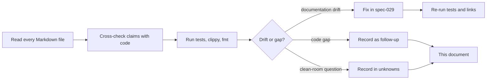

# Review findings — not-notion

This document records the findings of the full documentation and architecture
review performed on 2026-11-08 (spec-029). It is deliberately candid: a
finding is a gap between what the project claims and what it actually does, or
between two documents that disagree.

Findings about the **original product** are not here; they belong in
`docs/api-observations.md` and `docs/unknowns.md`, with an evidence level. This
file is about **our** repository.

## 1. Method

1. Read every Markdown file in the repository (`README.md`, `AGENTS.md`,
   `CHANGELOG.md`, `docs/*`, `spec/*`).
2. Cross-check each claim against the code and the test suite.
3. Run `cargo test --all-targets`, clippy and `cargo fmt --check`.
4. Record each discrepancy with severity, evidence and resolution.
5. Fix documentation drift in spec-029; leave code gaps as scoped follow-ups.

## 2. Summary

| Severity | Count | Meaning |
| -------- | ----: | ------- |
| High | 4 | A document stated something materially false about the implementation or scope. |
| Medium | 7 | A document was stale, misleading or missing an important caveat. |
| Low | 7 | A broken reference, outdated count, or missing explanation. |
| Code follow-up | 10 | Real gaps in the product that are out of scope for a documentation pass. |

All high/medium/low documentation findings below were **resolved in spec-029**
unless marked otherwise.

## 3. Documentation findings

### RF-D01 — Non-functional requirements were inside a functional section

- **Severity:** high
- **Evidence:** `docs/requirements.md` §1.17 contained NFR-10 … NFR-15 after
  FR-77, while §2 "Non-functional requirements" ended at NFR-09.
- **Impact:** the requirement map and any tool that reads sections would
  misclassify six non-functional requirements.
- **Resolution:** NFR-10 … NFR-15 moved into §2; the requirement → spec map was
  updated and a new NFR-16 was added for documentation upkeep.

### RF-D02 — Requirement statuses contradicted implemented specs

- **Severity:** high
- **Evidence:**
  - FR-68 said localization was "planned, spec-016 A6"; `spec-028` implemented
    it and `tests/i18n.rs` exists.
  - FR-71 still said settings row filtering was "planned"; A9 is genuinely not
    implemented, so the status must stay open but the wording was ambiguous.
  - FR-57 described page actions without version history, which spec-015 added.
  - FR-02 omitted the page flags added by specs 014/026 (`locked`,
    `available_offline`, `show_toc`, `discussions`, `inline_comments`,
    `archived`, `comments`).
  - FR-73 said Library rows were placeholders; spec-024 made them real.
- **Impact:** a reader could not tell what is built.
- **Resolution:** statuses and descriptions updated; FR-71 is explicitly marked
  **open (spec-016 A9)**.

### RF-D03 — ADR-003 described collaboration persistence as future work

- **Severity:** high
- **Evidence:** ADR-003 §7 said "Store … + `CollabStore` for accounts/shares/log"
  and the consequences said "a dedicated `CollabStore` port is the next
  persistence step". `spec-019` implemented it (`JsonCollabStore`, `collab.json`,
  restart restore, failing-store `500`).
- **Impact:** the ADR understated the implemented system and contradicted
  `README.md`.
- **Resolution:** ADR-003 gained an implementation-status section and corrected
  consequences; export ownership now points at `src/collab/export.rs`.

### RF-D04 — ADR-004 said the UI had "seven cohesive modules"

- **Severity:** high
- **Evidence:** ADR-004 consequences said `src/ui` had seven modules. Specs
  017/018 and later feature specs produced `ui/commands`, `view`, `input`,
  `apply`, `render/*`, `dialogs/*`, `widgets`, `switcher`, `page_icon`,
  `edit_queue`, `invite`, `library_filter`, `search_cache`, `settings_search`,
  `palette`, `icons`, plus onboarding/templates dialogs.
- **Impact:** the document gave a false picture of the codebase size and shape.
- **Resolution:** ADR-004 now distinguishes the decision (split by
  responsibility) from the current module count and points at
  `docs/architecture.md`.

### RF-D05 — API observations used an outdated requirement range

- **Severity:** medium
- **Evidence:** `docs/api-observations.md` cited "FR-01..FR-71"; the
  requirements now run to FR-77, and the implementation status of members,
  shares, versions and collaboration persistence changed.
- **Impact:** the inventory looked older than the code.
- **Resolution:** range updated, implementation-status section added, change
  log extended with the 2026-11-08 review.

### RF-D06 — Unknowns ledger reported "65 tests" and stale U-06 progress

- **Severity:** medium
- **Evidence:** `docs/unknowns.md` ended with "65 tests"; the suite now has 115.
  U-06 still said version history was only planned, while spec-015 implemented
  it and spec-026 added archive/discussions.
- **Impact:** a reader could not tell which page actions are real.
- **Resolution:** current status section rewritten for 2026-11-08; U-06 and
  U-08 updated; U-09 keeps the strict-scope decision explicit.

### RF-D07 — Visual inventory listed implemented surfaces as gaps

- **Severity:** medium
- **Evidence:** `docs/visual-reference-inventory.md` "Gaps" said onboarding,
  template library, comments/discussions, archive, offline management and the
  multi-email sharing dialog were "not fully implemented". Specs 023–028
  implemented them.
- **Impact:** the gap list understated the product and hid the real remaining
  gaps.
- **Resolution:** gap section rewritten: implemented vs remaining (AI agents,
  Mail & Calendar, richer Library tabs, block-anchored comments, move-to,
  analytics, custom templates, persisted language choice).

### RF-D08 — spec-016 plan checkboxes were stale

- **Severity:** medium
- **Evidence:** A1, A2, A3, A4, A6, A7, A8 and A10 were implemented by specs
  019–022 and 028 but remained unchecked. A9 is still open. B3 is blocked, not
  merely unchecked. B4/B5 are pending on public API input.
- **Impact:** the plan could not be used to see what remains.
- **Resolution:** checkboxes and status notes updated; A9, B3, B4/B5 are
  explicit.

### RF-D09 — spec-014 plan checkboxes were all unchecked

- **Severity:** medium
- **Evidence:** spec-014's 15 plan items were implemented across spec-014,
  spec-015 and later specs, but every box was empty.
- **Impact:** the spec looked unstarted.
- **Resolution:** plan marked complete with a note that settings row filtering
  moved to A9 and version-history depth moved to spec-015/026.

### RF-D10 — spec-002 described tests inside `src/model.rs`

- **Severity:** low
- **Evidence:** spec-002 plan step 1 said "Write the ten tests above in
  `src/model.rs` (`#[cfg(test)]`)". Spec-008 moved all tests to `tests/`.
- **Impact:** the historical plan contradicted the current rule.
- **Resolution:** added a historical note pointing at `tests/model.rs` and
  spec-008.

### RF-D11 — spec-011 said `CollabStore` was out of scope

- **Severity:** low
- **Evidence:** spec-011 listed "a `CollabStore` persistence adapter" as out of
  scope; spec-019 implemented it.
- **Impact:** the historical scope note was no longer true.
- **Resolution:** added a status note that spec-019 closed that item.

### RF-D12 — spec-008 test list was frozen at the original layout

- **Severity:** low
- **Evidence:** spec-008 listed nine test files; the suite now has 17 test
  crates.
- **Impact:** the list was a snapshot, not a current map.
- **Resolution:** added a note that `docs/testing.md` owns the current map.

### RF-D13 — README architecture list was incomplete

- **Severity:** low
- **Evidence:** README listed most modules but omitted `templates.rs`,
  `collab/export.rs` (mentioned later), onboarding/templates dialogs, and the
  new documentation hub.
- **Impact:** a newcomer missed entry points.
- **Resolution:** README now points at `docs/index.md`, lists the current
  modules and the documentation map.

### RF-D14 — AGENTS module tree was incomplete

- **Severity:** low
- **Evidence:** AGENTS omitted `ui/dialogs/onboarding.rs`,
  `ui/dialogs/templates.rs`, `tests/collab_store.rs`, `tests/i18n.rs`,
  `tests/templates.rs`; the API table omitted
  `GET /api/pages/{id}/versions`.
- **Impact:** agents could create duplicate files or miss the version route.
- **Resolution:** tree and API table updated; docs-maintenance list extended.

### RF-D15 — ADR-005 status did not reflect B1/B2 completion

- **Severity:** low
- **Evidence:** ADR-005 was "Accepted" but did not say B1/B2 were done, B3 was
  blocked, or B4/B5 were pending. The log had that information, the ADR did
  not.
- **Impact:** a reader of the ADR alone could not tell the current phase.
- **Resolution:** added a status/phase section and a link to the clean-room
  guide.

### RF-D16 — ADR-001 context described a single-user local app

- **Severity:** low
- **Evidence:** ADR-001 context said "one user, no accounts, no cloud services";
  the direction changed in ADR-003.
- **Impact:** the historical context was easy to misread as current.
- **Resolution:** the existing update note was expanded with the current v1
  status (loopback + JSON; Axum/PostgreSQL still future).

### RF-D17 — No single entry point for contributors

- **Severity:** medium
- **Evidence:** the repo had requirements, ADRs and 28 specs, but no index that
  said what to read in which order, no testing guide, no glossary, no API
  contract reference and no clean-room guide.
- **Impact:** onboarding depended on reading everything.
- **Resolution:** added `docs/index.md`, `docs/architecture.md`,
  `docs/contributor-guide.md`, `docs/testing.md`, `docs/glossary.md`,
  `docs/api-contract.md`, `docs/clean-room.md`, `spec/README.md` and this file.

### RF-D18 — Visual evidence was undercounted as "29 pictures"

- **Severity:** medium
- **Evidence:** the workspace `reference/` folder contains **98** pictures
  (`1`–`29` original, `30`–`98` later build), and `app/screenshots/` contains
  **72** local later-build pictures. Many documents, `AGENTS.md` included, said
  only "the 29 pictures in `reference/` are the visual source of truth".
- **Impact:** a contributor could miss 69 reference pictures and 72 local
  pictures that show the later surfaces (new-tab switcher, Add members, Library
  tabs, onboarding, templates, AI/agents, icon/slash pickers).
- **Resolution:** current docs now state 98 + 72 and distinguish the original
  29 from the later set. `docs/visual-reference-inventory.md` has a
  `reference/` range table plus the existing `screenshots/` table. Historical
  specs and changelog entries keep "29" because that was the set at the time.

## 4. Code and product findings (follow-ups, not doc bugs)

These are real gaps found while checking the docs. They are **not** fixed by a
documentation pass; each needs its own spec.

| # | Finding | Impact | Suggested next step |
| - | ------- | ------ | ------------------- |
| RF-C01 | Settings search filters the navigation rail, not the rows inside the open section (spec-016 A9). | A search can highlight a section but still show unrelated rows. | Implement A9 in a small spec; reuse `ui/settings_search.rs`. |
| RF-C02 | Auth/sessions, password hashing and Bearer tokens are decided (ADR-003) but not implemented. | The loopback server has no authentication; it is local-only by design. | Production adapter spec; keep the port boundary. |
| RF-C03 | The WebSocket/CRDT real-time channel is a contract (`GET /api/realtime`) but no server runs it. | "Real-time editing" is a decided target, not a working feature. | Yrs/WebSocket adapter spec after the API review. |
| RF-C04 | Invite messages are captured in UI state but not sent (`MemberDraft` has no message field). | The optional message is silently discarded. | Add `message` to `MemberDraft` or remove the field from the UI. |
| RF-C05 | Inline comments persist a flag but not block anchors. | The UI must explain that anchors are not implemented. | Block-anchor model + tests. |
| RF-C06 | Workspace deletion is disabled. | The danger-zone control is a placeholder. | Decide destructive-flow semantics before enabling. |
| RF-C07 | Move-to, Updates & analytics, Suggest edits, Notify me and the Library AI/Agents/Templates views are placeholders. | They show status feedback, not real behavior. | One spec per real surface, or keep as explicitly out of scope. |
| RF-C08 | The server has no pagination or sorting; every list is a full snapshot. | Fine for the current small workspace, not for a large one. | Add cursor/pagination when a real deployment needs it. |
| RF-C09 | The full `PUT /api/workspace` fallback records versions for every changed page. | A structural change can create many snapshots. | Accept for now; revisit with diff-based versions. |
| RF-C10 | The selected language is not persisted across restarts. | A user must reselect it each run. | Persist locale in `WorkspaceSettings` or local config. |

## 5. What the review confirmed is healthy

- **Layer direction:** `model`/`collab` have no egui, socket or file types;
  `ui → client → server → model` holds.
- **Ports:** `WorkspaceApi`, `WorkspaceStore` and `CollabStore` are small and
  injected; test doubles are trivial.
- **Single write path:** `WorkspaceServer::write` bumps the version, records the
  sync entry and persists both documents.
- **Persistence safety:** atomic save, separate `workspace.json`/`collab.json`,
  storage failure → `500`.
- **Per-page writes:** PATCH + 250 ms debounce; full replace only for structural
  or settings changes.
- **Version retention:** 50 newest snapshots per page, restore records a new
  version.
- **Test discipline:** 115 integration tests, no `#[cfg(test)]` in `src/`,
  shared helpers in `tests/common/mod.rs`.
- **Quality gates:** `cargo test --all-targets`, clippy and `cargo fmt --check`
  are clean at the time of this review.
- **Clean room:** no capture, proxy, source map or decompilation artifact is in
  the repository; the strict B1 scope is recorded consistently.

## 6. Documentation rules adopted by this review

1. Every document states its **status** and **date** when it is a decision or a
   snapshot.
2. Historical documents (retired specs, past plans) keep a short **status note**
   at the top instead of being silently rewritten.
3. Requirement statuses use one vocabulary: **implemented**, **open**,
   **planned**, **retired**, **blocked**.
4. Counts (tests, modules, routes) live in one place (`docs/testing.md`,
   `docs/architecture.md`) and are linked, not copied everywhere.
5. A new route or DTO updates `docs/api-contract.md`; a new module updates
   `AGENTS.md` and `docs/architecture.md`; a new term updates
   `docs/glossary.md`.
6. Clean-room claims cite an evidence level and a log entry.
7. Mermaid diagrams are preferred for flows and relationships, but the prose
   must stand alone if the diagram fails to render.

## 7. Follow-up queue

| Priority | Item | Owner document |
| -------- | ---- | -------------- |
| Next | Review the Notion public API links and derive B4/B5 | `docs/api-observations.md`, spec-016 |
| Next | Implement A9 settings row filtering | spec-016 |
| Later | Persist the selected language | spec-028 follow-up |
| Later | Send or remove the invite message | spec-023 follow-up |
| Later | Block-anchored inline comments | spec-026 follow-up |
| Later | Production auth + WebSocket/CRDT adapters | ADR-003 |
