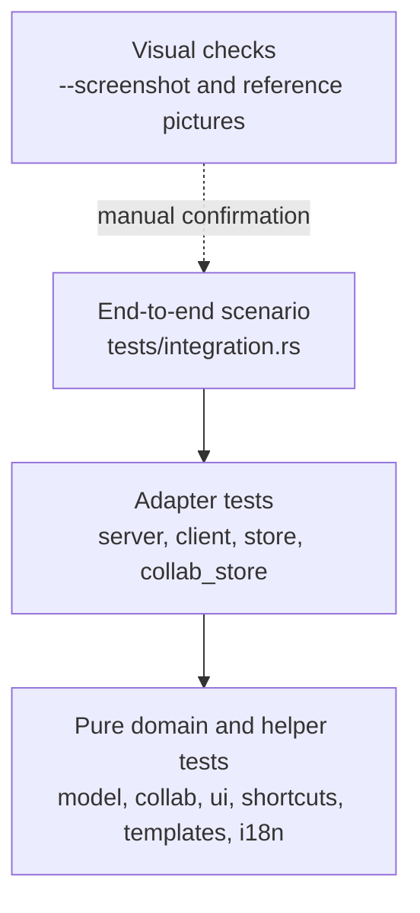
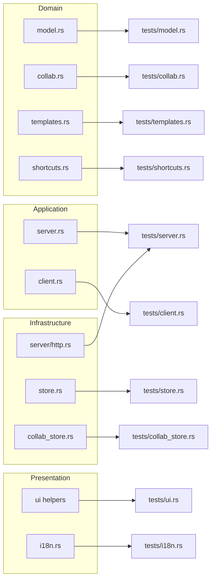
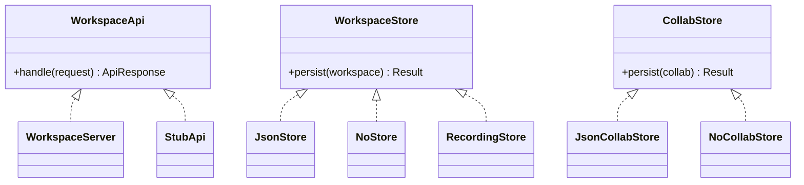

# Testing guide — ion-of-notes

This document explains the test strategy, the test-crate layout, the shared
fixtures, and the red → green → refactor discipline. It is the practical
companion to `AGENTS.md` (TDD rules) and `docs/contributor-guide.md` (the
workflow).

## 1. Principles

1. **No production code without a failing test first.** For a pure move or
   rename, the red step is a compile failure caused by the new module
   declaration before the code is moved.
2. **Tests use public interfaces only.** A test imports `ion_of_notes::…`; it
   never reaches into a private function.
3. **Tests never live in `src/`.** No `#[cfg(test)]` block is allowed there.
4. **One integration-test crate per module**, named after the module
   (`tests/model.rs`, `tests/server.rs`, …).
5. **Shared helpers live once** in `tests/common/mod.rs` (DRY).
6. **Determinism:** unique temporary paths, no wall-clock assertions, no
   listener left running, no network dependency, no test-order dependency.

## 2. Test pyramid in this project

The project is a desktop app with a clean domain, so the pyramid is weighted
towards fast integration tests around the seams rather than a separate unit
test suite.



| Level | What it proves | Cost |
| ----- | -------------- | ---- |
| Pure tests | rules, ranking, diff, filters, parsing, formatting | milliseconds |
| Adapter tests | routes, envelopes, persistence, HTTP parsing, concurrency | milliseconds |
| End-to-end | client + server + store work together | milliseconds |
| Visual checks | the window still matches the reference pictures | seconds, manual |

## 3. Test-crate map (286 tests across the two feature passes, 2026-11-12)

| File | Tests | Covers |
| ---- | ----: | ------ |
| `tests/model.rs` | 26 | entities, tree, search, diff, index, settings, comments, JSON round-trip |
| `tests/server.rs` | 12 | routes, envelopes, status codes, HTTP parse/format, concurrent loopback |
| `tests/collab.rs` | 12 | members, shares, access resolution, sync log, versions, export, realtime contract |
| `tests/ui.rs` | 22 | palette, block menu, status colors, commit plan, debounce, invite parsing, Library filters, settings matcher/row filtering, search cache, desktop feature seam |
| `tests/client.rs` | 15 | typed client methods, v1/v2 error mapping, retry policy, encode/decode failures |
| `tests/contract.rs` | 18 | v2 versioning, structured errors, auth, capabilities, request IDs, HTTP headers |
| `tests/pagination.rs` | 11 | list envelopes, cursor round-trip, page bounds, v2 pages/search/sync/versions |
| `tests/blocks.rs` | 12 | rich text, block metadata, nesting, tables, unsupported types, block endpoints |
| `tests/properties.rs` | 9 | property schemas/values, clear rules, row migration, databases/data sources, property items |
| `tests/views.rs` | 10 | view CRUD, filters/sorts, board/calendar grouping, query pagination |
| `tests/comments.rs` | 8 | comment CRUD/pagination, attachments, users, file uploads |
| `tests/webhooks.rs` | 13 | subscriptions, verification, signatures, injected sender, delivery/retry, persistent outbox, dead letter/requeue |
| `tests/shared_limits.rs` | 2 | SQLite shared workspace budget and window reset |
| `tests/web.rs` | 11 | Axum adapter, request IDs, Retry-After, body limits, query strings, webhooks, `/ready`, `/metrics` |
| `tests/realtime.rs` | 7 | WebSocket auth, ready, backlog, live change, presence, awareness, ping |
| `tests/crdt.rs` | 3 | Yrs convergence, server projection, WebSocket CRDT sync |
| `tests/ui_crdt.rs` | 5 | client Yrs diff, empty-sync baseline, projection, convergence |
| `tests/remote.rs` | 4 | login, remote REST/CRDT and WebSocket change/awareness, remembered session |
| `tests/auth.rs` | 7 | Argon2id, login, logout, demo token, sessions, SQLite restart, password-file secret |
| `tests/sqlite_store.rs` | 3 | workspace/collab round-trip, accounts/sessions, JSON migration |
| `tests/limits.rs` | 14 | rate/workspace budgets, size/block boundaries, block limit, 409/503/529, Retry-After |
| `tests/shortcuts.rs` | 8 | shortcut table, exactness, focus/modifier guard |
| `tests/ollama.rs` | 7 | endpoint parsing, request/response decoding, chunked bodies, status |
| `tests/collab_store.rs` | 6 | collaboration JSON round-trip, seed/corrupt fallback, restart restore, failing store |
| `tests/fidelity.rs` | 6 | chrome colors, strong font, tab truncation, seeded page shape |
| `tests/store_port.rs` | 5 | injectable store, failing store → `500`, null store |
| `tests/store.rs` | 5 | JSON save/load, atomic write, missing file seed, workspace catalog |
| `tests/cli.rs` | 3 | argument parsing for desktop, screenshot and serve |
| `tests/templates.rs` | 3 | template catalog, stable page building, purpose mapping |
| `tests/app.rs` | 4 | composition root wiring, replace-workspace, core-without-desktop feature seam |
| `tests/i18n.rs` | 2 | key completeness across locales, fallback |
| `tests/deployment.rs` | 6 | Dockerfile, Compose hardening, Caddy TLS, build profiles, toolchain pins |
| `tests/smoke.rs` | 1 | real listener: health/ready/metrics and authenticated v2 workspace |
| `tests/screenshot.rs` | 2 | `ColorImage` → RGBA, PNG output |
| `tests/integration.rs` | 1 | client → server → store end to end |

Run the two feature passes:

```sh
# 235 core tests: no eframe/egui/wgpu, no binary and no UI test crates
cargo test --all-targets --no-default-features

# 26 desktop tests: the four UI crates, with the default-on desktop feature
cargo test --features desktop --test ui --test fidelity --test ui_crdt --test screenshot

cargo clippy --all-targets -- -D warnings
cargo clippy --all-targets --no-default-features -- -D warnings
cargo fmt --check

# Or run the full gate, including the Markdown checks:
pwsh -File scripts/quality.ps1
```

`cargo test --all-targets` still runs all default-feature tests (254) with the
`desktop` feature, but it links the window into every test binary. Prefer the
two passes above; they are the gate used by `scripts/check-tests.ps1`
(spec-048) and cover 261 unique tests because each feature pass includes its
own seam test.

### 3.1 Build profile and feature seam

- `desktop` is a default-on cargo feature; `eframe`, `egui`, `image`, `ui` and
  `screenshot` are absent under `--no-default-features`.
- The binary and `tests/ui.rs`, `tests/fidelity.rs`, `tests/ui_crdt.rs` and
  `tests/screenshot.rs` declare `required-features = ["desktop"]`, so the core
  pass skips them.
- `[profile.test] debug = 0` removes full debug info (the old 220-270 MB PDBs);
  the remaining per-test PDBs are about 4-15 MB.
- `[profile.dev] debug = "line-tables-only"` keeps file/line backtraces for the
  app while shrinking its PDB.
- Incremental compilation stays enabled and Cargo keeps its default job count;
  the gate does not set `-j` or `CARGO_INCREMENTAL`.

### 3.2 Runtime smoke tests

The Rust suite does not start the shipped binary or build Docker images.
`cargo test --test smoke` is the no-Docker listener smoke and runs in the normal
test passes. Run the artifact smokes when startup wiring, the listener,
`Dockerfile`, `compose.yml` or the headless binary changes (spec-067):

```sh
cargo test --test smoke                 # real listener, health/ready/metrics/v2
pwsh -File scripts/smoke-server.ps1     # headless binary + temp SQLite + page
pwsh -File scripts/smoke-docker.ps1     # opt-in Compose build + volume restart
```

`smoke-server.ps1` builds the release server binary unless `-SkipBuild` is
passed, uses a free loopback port and a temporary database, and always stops
the process. `smoke-docker.ps1` exits cleanly when Docker is unavailable and
uses an isolated `ion-of-notes-smoke-data` volume, so it never touches the
normal `ion-data` volume. The Docker smoke checks `/health`, `/ready`,
`/metrics`, the v2 workspace, a page write/read and persistence across
`--force-recreate`.

Manual container checks remain useful for TLS and multi-arch:

```sh
ION_OF_NOTES_OWNER_PASSWORD=test docker compose config
ION_OF_NOTES_DOMAIN=notes.example.com docker compose -f compose.prod.yml config
docker buildx bake --print
```

`docker compose up --build` must become healthy on `/health`; create
`secrets/owner_password.txt` from the example first. The hardened stack must
show `127.0.0.1:8787:8787`, `read_only: true`, `cap_drop: [ALL]`,
`no-new-privileges` and the `owner_password` secret in `docker compose config`.
For the production manifest, `compose.prod.yml` must show Caddy on 80/443 and
no host port on the app; the `--profile backup` config must include the backup
service. See `docs/deployment.md` for backups, TLS and upgrade checks.

### 3.3 Supply-chain checks

The toolchain and CI inputs are pinned (spec-053):

- `rust-toolchain.toml` selects Rust `1.99.1` with `rustfmt` and `clippy`.
- GitHub Actions are referenced by commit SHA with a version comment; Docker
  and GitLab base images are referenced by digest.
- `renovate.json` groups Cargo, GitHub Actions and Docker updates.
- A `security` job runs `cargo audit` on both CI systems. Locally:

```sh
cargo install cargo-audit --locked   # once
cargo audit
```

Unmaintained-crate warnings are reported but do not fail the audit; a
vulnerability fails it. `cargo deny` (licenses/bans) remains a future step.

### 3.4 Remote and webhook checks

- `tests/webhooks.rs` covers the persistent outbox, restart delivery,
  dead-lettering and requeue.
- `tests/remote.rs` covers the remembered session file in addition to login,
  REST/CRDT and WebSocket behavior.
- The webhook worker interval can be shortened for a manual check with
  `ION_OF_NOTES_WEBHOOK_INTERVAL_SECS=1` when running `--serve`.
- Remote session file: `remote-session.json` beside `workspace.json`; delete it
  or use Disconnect to clear it. The password is never written.

## 4. What each layer tests



### Domain tests

- **model:** tree operations, duplicate ids, subtree deletion, breadcrumbs,
  ranked search, plain text, JSON round-trip, todo toggle, block kind change,
  version bump, `PageDiff`, the derived index and its safe fallback,
  `WorkspaceSettings`, page flags and comments, archived filtering.
- **collab:** role/access labels, seeded owner and general access, invite,
  most-specific-first access, sync cursor, markdown/CSV export, realtime
  contract, version retention and newest-first order.
- **templates:** unique ids, stable page/block ids, purpose → template mapping.
- **shortcuts:** exact lookup, no ambiguous combos, context guard (focus,
  pointer, modifiers).

### Application tests

- **server:** every route, envelope shape, `400`/`404`/`500`, HTTP parsing and
  formatting, concurrent connections.
- **client:** typed methods, `ClientError::Http`/`Decode`/`Encode`, per-page
  update, version reads.

### Infrastructure tests

- **store:** atomic save, load, seed on missing file, no temporary file left.
- **collab_store:** round-trip, missing/corrupt file, restart restore, failing
  store → `500`.
- **server/http:** covered through `tests/server.rs`; no separate crate.

### Presentation tests

Pure helpers only: palette colors, block menu, status colors, commit plan,
debounce, invite parsing, Library filtering, settings matching, search cache.
Rendering itself is verified with `--screenshot` because it needs a GPU/window
context.

## 5. Test doubles and ports

The ports are small, so fakes are small:

| Port | Fake / adapter | Used for |
| ---- | -------------- | -------- |
| `WorkspaceApi` | `StubApi` in `tests/client.rs` | force status codes and malformed bodies |
| `WorkspaceApi` | real `WorkspaceServer` | most client and integration tests |
| `WorkspaceStore` | `RecordingStore`, failing store | prove injection and error propagation |
| `CollabStore` | failing store | prove `500` on collaboration writes |
| `NoStore`, `NoCollabStore` | null objects | in-memory server |



## 6. Writing a new test

1. Put it in the crate that matches the module under test.
2. Use a unique path from `tests/common/mod.rs` for anything on disk.
3. Assert observable behavior, not private structure.
4. Name the test after the rule it protects
   (`sync_log_returns_only_changes_after_the_cursor`), not after the function.
5. Run it and **observe red** before writing the implementation.
6. Run the whole suite; a new test must not rely on another test's state.

Example shape:

```rust
#[test]
fn version_history_keeps_the_newest_fifty_snapshots() {
    // arrange: a page and 55 versions
    // act: record one more version
    // assert: 50 remain, newest first, other pages untouched
}
```

## 7. Determinism checklist

- Use `tests/common::temp_path("name")`, not a fixed file name.
- Never assert on `chrono::Utc::now()` values; assert that a timestamp is
  non-empty or that it changed.
- Bind the loopback listener to `127.0.0.1:0` and read the assigned port.
- Join threads and drop listeners before the test returns.
- Do not depend on environment variables unless the test sets them itself.

## 8. Visual verification

Unit tests cannot prove the window looks right. After a UI change:

```sh
cargo run -- --screenshot shots/now.png
```

Then compare the PNG by eye with `reference/` (98 source-of-truth pictures:
the original 29 plus the later build) and `screenshots/` (72 local later UI
pictures). Use the preview hook to open a specific state:

```sh
ION_OF_NOTES_SHOW=settings-general cargo run -- --screenshot shots/settings.png
```

The hook is inert in normal runs and in the rebuild check.

## 9. What is intentionally not tested

- GPU rendering and pixel-exact layout (verified visually).
- Real email delivery, real AI model output, and real network services.
- The original product's server behavior (unknown and out of clean-room scope).
- Production auth, PostgreSQL and WebSocket transports (decided, not built).

## 10. v2 contract tests

The public-API alignment roadmap (specs 030–038) adds new test areas. The
specs 030–038 are implemented:

| Area | Test crate |
| ---- | ---------- |
| v2 versioning, errors, capabilities, request IDs | `tests/contract.rs` (implemented) |
| pagination and list envelopes | `tests/pagination.rs` (implemented) |
| rich text, block metadata, block children | `tests/blocks.rs` (implemented) |
| page properties, data sources, property items | `tests/properties.rs` (implemented) |
| views, filters, sorts, queries | `tests/views.rs` (implemented) |
| comments, users, files, uploads | `tests/comments.rs` (implemented) |
| webhook verification, signatures, retries | `tests/webhooks.rs` (implemented) |
| rate/size/block limits | `tests/limits.rs` (implemented) |
| Axum HTTP adapter and B5 contract suite | `tests/web.rs` (implemented) |
| sessions, Argon2id, SQLite, JSON migration | `tests/auth.rs`, `tests/sqlite_store.rs` (implemented) |
| WebSocket change feed and presence | `tests/realtime.rs` (implemented) |
| TLS webhook sender and shared SQLite limits | `tests/webhooks.rs`, `tests/shared_limits.rs` (implemented) |
| Yrs CRDT text merge and WebSocket sync | `tests/crdt.rs` (implemented) |
| client Yrs session and awareness | `tests/ui_crdt.rs`, `tests/realtime.rs` (implemented) |
| remote REST/WebSocket transport | `tests/remote.rs` (implemented) |

These are written before implementation, following the same red → green rule.
Contract tests drive the real `Client` against the v2 mock, not against the
public Notion service.

## 11. Definition of done for a spec

- [ ] Tests were written first and observed red.
- [ ] `cargo test --all-targets` is green.
- [ ] `cargo clippy --all-targets -- -D warnings` is clean.
- [ ] `cargo fmt --check` is clean.
- [ ] `--screenshot` was checked if the UI changed.
- [ ] Requirements, data model, ADR, docs and `CHANGELOG.md` are updated.
- [ ] The spec is committed with a message naming it.
