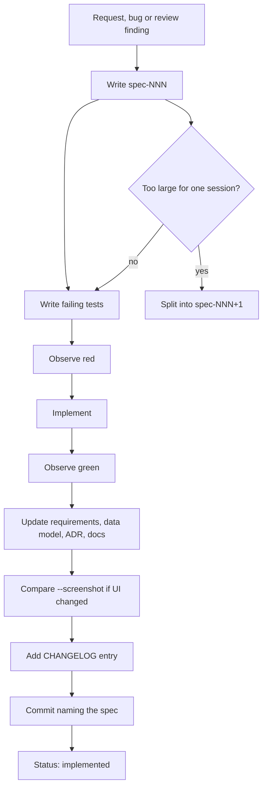

# Spec index — ion-of-notes

Every feature starts here. A spec is the boundary of one working session:
nothing outside its scope is built in that session. This index is the map; the
individual files are the source of truth for their scope and acceptance
criteria.

## 1. Lifecycle



Status vocabulary:

| Status | Meaning |
| ------ | ------- |
| **implemented** | Code, tests, docs and changelog are complete and committed |
| **in progress** | This session is actively working on it |
| **plan** | A scoped plan; some phases may still be open |
| **retired** | Kept as history; superseded by a later decision |
| **blocked** | Cannot proceed without a new decision or external input |

## 2. Index

| Spec | Title | Status | Notes |
| ---- | ----- | ------ | ----- |
| [001](spec-001-project-foundation.md) | Project foundation, documentation, build skeleton | implemented | Rules, docs, Cargo skeleton |
| [002](spec-002-domain-model.md) | Workspace domain model, page tree, search | implemented | Tests now live in `tests/model.rs` (spec-008) |
| [003](spec-003-workspace-server.md) | Workspace server, API, persistence, loopback | implemented | Core routes and HTTP adapter |
| [004](spec-004-client-layer.md) | API client used by the desktop UI | implemented | `Client<A: WorkspaceApi>` |
| [005](spec-005-desktop-ui.md) | Desktop window, blocks, table, search, theme | implemented | First UI |
| [006](spec-006-screenshot-mode.md) | Screenshot option for visual checks | implemented | `--screenshot` |
| [007](spec-007-free-and-open-for-all.md) | Free and open for all | **retired** | Superseded by ADR-003 (accounts, no marketing card) |
| [008](spec-008-modular-architecture.md) | Modular architecture, separated tests | implemented | Tests moved to `tests/`, `WorkspaceStore` port |
| [009](spec-009-visual-fidelity.md) | Visual fidelity against the reference pictures | implemented | 29 at the time; the set is now 98 plus 72 screenshots |
| [010](spec-010-architecture-guidelines.md) | Architecture guidelines and composition root | implemented | `src/app.rs`, ADR-002 |
| [011](spec-011-collaborative-server.md) | Self-hosted client/server, decided API | implemented | First slice; `CollabStore` closed in spec-019 |
| [012](spec-012-interaction-polish.md) | Frameless window, tabs, shortcuts, Ollama | implemented | `shortcuts.rs`, `ollama.rs` |
| [013](spec-013-interaction-polish-and-modularity.md) | Interaction polish, bugs, modularity | implemented | ADR-004, `switcher`, `page_icon` |
| [014](spec-014-bug-fixes-and-improvements.md) | Bug fixes and improvements | implemented | Batch of editor/settings/UI fixes |
| [015](spec-015-hardening-and-performance.md) | Hardening, missing surfaces, performance | implemented | Settings filter, versions, cache, atomic save |
| [016](spec-016-architecture-follow-up-and-observation.md) | Architecture follow-up and clean-room observation | **plan** | A1–A10 done; B1/B2/B4 done; B3 blocked; B5 pending |
| [017](spec-017-ui-modularization.md) | UI modularization refactor | implemented | `ui/commands`, `view`, `input`, `apply`, `render/*`, `dialogs/*` |
| [018](spec-018-domain-and-infrastructure-modularization.md) | Domain and infrastructure modularization | implemented | `model/*`, `collab/export.rs`, `server/http.rs` |
| [019](spec-019-collaboration-persistence.md) | Collaboration persistence | implemented | `CollabStore`, `collab.json` |
| [020](spec-020-per-page-writes-and-debounce.md) | Per-page writes and debounce | implemented | `PageDiff`, `CommitPlan`, 250 ms |
| [021](spec-021-quality-and-concurrency-baseline.md) | Quality and concurrency baseline | implemented | `ClientError::Encode`, concurrent `--serve`, CI, fmt |
| [022](spec-022-workspace-index-and-version-retention.md) | Workspace index and version retention | implemented | `WorkspaceIndex`, 50 versions/page |
| [023](spec-023-add-members-sharing-dialog.md) | Add members / sharing dialog | implemented | Functional Share popover |
| [024](spec-024-library-views.md) | Library views | implemented | Recents/Favorites/Shared/Private, More menu |
| [025](spec-025-settings-pages.md) | Settings pages | implemented | General/Sidebar/People/Offline, persisted settings |
| [026](spec-026-page-actions-and-comments.md) | Page actions and comments | implemented | TOC, discussions, archive, copy contents |
| [027](spec-027-onboarding-and-templates.md) | Onboarding and templates | implemented | Purpose modal, starter catalog |
| [028](spec-028-i18n-coverage.md) | Internationalization coverage | implemented | en / pt-BR / eo key tables |
| [029](spec-029-documentation-and-contributor-guide.md) | Documentation and contributor guide | implemented | Documentation hub and review |
| [030](spec-030-api-v2-foundation.md) | API v2 foundation: versioning, errors, capabilities | implemented | `/api/v2`, `ApiError`, capabilities, request IDs |
| [031](spec-031-pagination.md) | Cursor pagination and list responses | implemented | `ListResponse`, opaque cursors, client helpers |
| [032](spec-032-rich-text-and-blocks.md) | Rich text and the block model | implemented | RichText, metadata, children, block endpoints |
| [033](spec-033-page-properties-and-data-sources.md) | Page properties and data sources | implemented | Typed properties, databases, data sources, migration |
| [034](spec-034-views-and-database-layouts.md) | Views and database layouts | implemented | View CRUD, filters/sorts, board/calendar grouping |
| [035](spec-035-comments-users-and-files.md) | Comments, users and files | implemented | Comment CRUD, users, file uploads |
| [036](spec-036-webhooks-and-event-delivery.md) | Webhooks and event delivery | implemented | Subscriptions, signatures, retries, all documented events |
| [037](spec-037-limits-and-operations.md) | Limits, rate limiting and operations | implemented | Rate/size/block limits, retry policy, operational errors |
| [038](spec-038-axum-web-server-and-contract-suite.md) | Axum web server and contract suite | implemented | Axum/Tokio adapter, B5 contract suite, graceful shutdown |
| [039](spec-039-sessions-and-sqlite-storage.md) | Sessions, Argon2id and SQLite storage | implemented | SQLite ports, login/logout/session, JSON migration |
| [040](spec-040-realtime-websocket-change-feed.md) | Real-time WebSocket change feed and presence | implemented | WS auth, backlog resume, change broadcast, presence |
| [041](spec-041-tls-webhooks-and-shared-limits.md) | TLS webhooks and shared rate limits | implemented | ureq/rustls sender, SQLite rate-limit store |
| [042](spec-042-yrs-crdt-merge.md) | Yrs CRDT text merge | implemented | Per-page Yrs text, WebSocket sync/update, projection |
| [043](spec-043-client-yrs-and-awareness.md) | Client-side Yrs and awareness | implemented | UI session, in-process CRDT, carets/selections |
| [044](spec-044-remote-websocket-client.md) | Remote WebSocket client transport | implemented | ureq REST + background WS, `--server`/`--token` |

## 3. Work status

| Item | Where | Status |
| ---- | ----- | ------ |
| B5 — broader mock server + contract suite | spec-016 | **Implemented:** Axum adapter + `tests/web.rs` (spec-038) |
| A9 — settings row filtering inside the open section | spec-016 | **Implemented:** per-page row table and filtered rendering |
| B4 — derive the contract from public API docs | spec-016 / ADR-006 | **Reviewed 2026-11-08**; specs 030–038 implemented |
| B3 - own-account HAR | spec-016 | **Blocked** by the strict B1 scope; needs a new decision |
| v2 foundation | spec-030 | **Implemented:** versioning, errors, capabilities |
| v2 pagination | spec-031 | **Implemented:** cursor lists |
| v2 rich text/blocks | spec-032 | **Implemented:** rich text, metadata, children |
| v2 properties/data sources | spec-033 | **Implemented:** typed schema, values, migration |
| v2 views | spec-034 | **Implemented:** CRUD, filters/sorts, grouping |
| v2 comments/users/files | spec-035 | **Implemented:** comments, users, uploads |
| v2 webhooks | spec-036 | **Implemented:** subscriptions, signatures, retries, all documented events |
| v2 limits | spec-037 | **Implemented:** rate/size/block limits, retry policy |
| Persist the selected language | spec-028 follow-up | Add to `WorkspaceSettings` or local config |
| Send or remove the invite message | spec-023 follow-up | Add `message` to `MemberDraft` or drop the UI field |
| Block-anchored inline comments | spec-026 follow-up | Model + tests |
| Production auth / WebSocket / PostgreSQL | ADR-003 | **Sessions + SQLite (039), WebSocket (040), TLS webhooks/shared limits (041), Yrs CRDT (042), client awareness (043) and remote WS client (044) done;** next: account UI, PostgreSQL |

## 4. Spec template

```markdown
# spec-NNN — Short title

## Purpose and scope
What this session changes, and what it deliberately does not.

## Evidence
Pictures, public docs, code findings, requirements.

## Acceptance criteria
Given / When / Then.

## Test scenarios (written before implementation)
Which test crates and test names.

## Design
Where the code goes and why.

## Plan / tasks
- [ ] ...
```

## 5. Rules

1. One spec is one working session. Split rather than sprawl.
2. Acceptance criteria are observable, not implementation steps.
3. Test scenarios are listed before implementation.
4. A spec that changes behavior updates `docs/requirements.md`; a new entity
   updates `docs/data-model.md`; a new route updates `docs/api-contract.md`.
5. A completed spec is committed in the same session with a message naming it.
6. A retired spec keeps a status note at the top and is not silently rewritten.
7. Historical plans keep their checkboxes honest: `[x]` only when the item is
   actually done, with a note when a later spec completed it.
