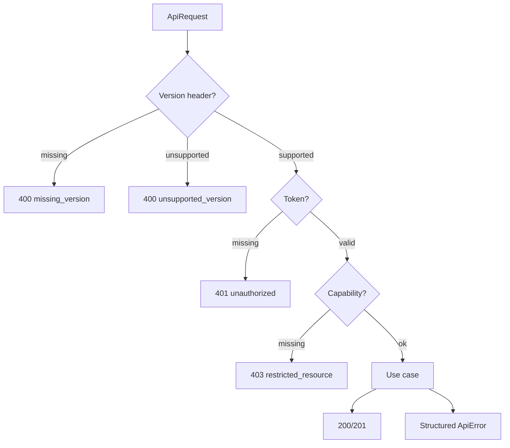

# spec-030 — API v2 foundation: versioning, errors and capabilities

## Purpose and scope

The public Notion API (B4 review, `docs/public-api-analysis.md`) shows three
foundational contracts our loopback API lacks: a required version header, a
structured error object with stable codes and request IDs, and
capability-based permissions. This spec defines our own **v2 contract
foundation** behind the existing `WorkspaceApi` seam.

In scope:

- a required `Not-Notion-Version` header for `/api/v2` requests;
- a structured `ApiError` object with `status`, `code`, `message`,
  `request_id` and optional `additional_data`;
- request IDs echoed in responses and logs;
- a `Capability` enum and a `Connection`/token model that gates read, update,
  insert, comment and user-info access;
- `/api/v2` route prefix with v1 loopback routes kept stable;
- typed client support for v2 errors and capabilities;
- contract tests for the new foundation.

Out of scope:

- OAuth or third-party identity; sessions remain self-hosted email/password
  (ADR-003);
- pagination (spec-031), rich text/blocks (spec-032), properties/data sources
  (spec-033), views (spec-034), comments/files (spec-035), webhooks
  (spec-036), limits (spec-037);
- changing the existing v1 loopback behavior.

## Evidence

Public documentation:

- <https://developers.notion.com/reference/intro> — Bearer token,
  `Notion-Version`, `object` discriminator, snake_case, ISO 8601.
- <https://developers.notion.com/reference/status-codes> — error object,
  stable codes, `request_id`, `additional_data`.
- <https://developers.notion.com/reference/versioning> — required version
  header, additive changes, opaque cursors, ignore unknown fields.
- <https://developers.notion.com/reference/capabilities> — read/update/insert
  content, read/insert comments, user-info levels, minimum capabilities.
- <https://developers.notion.com/reference/changes-by-version> — versioned
  breaking changes.

Current code:

- `src/server.rs`: `ApiRequest { method, path, body }`, `ApiResponse { status,
  body }`, `Envelope<T> { data, error }`, `WorkspaceApi::handle`.
- `src/client.rs`: `ClientError::{Http, Decode, Encode}`.
- `src/collab.rs`: `Role`, `Access`, `Member`, `Share`.
- `src/server/http.rs`: loopback HTTP adapter with no headers or version check.

## Acceptance criteria

1. **Given** a `/api/v2` request without `Not-Notion-Version`, **when** it is
   handled, **then** it returns `400` with `code: "missing_version"` and no
   mutation occurs.
2. **Given** an unsupported version, **when** it is handled, **then** it
   returns `400` with `code: "unsupported_version"` and the supported versions
   in `additional_data`.
3. **Given** a malformed JSON body, **when** it is handled, **then** it returns
   `400` with `code: "invalid_json"`.
4. **Given** a schema mismatch, **when** it is handled, **then** it returns
   `400` with `code: "validation_error"` and a useful `message`.
5. **Given** a missing or invalid token, **when** a v2 request is handled,
   **then** it returns `401` with `code: "unauthorized"`.
6. **Given** a valid token without the required capability, **when** a v2
   request is handled, **then** it returns `403` with
   `code: "restricted_resource"` and the missing capability.
7. **Given** any v2 response, **when** it is inspected, **then** it contains a
   `request_id` that also appears in the server log.
8. **Given** a v1 request, **when** it is handled, **then** its existing
   envelope and status behavior are unchanged.
9. **Given** a client call, **when** a v2 error is returned, **then**
   `ClientError` exposes the code, message, request id and additional data.
10. **Given** a capability set, **when** a content mutation is attempted,
    **then** read/update/insert are checked separately.

## Test scenarios (written before implementation)

- `tests/server.rs`:
  - missing version → 400 `missing_version`;
  - unsupported version → 400 `unsupported_version`;
  - invalid JSON → 400 `invalid_json`;
  - validation error → 400 `validation_error`;
  - missing token → 401 `unauthorized`;
  - missing capability → 403 `restricted_resource`;
  - request id present and stable in the response.
- `tests/client.rs`: v2 error decoding into a structured `ClientError`.
- `tests/collab.rs`: capability checks for read/update/insert/comment/user-info.
- `tests/integration.rs`: v1 request still works unchanged.

## Design

### Contract types

```rust
pub const API_V2_VERSION: &str = "2026-11-08";

pub struct ApiError {
    pub object: &'static str,          // "error"
    pub status: u16,
    pub code: String,                  // "validation_error", ...
    pub message: String,
    pub request_id: String,
    pub additional_data: Option<serde_json::Value>,
}

pub struct ApiRequest {
    pub method: Method,
    pub path: String,
    pub body: Option<String>,
    #[serde(default)]
    pub headers: BTreeMap<String, String>,
}
```

- Add `headers` with a serde default so existing constructors keep working.
- Add `WorkspaceServer::handle_v2` or a version-aware dispatch; v1 stays the
  existing `handle`.
- The HTTP adapter copies request headers into `ApiRequest.headers` and writes
  the response `request_id` header.
- `Client` gains `handle_v2`/typed v2 methods; v1 methods remain.

### Capabilities

```rust
pub enum Capability {
    ReadContent,
    UpdateContent,
    InsertContent,
    ReadComments,
    InsertComments,
    UserInfoNone,
    UserInfoWithoutEmail,
    UserInfoWithEmail,
}
```

- A `Connection` owns a token hash, member id, capability set and workspace id.
- `Access` remains the per-page share level; capabilities gate the connection
  as a whole, matching the public model.
- A capability check runs in the transport/use-case layer, never in the domain.

### Versioning

- `Not-Notion-Version: 2026-11-08` is required on `/api/v2`.
- Additive changes do not bump the version; breaking changes do.
- Responses may add fields; clients must ignore unknown fields.
- Cursors are opaque (spec-031).



## Plan / tasks

- [x] Spec + failing tests (red).
- [x] Add `ApiError`, `request_id` and `headers` to the contract.
- [x] Add version validation and v2 dispatch.
- [x] Add `Capability`/`Connection` and permission checks.
- [x] Add typed client error decoding.
- [x] Update `docs/api-contract.md`, `docs/public-api-analysis.md`,
  `docs/requirements.md`, `docs/data-model.md`, `AGENTS.md`.
- [x] Build/test/clippy/fmt, commit.

## Result

- New `src/server/contract.rs`: `API_VERSION`, `ApiError`, `Capability`,
  `Connection`, `RequestLogEntry`, bearer parsing and request IDs.
- `ApiRequest` carries case-insensitive headers; `ApiResponse` carries an
  optional request ID; the HTTP adapter echoes `X-Request-Id`.
- `/api/v2` validates the version, bearer token and capability, then reuses the
  v1 use cases; errors are structured `ApiError` bodies.
- `Client::with_token` and the `*_v2` methods decode structured errors as
  `ClientError::Api`.
- Tests: 17 in `tests/contract.rs` plus 4 v2 client tests; the suite is 136
  tests. v1 behavior is unchanged.

## Requirement mapping

| Requirement | How |
| ----------- | --- |
| New FR (versioned v2 contract) | `Not-Notion-Version` and `/api/v2` |
| New FR (structured errors) | `ApiError` with stable codes |
| New FR (capabilities) | `Capability` + `Connection` |
| NFR (observability) | `request_id` in every response |
| NFR (compatibility) | v1 routes unchanged |
