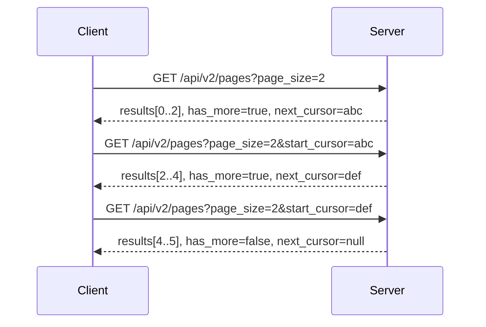

# spec-031 — Cursor pagination and list responses

## Purpose and scope

The public API paginates every list endpoint with `start_cursor` and
`page_size`, and returns `{ object: "list", results, has_more, next_cursor }`.
Our v1 endpoints return full arrays, which will not scale and cannot support a
stable sync UI. This spec adds a reusable cursor-pagination contract to
`/api/v2`.

In scope:

- a generic `ListResponse<T>` with `object: "list"`, `type`, `results`,
  `has_more` and `next_cursor`;
- opaque cursor encoding/decoding in one pure module;
- `page_size` (1–100, default 100) for pages, search, members, comments,
  versions and sync;
- stable ordering rules per endpoint;
- a client helper that follows cursors safely;
- tests for first page, next page, last page, invalid cursor and page size.

Out of scope:

- property-item pagination (spec-033);
- view-query pagination (spec-034);
- infinite scroll UI (a later UI spec);
- changing v1 endpoints.

## Evidence

- <https://developers.notion.com/reference/pagination> — `start_cursor`,
  `page_size`, `results`, `has_more`, `next_cursor`, opaque cursors, 1–100.
- <https://developers.notion.com/reference/versioning> — do not parse or store
  cursors; only pass them back.
- `docs/public-api-analysis.md` §4.

Current code: `GET /api/pages`, `GET /api/members`, `GET /api/shares`,
`GET /api/search`, `GET /api/sync` and `GET /api/pages/{id}/versions` return
full arrays.

## Acceptance criteria

1. **Given** 5 pages and `page_size=2`, **when** the first page is requested,
   **then** 2 results are returned with `has_more: true` and a non-null
   `next_cursor`.
2. **Given** the returned cursor, **when** it is passed back unchanged,
   **then** the next 2 results are returned and the union has no duplicates.
3. **Given** the final page, **when** it is requested, **then**
   `has_more: false` and `next_cursor: null`.
4. **Given** no `page_size`, **when** a list is requested, **then** the default
   is 100.
5. **Given** `page_size=0` or `page_size=101`, **when** requested, **then**
   the server returns `400 validation_error`.
6. **Given** a malformed or tampered cursor, **when** requested, **then** the
   server returns `400 invalid_cursor` and does not leak internal offsets.
7. **Given** an empty list, **when** requested, **then** `results: []`,
   `has_more: false`, `next_cursor: null`.
8. **Given** a mutation between pages, **when** the cursor is followed,
   **then** the documented ordering rule keeps the traversal stable enough for
   sync (no silent duplicate or skipped page beyond the documented semantics).

## Test scenarios (written before implementation)

- `tests/server.rs`:
  - first page, next page, final page;
  - default and boundary page sizes;
  - invalid cursor;
  - empty list;
  - stable order for pages and versions.
- `tests/client.rs`: `Client::list_all` follows cursors and stops at the end.
- `tests/ui.rs`: pure cursor helper does not parse or mutate a cursor.
- Existing v1 list tests remain green.

## Design

```rust
pub struct ListResponse<T> {
    pub object: &'static str,       // "list"
    pub r#type: String,             // "page", "member", "comment", ...
    pub results: Vec<T>,
    pub has_more: bool,
    pub next_cursor: Option<String>,
}
```

- `src/server/pagination.rs`:
  - `PageRequest { start_cursor: Option<String>, page_size: Option<u16> }`;
  - `Cursor { offset: usize, sort: String }`;
  - `encode`/`decode` as URL-safe base64 of a small JSON payload;
  - `validate_page_size` (1..=100, default 100).
- Each list route slices a deterministic ordered vector and builds a cursor
  from the next offset plus the endpoint's sort key. Cursors are opaque to
  clients.
- `GET /api/v2/pages?page_size=&start_cursor=`
- `GET /api/v2/search?q=&page_size=&start_cursor=`
- `GET /api/v2/members?page_size=&start_cursor=`
- `GET /api/v2/shares?page=&page_size=&start_cursor=`
- `GET /api/v2/sync?since=&page_size=&start_cursor=`
- `GET /api/v2/pages/{id}/versions?page_size=&start_cursor=`
- `Client::list_pages_page`, `list_members_page`, etc., plus a generic
  `collect_pages` helper that refuses to loop forever (max page count).



## Plan / tasks

- [x] Spec + failing tests (red).
- [x] `ListResponse<T>` and `pagination` module.
- [x] v2 list routes for pages, search, members, shares, versions and sync.
- [x] Client pagination helpers.
- [x] Update `docs/api-contract.md`, `docs/requirements.md`, `docs/testing.md`.
- [x] Build/test/clippy/fmt, commit.

## Result

- `src/server/pagination.rs`: `PageRequest`, `PaginationError`, opaque
  hex-encoded cursors bound to a sort key, and `paginate`.
- `ListResponse<T>` in `src/server/contract.rs`: `object:"list"`, `type`,
  `results`, `has_more`, `next_cursor`.
- `/api/v2` list routes for pages, search, members, shares, versions and sync;
  `page_size` 1–100 with default 100; invalid cursor returns `invalid_cursor`.
- `Client` helpers: `*_page_v2` methods plus `list_pages_v2`/`search_v2`/
  `list_members_v2`/`list_shares_v2`/`sync_v2`/`page_versions_v2` follow
  cursors with a termination guard.
- Tests: 11 in `tests/pagination.rs`; the suite is 147 tests.

## Requirement mapping

| Requirement | How |
| ----------- | --- |
| New FR (paginated lists) | `ListResponse<T>` + v2 list routes |
| New NFR (scale) | bounded page size, opaque cursors |
| NFR (compatibility) | v1 list routes unchanged |
