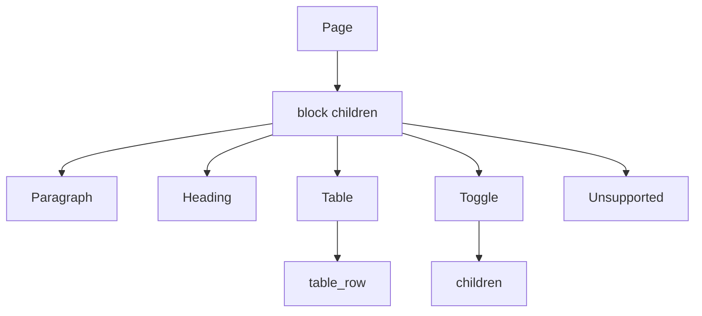

# spec-032 — Rich text and the block model

## Purpose and scope

Our current `Block` is a flat `{ id, kind, text, checked, collapsed }` with 11
kinds and plain text. The public API models a block as a typed object with
identity, parent, timestamps, users, `in_trash`, `has_children`, and an array
of rich text objects; blocks can nest and have dedicated endpoints. This spec
introduces a compatible rich-text and block model for `/api/v2`.

In scope:

- `RichText` objects: `text`, `mention`, `equation`; `annotations`,
  `plain_text`, `href`;
- block metadata: `object`, `id`, `parent`, `created_time`, `created_by`,
  `last_edited_time`, `last_edited_by`, `in_trash`, `has_children`, `type`;
- typed block payloads for the subset the UI renders: paragraph, heading 1–4,
  bulleted/numbered list item, to-do, quote, callout, code, divider, table,
  table row, toggle, child page, column list/column;
- nested `children` and block endpoints:
  `GET /api/v2/blocks/{id}`,
  `GET /api/v2/blocks/{id}/children`,
  `PATCH /api/v2/blocks/{id}/children`,
  `PATCH /api/v2/blocks/{id}`,
  `DELETE /api/v2/blocks/{id}`;
- `unsupported` blocks for types we do not render;
- backward-compatible serde for the existing `Block.text` field;
- tests for rich text, metadata, nesting, append/update/delete and pagination.

Out of scope:

- media blocks (image/video/audio/file/pdf/embed), bookmarks, equations as
  standalone blocks, synced blocks, tabs, meeting notes, templates, link
  previews (later specs);
- real-time CRDT merge (ADR-003 target);
- the full 30+ block type set;
- the UI editor rewrite (a later UI spec may consume the new model).

## Evidence

- <https://developers.notion.com/reference/block> — block keys, type list,
  children, constraints.
- <https://developers.notion.com/reference/rich-text> — text/mention/equation,
  annotations, plain_text, href, limits.
- <https://developers.notion.com/reference/pagination> — block children are
  paginated.
- <https://developers.notion.com/reference/request-limits> — 100 rich text
  objects, 2000-character content/link, 1000-character equation.
- `docs/public-api-analysis.md` §6–7.

Current code: `src/model.rs` `Block`, `BlockKind`; `src/ui/render/content.rs`;
`src/ui/apply.rs`; `src/model/seed.rs`; `src/collab/export.rs`.

## Acceptance criteria

1. **Given** a paragraph with two rich text objects (plain and bold), **when**
   it round-trips through JSON, **then** `plain_text`, annotations and `href`
   are preserved.
2. **Given** a rich text object with a link, **when** it is serialized, **then**
   the link URL is preserved; an equation preserves its expression.
3. **Given** a block, **when** it is read, **then** it has `object: "block"`,
   a UUID id, a parent object, timestamps, users, `in_trash` and
   `has_children`.
4. **Given** a page with nested blocks, **when**
   `GET /api/v2/blocks/{id}/children` is called, **then** direct children are
   returned as a paginated list, not a deep tree.
5. **Given** an append request, **when** it succeeds, **then** the new blocks
   are returned and `has_children` is updated on the parent.
6. **Given** an update request, **when** it changes a block's rich text,
   **then** the block is updated and `last_edited_time` changes.
7. **Given** a delete request, **when** it succeeds, **then** the block is
   moved to trash (`in_trash: true`) and can be restored.
8. **Given** a table, **when** it is created, **then** `table_width` is set and
   cannot be changed by an update; a table row's `cells` match the width.
9. **Given** an unsupported block type, **when** it is read, **then** it is
   returned as `type: "unsupported"` with a `block_type` field, not silently
   dropped.
10. **Given** an existing v1 page with `Block.text`, **when** it is loaded,
    **then** the text is exposed as a single rich text object and saving it
    does not lose content.

## Test scenarios (written before implementation)

- `tests/model.rs`:
  - rich text JSON round-trip for text, link, equation, mention, annotations;
  - block metadata round-trip;
  - legacy `text` → rich text migration;
  - nested children and `has_children`;
  - table width and table row cells;
  - unsupported block preservation.
- `tests/server.rs`:
  - retrieve block;
  - list children (paginated);
  - append children;
  - update block;
  - delete/restore block;
  - invalid parent / invalid block type.
- `tests/client.rs`: typed block methods.
- Existing export tests: markdown export still works.

## Design

### Rich text

```rust
pub struct RichText {
    pub r#type: RichTextType,        // text | mention | equation
    pub text: Option<TextContent>,   // content + optional link
    pub mention: Option<Mention>,
    pub equation: Option<Equation>,
    pub annotations: Annotations,
    pub plain_text: String,
    pub href: Option<String>,
}
```

- `Annotations { bold, italic, strikethrough, underline, code, color }`.
- `Mention` initially supports `page`, `user`, `date`; `database` and
  `link_preview` can be represented as `Unsupported` until needed.
- `RichText::plain()` is a helper for export and search.
- Limits are validated in the use case: 2000 chars content/link, 1000
  equation, 100 objects per array.

### Blocks

```rust
pub struct Block {
    pub object: &'static str,        // "block"
    pub id: String,
    pub parent: Parent,
    pub created_time: String,
    pub created_by: UserRef,
    pub last_edited_time: String,
    pub last_edited_by: UserRef,
    pub in_trash: bool,
    pub has_children: bool,
    pub r#type: BlockType,
    pub content: BlockContent,       // typed payload
    pub children: Vec<Block>,        // only on create/read with depth
}
```

- Keep `BlockKind` as the UI-facing enum; map it to `BlockType`.
- Keep the old `text` field as `#[serde(default)]` for v1 compatibility and
  expose `rich_text` as the new source of truth; `Block::migrate()` converts.
- `BlockContent` variants mirror the supported types; `Unsupported { block_type }`
  preserves unknown types.
- `Parent` is the parent-object DTO from spec-030 (page/block/workspace/
  data_source/database/agent).

### Endpoints

| Method | Path | Purpose |
| ------ | ---- | ------- |
| `GET` | `/api/v2/blocks/{id}` | Retrieve one block |
| `GET` | `/api/v2/blocks/{id}/children` | Paginated direct children |
| `PATCH` | `/api/v2/blocks/{id}/children` | Append children |
| `PATCH` | `/api/v2/blocks/{id}` | Update a block |
| `DELETE` | `/api/v2/blocks/{id}` | Trash a block |

- Append accepts `children: [Block]` and optional `after`/`position`.
- A table row append must match `table_width`.
- Deleting a block marks it `in_trash`; restoring is an update with
  `in_trash: false`.
- A page's content is read through its block children, not embedded in the
  page DTO (the page DTO may include a convenience `children` only on create).



## Plan / tasks

- [ ] Spec + failing tests (red).
- [ ] `RichText`, `Annotations`, `Mention`, `Equation` types.
- [ ] `Block` metadata, `BlockContent`, `Unsupported`, legacy migration.
- [ ] Block endpoints and pagination.
- [ ] Update the export and search helpers to use `plain_text`.
- [ ] Update `docs/data-model.md`, `docs/api-contract.md`,
  `docs/requirements.md`, `docs/public-api-analysis.md`.
- [ ] Build/test/clippy/fmt, commit.

## Requirement mapping

| Requirement | How |
| ----------- | --- |
| New FR (rich text) | `RichText` + annotations + mentions/equations |
| New FR (block metadata) | `Block` fields and parent object |
| New FR (block children API) | five block endpoints |
| New FR (unsupported types) | `unsupported` block representation |
| NFR (compatibility) | legacy `text` migration |
