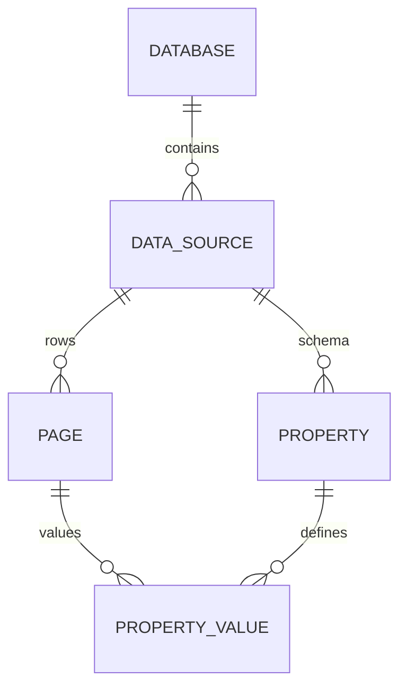

# spec-033 — Page properties and data sources

## Purpose and scope

Our inline table is a `Vec<TableRow>` with four strings. The public API models
a database as a container of one or more **data sources**, each with a
property schema, and each page in a data source carries typed **property
values**. This spec introduces that model for `/api/v2`, while keeping the
existing inline table as a compatibility view.

In scope:

- `Property` schema objects: `id`, `name`, `description`, `type`, settings;
- core property types: `title`, `rich_text`, `number`, `select`,
  `multi_select`, `status`, `date`, `checkbox`, `url`, `email`,
  `phone_number`, `people`, `files`, `relation`, `formula`, `rollup`,
  `created_time`, `created_by`, `last_edited_time`, `last_edited_by`,
  `unique_id`;
- `PagePropertyValue` objects and write/clear rules;
- `PropertyItem` and paginated property values;
- `Database` container with `data_sources`, and `DataSource` with `properties`;
- endpoints for databases, data sources and page properties;
- migration of the existing `TableRow` data to a default data source;
- tests for schema round-trip, page property values, clearing, relations,
  formulas/rollups (read-only), and property-item pagination.

Out of scope:

- views and filters/sorts (spec-034);
- `place`, `verification`, `button` (later; they are read-only or niche);
- full formula evaluation (we store the expression and a computed result only
  for a small supported subset, or return `unsupported`);
- multi-source database UI (the model supports it; the UI may use one source);
- replacing the inline table UI in the same session.

## Evidence

- <https://developers.notion.com/reference/page> — page object and
  `properties`.
- <https://developers.notion.com/reference/page-property-values> — type
  objects, write/clear rules, paginated values.
- <https://developers.notion.com/reference/property-item-object> — property
  item wrappers and pagination.
- <https://developers.notion.com/reference/database> — database container and
  `data_sources`.
- <https://developers.notion.com/reference/data-source> — data source fields
  and schema.
- <https://developers.notion.com/reference/property-object> — property types
  and settings.
- <https://developers.notion.com/reference/request-limits> — 500 properties /
  50 KB recommendation, 100 options/relations/people per request.
- `docs/public-api-analysis.md` §8–9.

Current code: `src/model.rs` `TableRow`, `Page.rows`; `src/ui/render/database.rs`;
`src/model/seed.rs`; `src/collab/export.rs`.

## Acceptance criteria

1. **Given** a data source with a `title`, `status` and `date` property,
   **when** it round-trips through JSON, **then** the schema and settings are
   preserved.
2. **Given** a page in a data source, **when** it is read, **then** its
   `properties` contain typed values keyed by property name, with stable ids.
3. **Given** a page write, **when** a property is omitted, **then** the
   existing value is preserved; an array property is replaced, not appended.
4. **Given** a clear request, **when** the type is title/rich_text/people/
   relation/multi_select/files, **then** an empty array clears it; number/url/
   email/phone/select/date clear with `null`; checkbox clears with `false`.
5. **Given** a `status` property, **when** a page value is written, **then** an
   existing option is selected by id or name; an unknown option is rejected
   unless the schema allows adding it.
6. **Given** a `relation`, **when** a page value is read, **then** it contains
   related page ids and `has_more`; the property-item endpoint paginates the
   full list.
7. **Given** a `formula` or `rollup`, **when** it is read, **then** it is
   read-only and returns a typed result or `unsupported`.
8. **Given** a database, **when** it is read, **then** it lists its
   `data_sources`; each data source exposes its own `properties` schema.
9. **Given** an existing page with `rows`, **when** the v2 model is loaded,
   **then** the rows are represented as pages in a default data source and no
   data is lost.
10. **Given** more than 25 relation or people values, **when** the page is
    read, **then** the page response may omit the excess and the property-item
    endpoint returns them paginated.

## Test scenarios (written before implementation)

- `tests/model.rs`:
  - property schema round-trip for each supported type;
  - page property value round-trip;
  - write/clear rules per type;
  - relation/people pagination flags;
  - formula/rollup unsupported result;
  - legacy `TableRow` migration.
- `tests/server.rs`:
  - create/read/update data source;
  - create/read/update page with properties;
  - property-item endpoint pagination;
  - invalid schema/value → `validation_error`.
- `tests/client.rs`: typed data source/property methods.
- Export tests: CSV still emits the expected columns.

## Design

### Schema

```rust
pub struct Property {
    pub id: String,
    pub name: String,
    pub description: Option<String>,
    pub r#type: PropertyType,
    pub config: PropertyConfig,
}

pub enum PropertyType {
    Title, RichText, Number, Select, MultiSelect, Status, Date, Checkbox,
    Url, Email, PhoneNumber, People, Files, Relation, Formula, Rollup,
    CreatedTime, CreatedBy, LastEditedTime, LastEditedBy, UniqueId,
}
```

- `PropertyConfig` holds the type-specific settings: `number.format`,
  `select.options`, `status.options/groups/default_option`,
  `relation.data_source_id/type`, `formula.expression`,
  `rollup.relation_property/rollup_property/function`, `unique_id.prefix`.
- Option ids are stable; names are unique case-insensitively and cannot
  contain commas.

### Page values

```rust
pub enum PropertyValue {
    Title(Vec<RichText>),
    RichText(Vec<RichText>),
    Number(Option<f64>),
    Select(Option<OptionRef>),
    MultiSelect(Vec<OptionRef>),
    Status(Option<OptionRef>),
    Date(Option<DateValue>),
    Checkbox(bool),
    Url(Option<String>),
    Email(Option<String>),
    PhoneNumber(Option<String>),
    People(Vec<UserRef>),
    Files(Vec<FileObject>),
    Relation(Vec<PageRef>),
    Formula(FormulaResult),
    Rollup(RollupResult),
    CreatedTime(String),
    CreatedBy(UserRef),
    LastEditedTime(String),
    LastEditedBy(UserRef),
    UniqueId { number: u64, prefix: Option<String> },
}
```

- A page in a data source stores `properties: BTreeMap<String, PropertyValue>`.
- A page whose parent is a page/workspace stores only `title`.
- Writes use property names or ids; responses key by name and include ids.

### Database and data source

```rust
pub struct Database {
    pub id: String,
    pub title: Vec<RichText>,
    pub data_sources: Vec<DataSourceRef>,
    pub parent: Parent,
    pub is_inline: bool,
    // timestamps, icon, cover, in_trash, url, public_url
}

pub struct DataSource {
    pub id: String,
    pub title: Vec<RichText>,
    pub properties: BTreeMap<String, Property>,
    pub parent: Parent,
    pub database_parent: Parent,
    // timestamps, icon, in_trash
}
```

- A database is a container; a data source owns the schema and rows.
- The current inline table becomes a default data source with `name`,
  `status`, `assignee`, `due` properties.
- `Page.rows` remains a read-only compatibility projection until the UI is
  migrated.

### Endpoints

| Method | Path | Purpose |
| ------ | ---- | ------- |
| `GET`/`POST` | `/api/v2/databases` | List/create databases |
| `GET`/`PATCH`/`DELETE` | `/api/v2/databases/{id}` | Read/update/trash |
| `GET`/`POST` | `/api/v2/databases/{id}/data_sources` | List/create sources |
| `GET`/`PATCH` | `/api/v2/data_sources/{id}` | Read/update schema |
| `POST` | `/api/v2/data_sources/{id}/query` | Query rows |
| `GET` | `/api/v2/pages/{id}/properties/{property_id}` | Paginated property item |



## Plan / tasks

- [ ] Spec + failing tests (red).
- [ ] `Property`, `PropertyConfig`, `PropertyValue`, `OptionRef`, `DateValue`.
- [ ] `Database`, `DataSource`, `DatabaseRef`, `DataSourceRef`.
- [ ] Page properties and property-item pagination.
- [ ] Database/data source endpoints and validation.
- [ ] Legacy `TableRow` migration adapter.
- [ ] Update export/search and docs.
- [ ] Build/test/clippy/fmt, commit.

## Requirement mapping

| Requirement | How |
| ----------- | --- |
| New FR (page properties) | typed property values + write/clear rules |
| New FR (data sources) | database container + schema |
| New FR (property items) | paginated property values |
| New FR (relations/formulas) | relation/rollup/formula DTOs |
| NFR (compatibility) | legacy `TableRow` migration |
