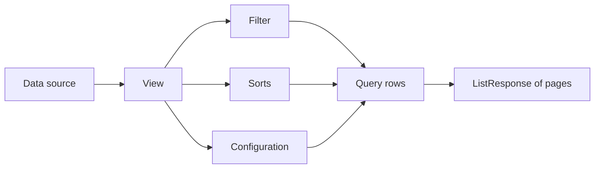

# spec-034 — Views and database layouts

## Purpose and scope

Our Library and inline table have ad-hoc filters and a table/board toggle. The
public API models a **view** as a first-class object with a type, filter,
sorts and layout configuration. This spec introduces view objects and
view-query results for `/api/v2`.

In scope:

- `View` object: `id`, `parent`, `data_source_id`, `name`, `type`, `filter`,
  `sorts`, `configuration`, timestamps, users, `url`;
- view types: `table`, `board`, `calendar`, `list` first; `gallery`,
  `timeline`, `form`, `chart`, `map`, `dashboard` represented as read-only or
  `unsupported` initially;
- filter and sort DTOs for the core property types;
- endpoints: list/create/retrieve/update/delete a view, and query results;
- a view-query id for paginated results;
- tests for filter/sort, board grouping, calendar by date, list, and
  pagination.

Out of scope:

- dashboard widgets, charts, maps and forms (read-only/unsupported);
- formula/rollup evaluation beyond spec-033;
- a full UI view builder (a later UI spec);
- real-time view updates.

## Evidence

- <https://developers.notion.com/reference/view> — view types, fields,
  `filter`, `sorts`, `configuration`, `data_source_id`.
- <https://developers.notion.com/reference/pagination> — view-query pagination
  uses a `query_id`.
- <https://developers.notion.com/reference/data-source> — views scope to a
  data source.
- <https://developers.notion.com/reference/page-property-values> — filter and
  sort values follow property types.
- `docs/public-api-analysis.md` §9.

Current code: `src/ui/render/database.rs` (table/board), `src/ui/render/library.rs`,
`src/ui/library_filter.rs`.

## Acceptance criteria

1. **Given** a data source and a table view, **when** the view is read,
   **then** it has `object: "view"`, the data source id, name, type, filter,
   sorts and configuration.
2. **Given** a filter on `status = Done`, **when** the view is queried,
   **then** only matching rows are returned.
3. **Given** a sort by `due` ascending, **when** the view is queried,
   **then** rows are ordered by that property and the order is stable.
4. **Given** a board view grouped by `status`, **when** it is queried,
   **then** rows are grouped into columns by status option.
5. **Given** a calendar view grouped by `due`, **when** it is queried,
   **then** rows are returned with their date values.
6. **Given** a view query with more rows than `page_size`, **when** the
   `query_id` is followed, **then** the next page is returned.
7. **Given** an unsupported view type, **when** it is read, **then** it is
   returned with its type and a documented `unsupported` configuration, not
   silently dropped.
8. **Given** a view create/update, **when** the filter references an unknown
   property, **then** the server returns `400 validation_error`.

## Test scenarios (written before implementation)

- `tests/model.rs`: filter/sort DTO round-trip; board grouping; calendar date
  extraction; unsupported view preservation.
- `tests/server.rs`: view CRUD; query filtering/sorting; query pagination;
  invalid property/filter.
- `tests/client.rs`: typed view methods.
- UI tests: pure `pages_for_view` remains compatible.

## Design

```rust
pub struct View {
    pub object: &'static str,        // "view"
    pub id: String,
    pub parent: Parent,              // database
    pub data_source_id: Option<String>,
    pub name: String,
    pub r#type: ViewType,
    pub filter: Option<Filter>,
    pub sorts: Option<Vec<Sort>>,
    pub configuration: Option<ViewConfig>,
    pub created_time: String,
    pub created_by: Option<UserRef>,
    pub last_edited_time: String,
    pub last_edited_by: Option<UserRef>,
    pub url: String,
}

pub enum ViewType {
    Table, Board, Calendar, List, Gallery, Timeline, Form, Chart, Map, Dashboard,
}
```

- `Filter` supports `and`/`or` groups and per-property predicates for title,
  rich_text, number, select, multi_select, status, date, checkbox, people,
  relation.
- `Sort` is `{ property, direction }`.
- `ViewConfig` variants: `Table`, `Board { group_by }`,
  `Calendar { date_property }`, `List`; unsupported variants keep their raw
  configuration.
- View queries reuse the spec-031 cursor pagination and return
  `ListResponse<Page>`.
- A `query_id` is an opaque cursor-like token bound to the view and filters.

### Endpoints

| Method | Path | Purpose |
| ------ | ---- | ------- |
| `GET`/`POST` | `/api/v2/views` | List/create views |
| `GET`/`PATCH`/`DELETE` | `/api/v2/views/{id}` | Read/update/delete |
| `POST` | `/api/v2/views/{id}/query` | Query rows (paginated) |



## Plan / tasks

- [ ] Spec + failing tests (red).
- [ ] `View`, `ViewType`, `Filter`, `Sort`, `ViewConfig`.
- [ ] View CRUD and query endpoints.
- [ ] Query pagination via spec-031.
- [ ] Board/calendar/list configuration.
- [ ] Update `docs/api-contract.md`, `docs/requirements.md`,
  `docs/data-model.md`.
- [ ] Build/test/clippy/fmt, commit.

## Requirement mapping

| Requirement | How |
| ----------- | --- |
| New FR (views) | `View` object + CRUD |
| New FR (filters/sorts) | `Filter`/`Sort` DTOs |
| New FR (view queries) | paginated query endpoint |
| NFR (scale) | cursor pagination |
