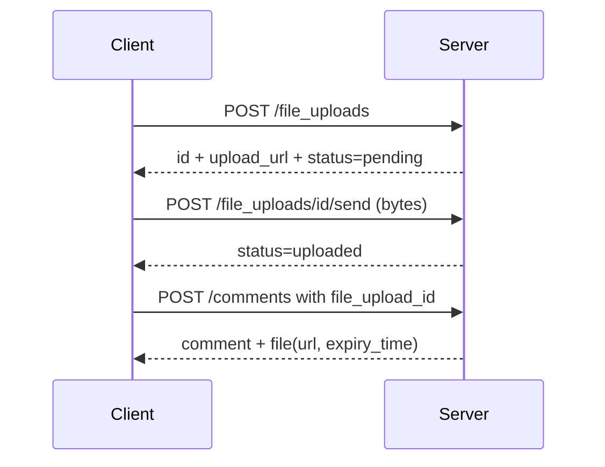

# spec-035 — Comments, users and files

## Purpose and scope

Our comments are plain-text page comments and our people are `Member`
name/email/role. The public API models comments on pages **or blocks** with
rich text, discussions, attachments and display names; users as people or
bots with optional profile fields; and files as external, hosted or uploaded
objects with a lifecycle. This spec introduces those objects for `/api/v2`.

In scope:

- `Comment` object: `object`, `id`, `parent`, `discussion_id`,
  `property_id`, timestamps, `created_by`, `rich_text`, `attachments`,
  `display_name`, `has_pending_attachments`;
- comment CRUD and paginated listing;
- up to 3 attachments per comment;
- `CommentAttachment { category, file }`;
- `CommentDisplayName` (`connection`, `user`, `custom` with resolved name);
- `User` object: `person` and `bot`, name/avatar/email, bot owner/workspace
  and `workspace_limits.max_file_upload_size_in_bytes`;
- `FileObject` (`file`, `file_upload`, `external`) and `FileUpload` lifecycle;
- file upload endpoints (create/send/complete/retrieve/list);
- tests for comments, attachments, display names, users and file uploads.

Out of scope:

- a full media viewer or drag-and-drop upload UI (a later UI spec);
- S3/object-store production adapter (the local adapter is the v1
  implementation; a production adapter is behind a port);
- SCIM/SSO;
- email notifications.

## Evidence

- <https://developers.notion.com/reference/comment-object> — comment fields,
  parent page/block, discussion, attachments, display name.
- <https://developers.notion.com/reference/comment-attachment> — up to 3
  attachments, categories, pending uploads.
- <https://developers.notion.com/reference/comment-display-name> — connection/
  user/custom.
- <https://developers.notion.com/reference/user> — person/bot, profile,
  workspace limits.
- <https://developers.notion.com/reference/file-object> — file/file_upload/
  external, temporary URLs.
- <https://developers.notion.com/reference/file-upload> — lifecycle and
  modes.
- <https://developers.notion.com/reference/capabilities> — comment and user
  capabilities.
- `docs/public-api-analysis.md` §10.

Current code: `src/model.rs` `Comment`; `src/ui/dialogs/page_actions.rs`;
`src/ui/dialogs/sharing.rs`; `src/collab.rs` `Member`; no file model.

## Acceptance criteria

1. **Given** a page comment with rich text, **when** it is created and read,
   **then** it has `object: "comment"`, a page parent, `discussion_id`, rich
   text and `has_pending_attachments: false`.
2. **Given** a block comment, **when** it is created, **then** its parent is
   `{ type: "block_id", block_id }` and it appears in the block's discussion.
3. **Given** a comment with 3 attachments, **when** a 4th is added, **then**
   the server returns `400 validation_error`.
4. **Given** a custom display name, **when** the comment is read, **then**
   `display_name` has `type: "custom"` and the resolved name.
5. **Given** a person user, **when** the token has email capability, **then**
   `person.email` is present; without it, the field is omitted.
6. **Given** a bot user, **when** it is read, **then** `type: "bot"`, `owner`,
   `workspace_name`, `workspace_id` and `workspace_limits` are present.
7. **Given** an external file, **when** it is attached, **then** the file
   object is `type: "external"` with a stable URL.
8. **Given** a file upload, **when** it is created and content is sent,
   **then** its status becomes `uploaded`; attaching it reads back as
   `type: "file"` with a temporary URL and `expiry_time`.
9. **Given** an expired upload, **when** it is attached, **then** the server
   returns `400 validation_error`.
10. **Given** a comment list, **when** it is requested, **then** comments are
    chronological and cursor-paginated.

## Test scenarios (written before implementation)

- `tests/model.rs`: comment/attachment/display-name/user/file round-trips.
- `tests/server.rs`: comment CRUD, block parent, attachment limit, user
  capability redaction, file upload lifecycle.
- `tests/client.rs`: typed comment/user/file methods.
- `tests/collab.rs`: capability checks for comment read/insert and user info.

## Design

```rust
pub struct Comment {
    pub object: &'static str,        // "comment"
    pub id: String,
    pub parent: Parent,              // page_id or block_id
    pub discussion_id: String,
    pub property_id: Option<String>,
    pub created_time: String,
    pub last_edited_time: String,
    pub created_by: UserRef,
    pub rich_text: Vec<RichText>,
    pub attachments: Vec<CommentAttachment>,
    pub display_name: Option<CommentDisplayName>,
    pub has_pending_attachments: bool,
}

pub struct CommentAttachment {
    pub category: AttachmentCategory, // audio|image|pdf|productivity|video
    pub file: FileObject,
}

pub enum CommentDisplayName {
    Connection,
    User,
    Custom { name: String },
}
```

```rust
pub struct User {
    pub object: &'static str,        // "user"
    pub id: String,
    pub r#type: Option<UserType>,    // person | bot
    pub name: Option<String>,
    pub avatar_url: Option<String>,
    pub person: Option<Person>,
    pub bot: Option<Bot>,
}

pub struct Bot {
    pub owner: BotOwner,             // workspace | user
    pub workspace_name: Option<String>,
    pub workspace_id: String,
    pub workspace_limits: WorkspaceLimits,
}
```

```rust
pub enum FileObject {
    File { url: String, expiry_time: String },
    FileUpload { id: String },
    External { url: String },
}

pub struct FileUpload {
    pub object: &'static str,        // "file_upload"
    pub id: String,
    pub status: UploadStatus,        // pending|uploaded|expired|failed
    pub filename: Option<String>,
    pub content_type: Option<String>,
    pub content_length: Option<u64>,
    pub expiry_time: Option<String>,
    pub upload_url: Option<String>,
    pub complete_url: Option<String>,
}
```

### Endpoints

| Method | Path | Purpose |
| ------ | ---- | ------- |
| `GET`/`POST` | `/api/v2/comments` | List/create comments |
| `GET`/`PATCH`/`DELETE` | `/api/v2/comments/{id}` | Read/update/delete |
| `GET` | `/api/v2/users` | List users (capability-filtered) |
| `GET` | `/api/v2/users/{id}` | Retrieve a user |
| `POST` | `/api/v2/file_uploads` | Create an upload |
| `POST` | `/api/v2/file_uploads/{id}/send` | Send content |
| `POST` | `/api/v2/file_uploads/{id}/complete` | Complete a multi-part upload |
| `GET` | `/api/v2/file_uploads/{id}` | Retrieve upload status |
| `GET` | `/api/v2/file_uploads` | List uploads (paginated) |

- Comments use the spec-031 list envelope.
- Attachments accept `file_upload_id`; files must be `uploaded`.
- Temporary URLs are signed and expire; the local adapter uses a token and an
  expiry timestamp.
- User responses are filtered by the connection's user-info capability.
- A production object store is a new adapter behind a `FileStore` port.



## Plan / tasks

- [x] Spec + failing tests (red).
- [x] Comment/attachment/display-name DTOs and CRUD.
- [x] User person/bot DTOs and capability filtering.
- [x] File object/upload DTOs, lifecycle and local store.
- [x] Endpoints and client methods.
- [x] Update `docs/data-model.md`, `docs/api-contract.md`,
  `docs/requirements.md`.
- [x] Build/test/clippy/fmt, commit.

## Result

- Added `CommentDto`, `CommentInput`, `CommentAttachment`,
  `CommentDisplayName`/`CommentDisplayNameDto`, `FileObject`, `FileUpload`,
  `FileUploadInput`, `UploadStatus`, `UserDto`, `UserType`, `Person`, `Bot`,
  `BotOwner` and `WorkspaceLimits`.
- `Workspace` persists v2 comments and file uploads; the existing page-comment
  UI model is unchanged.
- Added v2 endpoints for comment CRUD/listing, user listing/retrieval and the
  file-upload lifecycle (create/send/complete/list/retrieve).
- Comments support page/block parents, rich text, discussions, up to three
  validated attachments and connection/user/custom display names.
- Users are person/bot objects and profile fields are filtered by the
  connection's user-info capability.
- Added client methods for comments, users and file uploads.
- Tests: 8 in `tests/comments.rs`; the suite is 186 tests.

## Requirement mapping

| Requirement | How |
| ----------- | --- |
| New FR (comment object) | page/block comments, rich text, discussions |
| New FR (attachments) | max 3, categories, pending state |
| New FR (user object) | person/bot, capability-filtered profile |
| New FR (file object/upload) | external/hosted/uploaded lifecycle |
| NFR (security) | signed temporary URLs, upload expiry |
