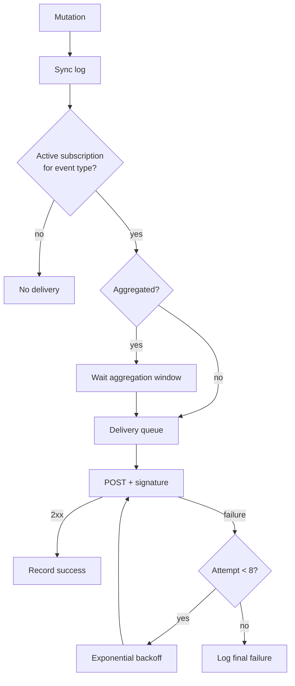

# spec-036 — Webhooks and event delivery

## Purpose and scope

Our server records a sync log but cannot notify an external system. The public
API provides webhook subscriptions with verification, HMAC signatures, event
types, aggregation and retries. This spec adds a webhook subsystem for the
self-hosted server, behind a port so a local-only deployment can disable it.

In scope:

- `WebhookSubscription` (id, url, event types, verification token, status);
- subscription create/list/delete and verification handshake;
- `X-Not-Notion-Signature` HMAC-SHA256 over the raw body;
- event types for pages, data sources, comments and sync;
- event payload shape (`id`, `timestamp`, `workspace_id`, `subscription_id`,
  `type`, `authors`, `entity`, `data`, `attempt_number`);
- aggregated vs immediate events;
- delivery queue with exponential backoff, up to 8 attempts over about 24h;
- at-most-once semantics, ordering by `timestamp`, and a delivery log;
- tests for verification, signature validation, event payload, retry and
  disabled/invalid subscriptions.

Out of scope:

- public internet exposure and TLS termination (operator concern);
- email/webhook UI beyond a settings list (a later UI spec);
- exactly-once delivery (the public contract is at-most-once);
- webhook events for features not implemented yet (views, files, agents).

## Evidence

- <https://developers.notion.com/reference/webhooks> — subscription creation,
  verification token, `X-Notion-Signature`, HMAC-SHA256, raw body, public HTTPS
  endpoint.
- <https://developers.notion.com/reference/webhooks-events-delivery> — event
  fields, event types, aggregation, ordering, retries, at-most-once.
- <https://developers.notion.com/reference/capabilities> — comment events need
  comment-read capability.
- `docs/public-api-analysis.md` §11.

Current code: `src/collab.rs` `Change`/`ChangeOp` sync log;
`WorkspaceServer::write`; no webhook module.

## Acceptance criteria

1. **Given** a subscription request with a public HTTPS URL and event types,
   **when** it is created, **then** a verification token is generated and a
   verification POST is queued.
2. **Given** the verification token is submitted, **when** it matches, **then**
   the subscription becomes active; a wrong token returns `400`.
3. **Given** an active subscription, **when** a page is created, **then** a
   `page.created` event is delivered with the documented fields.
4. **Given** a delivery, **when** the receiver validates the signature,
   **then** `X-Not-Notion-Signature: sha256=<hex>` matches HMAC-SHA256 of the
   raw body with the verification token.
5. **Given** a failed delivery, **when** the receiver returns a non-2xx or
   times out, **then** delivery is retried with exponential backoff up to 8
   attempts and the final failure is logged.
6. **Given** rapid page edits, **when** aggregation is enabled, **then** a
   single `page.content_updated` event is delivered within the aggregation
   window instead of one event per keystroke.
7. **Given** events delivered out of order, **when** the receiver sorts by
   `timestamp`, **then** the intended order is recoverable.
8. **Given** a `comment.created` event, **when** the subscription lacks the
   comment-read capability, **then** the event is not delivered.
9. **Given** a localhost or non-HTTPS URL, **when** a subscription is created,
   **then** the server returns `400 validation_error` (unless an explicit
   development override is configured).
10. **Given** a deleted subscription, **when** an event occurs, **then** no
    delivery is attempted.

## Test scenarios (written before implementation)

- `tests/webhooks.rs`:
  - subscription create/list/delete;
  - verification success/failure;
  - signature computation and constant-time comparison;
  - payload fields for page/comment events;
  - aggregation window;
  - retry/backoff with a fake clock;
  - capability-gated comment events;
  - invalid URL rejection.
- `tests/server.rs`: a mutation enqueues exactly one event per logical change.
- `tests/integration.rs`: end-to-end local receiver (bound to `127.0.0.1:0`)
  with an explicit test override.

## Design

```rust
pub struct WebhookSubscription {
    pub id: String,
    pub url: String,
    pub events: Vec<WebhookEventType>,
    pub verification_token: String,
    pub status: SubscriptionStatus, // pending | active | paused | deleted
    pub created_at: String,
}

pub enum WebhookEventType {
    PageCreated, PageContentUpdated, PagePropertiesUpdated, PageMoved,
    PageDeleted, PageUndeleted, PageLocked, PageUnlocked,
    DataSourceCreated, DataSourceContentUpdated, DataSourceSchemaUpdated,
    DataSourceMoved, DataSourceDeleted, DataSourceUndeleted,
    CommentCreated, CommentUpdated, CommentDeleted,
}

pub struct WebhookEvent {
    pub id: String,
    pub timestamp: String,
    pub workspace_id: String,
    pub subscription_id: String,
    pub r#type: WebhookEventType,
    pub authors: Vec<ActorRef>,
    pub entity: EntityRef,
    pub data: serde_json::Value,
    pub attempt_number: u8,
}
```

- `src/webhooks.rs`: pure subscription/event/signature helpers.
- `src/server/webhooks.rs`: storage and delivery queue.
- `src/store.rs`: `WebhookStore` port with a JSON adapter (or a section of
  `collab.json`; a separate `webhooks.json` is preferred for isolation).
- Delivery is a background worker; a local-only build can leave it disabled.
- Aggregation groups `page.content_updated` per page within a short window.
- Signatures use `hmac`/`sha2` crates (new dependencies) or a small in-crate
  HMAC-SHA256 implementation; the spec should prefer a well-tested crate.
- The endpoint must be HTTPS in production; tests may opt into loopback.



## Plan / tasks

- [ ] Spec + failing tests (red).
- [ ] Subscription/event/signature types.
- [ ] Store port and JSON adapter.
- [ ] Verification handshake.
- [ ] Delivery worker, retries and aggregation.
- [ ] Capability gating and URL validation.
- [ ] Update `docs/api-contract.md`, `docs/requirements.md`,
  `docs/data-model.md`, `docs/clean-room.md`.
- [ ] Build/test/clippy/fmt, commit.

## Requirement mapping

| Requirement | How |
| ----------- | --- |
| New FR (webhooks) | subscriptions + delivery |
| New FR (verification/signatures) | token + HMAC-SHA256 |
| New FR (event types) | page/data source/comment events |
| NFR (reliability) | retries, at-most-once, ordering |
| NFR (security) | signature validation, HTTPS |
