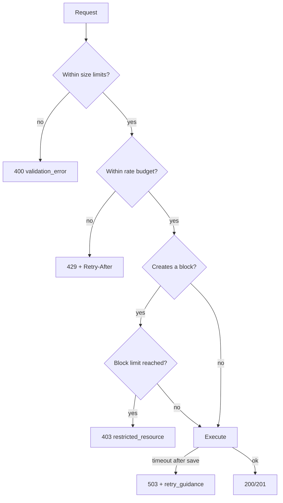

# spec-037 — Limits, rate limiting and operational behavior

## Purpose and scope

The public API documents explicit rate limits, request-size limits, workspace
block limits, retry guidance and a stable error taxonomy. Our server has none
of these; a large request or a tight loop can exhaust it. This spec adds the
operational contract for `/api/v2`.

In scope:

- per-connection and per-workspace rate limits;
- `429 rate_limited` and `529 service_overload` with `Retry-After`;
- request-size validation: 1000 block elements, 500 KB, 2000-character text/
  link, 1000-character equation, 100 block/rich-text items, 2000-character
  URL, 200-character email/phone, 100 multi-select/relation/people items;
- workspace block limit for a Free multi-member workspace (1000 lifetime
  blocks) with `403 restricted_resource` and `additional_data.block_limit`;
- `503` retry guidance for writes, `409 conflict_error`, `502`/`504` handling;
- request IDs and structured error codes (from spec-030);
- retry policy documentation and tests;
- a configurable plan/member-count model for limits.

Out of scope:

- billing, upgrades or plan management UI;
- a distributed rate limiter (the v1 adapter is in-process; a production
  adapter can use Redis/Postgres);
- TLS termination or reverse-proxy configuration;
- changing v1 behavior.

## Evidence

- <https://developers.notion.com/reference/request-limits> — 600/180 requests
  per minute, workspace limit, 429/529, `Retry-After`, size limits, 503 retry
  guidance, 1000 blocks/500 KB.
- <https://developers.notion.com/reference/workspace-block-limits> — 1000
  lifetime blocks for Free multi-member workspaces, 403 `restricted_resource`,
  `additional_data.block_limit`.
- <https://developers.notion.com/reference/status-codes> — 400/401/403/404/
  409/429/500/502/503/504/529 codes.
- <https://developers.notion.com/reference/versioning> — additive changes,
  opaque cursors, ignore unknown fields.
- `docs/public-api-analysis.md` §12.

Current code: `src/server.rs` routes; `src/server/http.rs` adapter;
`src/model.rs` `Workspace`; `src/collab.rs` `Member`; no limiter or size
validation.

## Acceptance criteria

1. **Given** a connection exceeds its request budget, **when** the next request
   arrives, **then** the server returns `429` with `code: "rate_limited"` and
   an integer `Retry-After`.
2. **Given** the workspace budget is exhausted, **when** any connection sends a
   request, **then** the server returns `429` with a workspace reason in
   `additional_data.rate_limit_reason`.
3. **Given** a server overload condition, **when** a request arrives, **then**
   the server returns `529` with `code: "service_overload"` and `Retry-After`.
4. **Given** a request body over 500 KB or 1000 block elements, **when** it is
   handled, **then** it returns `400 validation_error` before any mutation.
5. **Given** rich text over 2000 characters or a URL over 2000 characters,
   **when** it is written, **then** it returns `400 validation_error`.
6. **Given** a Free multi-member workspace at its 1000-block lifetime limit,
   **when** a create/append request arrives, **then** it returns `403` with
   `code: "restricted_resource"` and `additional_data.block_limit:
   "block_creation"`; reads, deletes and non-creating edits still work.
7. **Given** a write that times out after saving, **when** the response is
   `503`, **then** `additional_data.retry_guidance` tells the client to read
   the object instead of repeating the write.
8. **Given** a conflicting write, **when** the server detects a collision,
   **then** it returns `409 conflict_error` and the client may retry with fresh
   state.
9. **Given** a `429` or `529`, **when** the client retries, **then** it respects
   `Retry-After` and uses exponential backoff with jitter.
10. **Given** a `403` block-limit response, **when** the client retries the
    same write, **then** the documented policy says retrying will not help.

## Test scenarios (written before implementation)

- `tests/limits.rs` (new):
  - per-connection limit and `Retry-After`;
  - per-workspace limit;
  - 529 overload;
  - request size boundaries (499 KB/500 KB/501 KB, 999/1000/1001 blocks);
  - rich text/URL/email/phone/array limits;
  - block limit 403 and `additional_data.block_limit`;
  - 503 retry guidance;
  - 409 conflict.
- `tests/server.rs`: existing routes still work below the limits.
- `tests/client.rs`: retry helper respects `Retry-After` and caps attempts.
- `tests/model.rs`: plan/member-count model.

## Design

```rust
pub struct RateLimiter {
    window: Duration,             // 60s
    per_connection: u32,          // 600 or 180
    per_workspace: u32,
    // in-process maps; a production adapter can replace this
}

pub struct RequestBudget {
    pub plan: Plan,               // Free | Business | Enterprise
    pub members: usize,
    pub blocks: u64,
}
```

- `src/server/limits.rs`: pure limit checks and retry guidance.
- `src/server/rate_limit.rs`: in-process token/window limiter; a port for a
  distributed limiter later.
- `src/server/errors.rs`: error codes and `ApiError` constructors (shared with
  spec-030).
- `src/server/http.rs`: reads `Content-Length`, enforces body size, adds
  `Retry-After` headers.
- The plan/member-count model is configuration, not a domain rule.
- `additional_data` carries `rate_limit_reason`, `block_limit`,
  `retry_guidance`, `committed_resource_id`, `committed_child_ids`.

### Retry policy

| Status | Retry? |
| ------ | ------ |
| 429 `rate_limited` | Yes, after `Retry-After` |
| 429 `public_api_request_blocked` | No |
| 529 `service_overload` | Yes, after `Retry-After` |
| 500/502/503/504 | Only idempotent requests, unless idempotency is protected |
| 503 write with saved change | Read the object; do not repeat the write |
| 400/401/403/404/409 | Fix the request/permission/state first |



## Plan / tasks

- [ ] Spec + failing tests (red).
- [ ] `ApiError` codes and `additional_data` helpers (shared with spec-030).
- [ ] Request-size validation.
- [ ] Rate limiter and `Retry-After`.
- [ ] Block-limit policy and 403 response.
- [ ] 503/409/529 behavior and retry guidance.
- [ ] Client retry helper.
- [ ] Update `docs/api-contract.md`, `docs/requirements.md`,
  `docs/testing.md`, `docs/public-api-analysis.md`.
- [ ] Build/test/clippy/fmt, commit.

## Requirement mapping

| Requirement | How |
| ----------- | --- |
| New NFR (rate limits) | 429/529 + `Retry-After` |
| New NFR (request size) | validation before mutation |
| New FR (block limit) | 403 `restricted_resource` |
| New NFR (reliability) | retry policy and 503 guidance |
| New NFR (observability) | request IDs and error codes |
